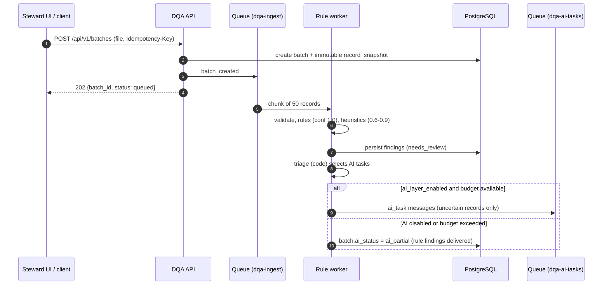
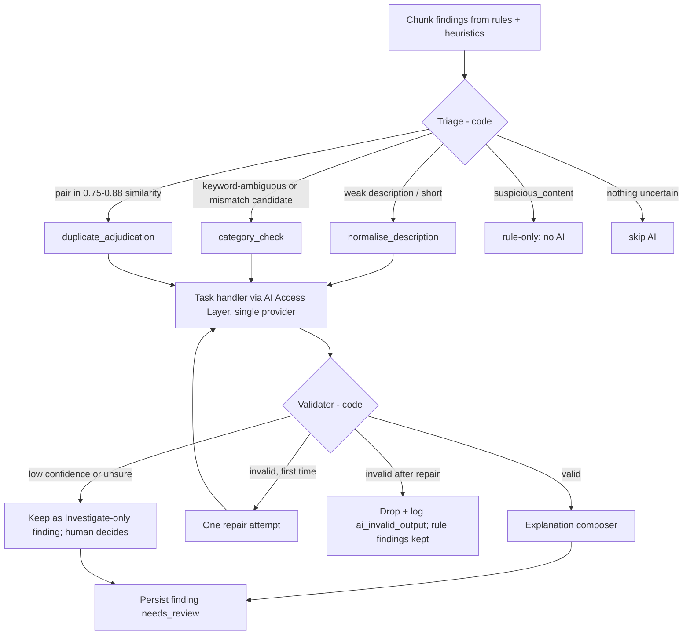
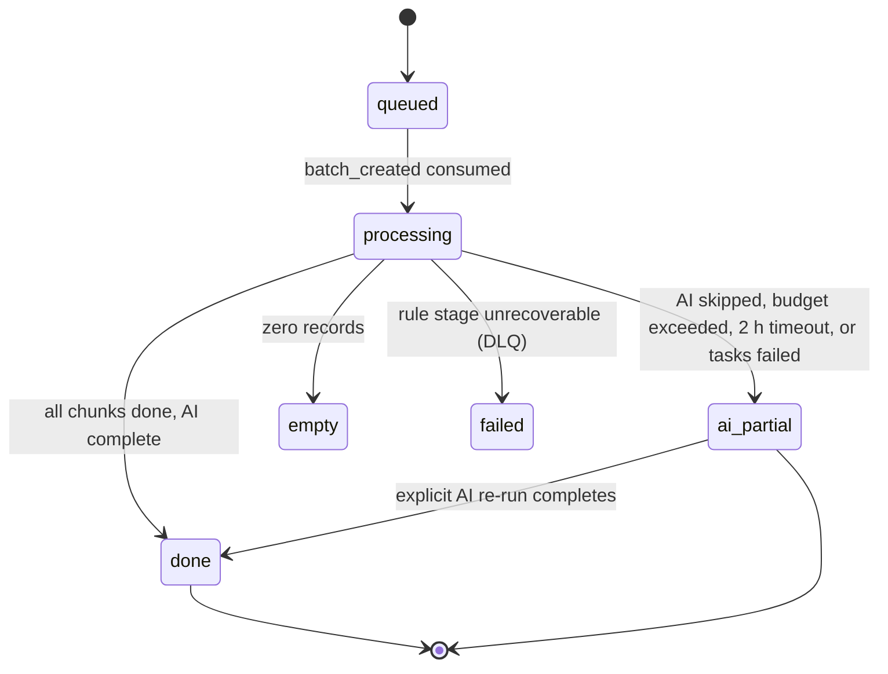

# Agent Workflow

## 1. Purpose

Describe how the AI workflow starts, how the deterministic supervisor (plain pipeline code) selects and assigns work, how AI task handlers communicate (through shared pipeline state and the queue only), how results are validated, how failures are handled, how execution resumes after a crash, and how it completes, with an explicit success path and failure path for every workflow.

## 2. Scope

The AI half of batch processing (from `ai_task` creation to persisted AI findings and batch completion). Upstream ingestion/rules/heuristics and downstream steward workflow are covered in LLD modules 01-03, 06 and 11.

## 3. Detailed explanation

### 3.1 Workflow overview

Execution is a bounded, deterministic pipeline whose progress is recorded in Postgres (`ai_task` and chunk status); there is no agent framework (ADR-019). Units of work:

- **Batch**: one uploaded file, split into **chunks** of `chunk_size` records (default 50, configurable).
- **Chunk run**: one pipeline run over a chunk with progress recorded per task, stages `ingest -> rules -> heuristics -> triage -> AI tasks -> validate -> compose -> persist`.
- **AI task**: one bounded unit (`category_check`, `normalise_description`, `duplicate_adjudication`) with deterministic `task_key = hash(record_key, task, prompt_version, model_id)`.

Rule and heuristic stages run synchronously in rule workers and publish findings immediately, so stewards can start reviewing before AI finishes. AI work runs asynchronously from the `dqa-ai-tasks` queue.

### 3.2 How the workflow starts



A batch only enters AI processing through a new upload or an explicit re-run. A finding produced by AI never causes its record to re-enter triage (HLD 4.8).

### 3.3 Supervisor selection (code, not a model)

The "supervisor" is the triage step plus the fixed pipeline code. The LLM never chooses the next agent or tool beyond the bounded allow-list for its step.



Selection rules are table-driven (`AGENT_DESIGN.md` §3.1) and versioned; changing them is a configuration/prompt change reviewed by PR.

### 3.4 Task assignment

1. Triage creates `ai_task` rows (`status = queued`, `ON CONFLICT (task_key) DO NOTHING`); if a cached result exists for the `task_key`, the task is marked `done` and reused (no re-billing on retry/replay).
2. One message per task is published to `dqa-ai-tasks` carrying `task_key` for idempotency; visibility timeout exceeds the maximum task time (HLD 8.5).
3. AI workers consume with a concurrency cap per provider (limits not specified in HLD, see `LLM_MANAGEMENT.md` and OQ-304).
4. The worker loads the chunk's progress from `ai_task`, runs the task handler, validator, composer and persist steps for each task.

### 3.5 Agent communication

Agents never message each other. Two channels only:

| Channel | Used for | Properties |
|---|---|---|
| Shared pipeline state (typed Pydantic object) | Inside one chunk run: record keys, findings, attempts, step counter | Progress persisted per task in `ai_task`; inspectable; replayable |
| Queue messages | Between stages (ingest to AI) | At-least-once; idempotent via `task_key`; dead-letter on non-retryable errors |

State object (conceptual):

```json
{
  "batch_id": "b_42",
  "chunk_id": "c_7",
  "records": ["ERP-A:1001", "ERP-B:1002"],
  "findings": [],
  "ai_tasks": [{"task_key": "...", "status": "queued", "attempts": 0, "repairs": 0}],
  "step_counter": 0,
  "budget": {"tokens_in": 0, "tokens_out": 0, "usd": 0.0},
  "flags": {"ai_layer_enabled": true}
}
```

### 3.6 Result validation

Every agent output passes the validator (schema, reference, grounding, consistency, policy, calibration) before it can be persisted. Outcomes: `accepted`, `downgraded` (confidence lowered), `dropped` (with reason). See `AGENT_DESIGN.md` §3.5 and `AI_GUARDRAILS.md` §3.3.

### 3.7 Per-workflow success and failure paths

#### W1 - Category check (`category_check`)

```mermaid
sequenceDiagram
  autonumber
  participant O as Orchestrator
  participant CA as Category handler
  participant RAG as Retrieval tools
  participant GW as AI Access Layer (in-process)
  participant V as Validator
  participant EC as Composer
  participant PG as PostgreSQL
  O->>CA: task (masked record, top-k taxonomy, similar items)
  CA->>RAG: taxonomy_lookup / similar_items (read-only, max 3)
  CA->>GW: complete (mid tier, schema-bound)
  GW-->>CA: JSON verdict
  CA->>V: raw output
  alt success path
    V-->>EC: accepted (calibrated confidence)
    EC->>PG: finding source=ai_suggestion, needs_review
  else invalid output (first time)
    V-->>CA: repair hint (one attempt)
  else unsure or low confidence
    V-->>EC: Investigate-only finding (no extra LLM call)
  else invalid after repair / policy block
    V->>PG: ai_task failed, error=ai_invalid_output (finding dropped)
  else provider error after retries
    O->>PG: ai_task failed, error=provider_error; batch may become ai_partial
  end
```

Success: a validated `needs_review` AI finding. Failure: rule/heuristic findings remain; AI finding dropped and logged; nothing blocks the steward queue.

#### W2 - Description normalisation (`normalise_description`)

Same shape as W1 with the small/fast tier and the `abbreviation_dictionary` tool. Success: a normalised-description suggestion with grounded attributes, shown for steward edit/approval. Failure paths identical; additionally a grounding failure on attributes drops the suggestion.

#### W3 - Duplicate adjudication (`duplicate_adjudication`)

Input is a pair produced by heuristic blocking. Success: `same_item` produces a `possible_duplicate` finding (confidence calibrated; never an auto-merge); `different` is stored on `ai_task` only; `unsure` produces an "Investigate" item. Failure paths as W1. If the AI result contradicts the heuristic finding on the same pair, both findings are kept and flagged for review.

#### W4 - Batch completion



Success: all chunks report `done` or `ai_partial` (HLD 4.2). Failure: a chunk that exhausts 3 stage retries goes to the DLQ, an alert is raised, and the batch is marked with the failure reason; already-persisted rule findings stay available. Whole-batch timeout 2 h marks `ai_partial` and raises an alert.

### 3.8 Failure handling summary

| Failure | Response | Result visible to steward |
|---|---|---|
| Provider timeout/5xx/429 | Retry (2, backoff 1s-8s with jitter); no second provider, chunk continues rule-only | Nothing, or `ai_partial` if exhausted |
| Output invalid | One repair attempt, then drop, log `ai_invalid_output` | Rule findings only |
| Low confidence / unsure | No further LLM call; finding kept as Investigate-only for a human | "Investigate" item |
| Policy block, 4xx | No retry; dead-letter with reason | Rule findings only |
| Budget exceeded / AI disabled | Skip AI layer, mark `ai_partial` | Rule + heuristic findings |
| Loop guard (step counter exceeded) | Abort run, error `loop_guard_triggered`, alert | Rule findings only |
| Worker crash | Resume from `ai_task` progress | None (idempotent) |
| Tool failure / timeout (2 s, 1 retry) | Treat as no retrieved evidence; model may answer `unsure` | May appear as Investigate |

### 3.9 Resuming execution

- Progress is persisted in PostgreSQL per task (`ai_task`). A crashed or evicted worker resumes from the last completed task; completed AI calls are not repeated because their results are stored and cached by `task_key`.
- Redelivered queue messages are no-ops for tasks already `done` (idempotency via `task_key`; findings insert with `ON CONFLICT DO NOTHING` on their dedupe key).
- **Replay**: a chunk can be re-run with a new prompt version for evaluation without touching live findings (results go to an evaluation namespace). A new `prompt_version` or `model_id` yields a new `task_key`, so replay never double-bills or overwrites.
- Checkpoint retention: until the batch completes + 30 days (HLD 4.4).

### 3.10 How the workflow completes

1. All chunks report `done` or `ai_partial`.
2. Batch row updated: `status`, `ai_status`, counts by issue type (feeds `GET /batches/{id}`).
3. `audit_event` rows exist for upload, each finding created (rule id/version or model id + prompt version) and configuration/prompt versions used.
4. Metrics emitted (time-to-first-finding, time-to-complete, cost, drop rate).
5. Optional webhook/SSE event to the client (delivery mechanism undecided, see `OPEN_QUESTIONS.md`).
6. Humans take over: every finding awaits a steward decision; nothing is written to source data.

## 4. Architecture decisions

| Decision | Rationale |
|---|---|
| Fixed pipeline per chunk, one loop only (single repair); no escalation tier (ADR-018) | Bounded, testable, loop-free (HLD 4.8) |
| Communication via state and queue only | No hidden conversations; replaceable agents |
| Checkpoint after every node | Crash recovery, replay, audit |
| AI back-pressure never blocks rule findings | Availability target: AI may degrade without blocking rule results |

ADR references: ADR-002 (orchestration framework), ADR-005 (Celery + SQS), ADR-010 (supervisor + specialists).

## 5. Dependencies

Queue and workers (LLD 06), data layer for `ai_task` and chunk status (LLD 05), AI Access Layer (LLD 07), validation (LLD 09), flags (LLD 12), observability (OTel span per step: `triage`, `category_task`, `validator`, ...).

## 6. Risks and edge cases

| Risk / edge case | Handling |
|---|---|
| Cap interaction in HLD 4.8 (repair + escalation) | Resolved by ADR-018: cap 2 calls, no escalation (OQ-300 resolved) |
| Chunk of 50 with many pairs creates a burst of AI tasks | Pair cap per chunk (OQ-314); concurrency cap |
| Poison message re-delivered forever | Max receives then DLQ; replay tool with ops approval |
| Checkpoint store growth | 30-day retention after batch completion |
| Partial AI results presented as complete | `ai_status = ai_partial` is visible via the API |
| Re-run after prompt change | New `task_key`; old findings keep original versions and stay explainable |

## 7. Related documents

`AI_ARCHITECTURE.md`, `AGENT_DESIGN.md`, `LLM_MANAGEMENT.md`, `AI_GUARDRAILS.md`, `../lld/modules/06-queue-and-workers.md`, `../lld/modules/08-agent-orchestrator.md`, `../lld/modules/11-review-workflow-and-export.md`, `../operations/OBSERVABILITY_AND_OPERATIONS.md`, `../project/OPEN_QUESTIONS.md`.
