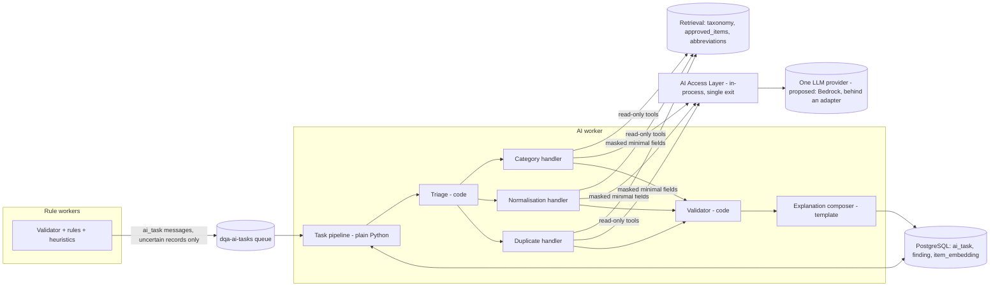

# AI Architecture

## 1. Purpose

Define how AI and LLMs are used in the Data-Quality Assistant (DQA): which problems go to a model, which stay in code, how agents are structured and orchestrated, and how retrieval (RAG), embeddings, memory and tool calling work. This is the parent document for the AI documentation set.

## 2. Scope

In scope: AI-layer architecture (provider/model tiers, single vs multi-agent, pipeline orchestration, prompts, context, memory, RAG, embeddings, vector store, tools, structured output, degradation, hallucination management).
Out of scope: rule and heuristic engine internals (see LLD modules 02/03), infrastructure (see `docs/infra/`), full security model (see `docs/security/SECURITY_AND_GOVERNANCE.md`).

Status of technology choices: every provider, framework and model named below comes from the source HLD (PDF, sections 2.3, 3.x, 8.x). **The user has not confirmed the provider or model choices**; the user has decided on a simplified, minimum-infrastructure, cost-effective AI layer (ADR-017, 018, 019, 020). They are recorded as *proposed* and tracked by ADR-001, ADR-002, ADR-003, ADR-006 and ADR-010. Nothing in the architecture requires a specific vendor; the AI Gateway (ADR-006) is the single seam that makes a provider swap a configuration change.

## 3. Detailed explanation

### 3.1 Where AI is, and is not, used

AI is advisory and sits behind the deterministic and heuristic layers. It never changes records and never decides an outcome. Every AI result is a `finding` with `source = ai_suggestion` (PROVISIONAL enum, see OQ-310) and `status = needs_review`; only a human steward moves it forward.

| Concern | Layer | Why |
|---|---|---|
| Parse, blank handling, malformed rows | Code (ingestion) | Deterministic, must never fail |
| Missing MPN, unsupported UoM, duplicate `item_id` | Code (rules) | Pure functions, confidence 1.0 per HLD (the brief shows 0.95: OQ-19) |
| Weak description, normalised-MPN duplicate blocking, keyword category mismatch | Code (heuristics) | Cheap, explainable, constant-time-ish |
| Semantic category fit | AI (`category_check`) | Needs reasoning over taxonomy + examples |
| Description normalisation / attribute extraction | AI (`normalise_description`) | Abbreviation expansion, short structured output |
| Fuzzy duplicate adjudication in the uncertain band (0.75-0.88) | AI (`duplicate_adjudication`) | Judgement between near-matches |
| Selecting which records/tasks go to AI | Code (triage) | Planning is never delegated to the model |
| Validating AI output | Code (validator) | Model output is untrusted |
| Steward-facing wording | Template (composer) | Approved wording only; no free text |

Target: fewer than 30 % of records reach AI (HLD 11.4), enforced as a metric and an alert, not as a hard rule.

### 3.2 Component view

### 3.3 Single-agent vs multi-agent (ADR-010)

Options considered: (a) one general agent with a long prompt; (b) free-form multi-agent with an LLM supervisor; (c) deterministic supervisor + specialists (HLD choice).

Selected (provisional, pending user confirmation): **(c)**. A fixed plain-Python pipeline (`triage -> run task -> validator -> composer -> persist`) decides order; a model only fills a typed answer for one bounded task. Rationale: predictability, testability, replayability, cost control and prompt-injection containment. A single agent was rejected because three tasks need different models, tools and output schemas; an LLM supervisor was rejected because it adds a model-controlled control flow that cannot be bounded or tested deterministically.

Consequence: adding a handler means adding a function, a prompt, a schema and an evaluation set; it does not change the pipeline's control semantics.

### 3.4 Orchestration (ADR-002, superseded in part by ADR-019)

The HLD proposed LangGraph. Because the flow is fixed (code decides every step; the model never routes), a framework adds a dependency without adding capability. The pipeline is plain Python functions: typed state, progress recorded per task in Postgres (`ai_task` status + chunk status), idempotent by `task_key`, deterministic replay with a new prompt version, one bounded loop (single repair). Human-in-the-loop is the review queue, not a graph interrupt. Details: `AGENT_WORKFLOW.md`.

### 3.5 Provider and model strategy (ADR-001)

HLD proposal: Claude via Amazon Bedrock, chosen for enterprise data controls, zero-retention terms and regional hosting. **One provider only**: the HLD's Azure OpenAI fallback is dropped (ADR-017); degradation is rule-only mode. The provider choice is unconfirmed (OQ-700, OQ-207). The architecture is provider-neutral through a small adapter interface:

- Models are selected **per task by evaluation, not by preference**, and recorded in a model registry (provider, exact version, data-processing terms, eval scores, owner).
- Tier mapping (HLD 3.1 examples, tiers not model IDs): mid tier for category suggestion and duplicate adjudication; small/fast for normalisation; one embedding model for retrieval. No top-tier model and no escalation path (ADR-018); the offline evaluation judge uses the mid tier.
- **Specific pinned model IDs are not decided** (OQ-301). No floating "latest" (HLD 8.8).
- Selection criteria: data residency and zero-retention terms, structured-output (tool use / JSON schema) support, accuracy on the golden set, latency, cost per 1k records (target below USD 0.50 per HLD NFR).

### 3.6 Prompt engineering strategy

Detailed in `AGENT_DESIGN.md` and `LLM_MANAGEMENT.md`. Principles: prompts are version-controlled files (`prompts/<task>/<version>.yaml`) containing system part, task part, JSON schema and 3-5 few-shot examples; record content is wrapped in `<record>...</record>` and declared as data; output is forced through tool use / JSON schema with free text limited to `rationale` (max 300 chars); the model cites `evidence_fields` and may answer `unsure`.

### 3.7 Context management

Per-record (or per candidate pair) context only: one record plus retrieved references (top-k = 5, passed with ids). Context is trimmed by relevance (dropping the lowest-ranked retrieved items), never truncated mid-record. No cross-batch conversation memory. Token budget per call is enforced by the AI Access Layer (HLD example 2k input / 300 output; configurable, OQ-304 for values).

### 3.8 Memory management

| Memory | Mechanism | Lifetime | Notes |
|---|---|---|---|
| Short-term | Typed pipeline state per chunk; durable progress in `ai_task` and chunk status (PostgreSQL) | Until batch completes + 30 days (HLD 4.4) | Record keys, findings, attempts, step counter |
| Long-term | Steward decisions become labelled examples feeding the `approved_items` index and few-shot selection | Per retention policy | Only after steward review/QA; never auto-injected into prompts unvetted |
| Conversation | None | n/a | Each call is stateless |

Few-shot examples come only from steward-approved decisions (OQ-307 asks who curates and approves them).

### 3.9 RAG architecture

| Index | Content | Used by | Retrieval |
|---|---|---|---|
| `taxonomy` | Category nodes with definitions and example items | Category handler | Hybrid |
| `approved_items` | Steward-approved clean records (masked) | Category, Duplicate handlers | Hybrid |
| `abbreviations` | Domain dictionary (BRG = bearing, VLV = valve, SS = stainless steel) | Normalisation handler | Exact lookup, not vector |

- Simplified hybrid retrieval (ADR-020): PostgreSQL full-text search (`tsvector`) on description tokens + pgvector similarity, merged by simple rank fusion, top-k = 5. **No separate reranker model.** (OQ-311 resolved in principle; fusion parameters in OQ-228.)
- Every retrieved item is passed to the model with its id so that cited evidence can be machine-checked by the validator (grounding check).
- Indexes are internal to the single deployment. Re-embed on change (new approved item, changed taxonomy node) plus a nightly delta job; embeddings are computed only for taxonomy nodes and approved items, in batches.
- The vector store is never a source of truth; embeddings are rebuilt from source tables.

### 3.10 Embedding strategy and vector database (ADR-003)

- Embedding model (HLD proposal): one model, Amazon Titan Embeddings v2, called through the in-process AI Access Layer `embed()` like completions (timeout 10 s, 3 retries, exponential backoff). The HLD's `text-embedding-3-small` fallback is dropped (ADR-017).
- Storage: `item_embedding(record_key, vector(1024), source)` where `source` is `approved` or `taxonomy`. 1024 dimensions is the HLD value.
- **Dimension mismatch (OQ-302): resolved by ADR-017.** With a single embedding model there is no cross-model index problem. Changing the embedding model later requires a full re-embed (embeddings are rebuildable, HLD 8.4); `model_id` is stored per row so a mixed state is detectable.
- Store: pgvector with HNSW indexes in the main PostgreSQL 16 cluster for v1, partitioning; move to a dedicated store (OpenSearch k-NN or Qdrant) if more than 10M vectors or p95 search above 100 ms (HLD 8.4). Retrieval reads from a read replica to limit contention with OLTP load (HLD 11.1).
- Duplicate search uses blocking first (normalised MPN + manufacturer alias, O(n)), vectors only for approved-item comparison; no all-pairs comparison.

### 3.11 Tool and function calling

Tools are read-only, typed and allow-listed per agent: `taxonomy_lookup(text)`, `similar_items(record_key, k)`, `manufacturer_alias(name)`, `abbreviation_dictionary(token)`. They are in-process Python functions (no shell, no network, no code execution), arguments validated with Pydantic, max 3 tool calls per handler step, 2 s timeout with one retry. No tool can write records, send messages or reach the internet. Per-handler allow-lists are in `AGENT_DESIGN.md`; enforcement in `AI_GUARDRAILS.md`.

### 3.12 Structured output validation

Every response passes six ordered checks before becoming a finding: schema, reference (taxonomy/UoM), grounding, consistency, policy (forbidden wording, PII), confidence calibration. Failure handling and the single repair loop are in `AGENT_WORKFLOW.md` and `AI_GUARDRAILS.md`.

### 3.13 Degradation and routing

Retry with backoff on the single provider; if still failing, the chunk continues rule-only and the batch is `ai_partial`. Invalid output after one repair is dropped (rule findings kept); low confidence or `unsure` is shown to a steward as Investigate (no escalation model); budget exhausted or AI disabled skips the AI layer and marks the batch `ai_partial`. Full table in `LLM_MANAGEMENT.md`.

### 3.14 Hallucination management

Defence in depth: closed-world outputs (category must exist in taxonomy), mandatory evidence citation checked against input and retrieved ids, `unsure` as a legal answer, consistency check against deterministic findings, calibrated confidence, confidence below 0.5 shown only as "Investigate", and measured offline (adversarial set, false-confident rate target < 2 %, out-of-taxonomy categories target 0 after validation, hallucinated-evidence rate target < 1 %).

## 4. Architecture decisions

| ADR | Decision | Status |
|---|---|---|
| ADR-001 | LLM provider and tiering | Proposed (HLD: Bedrock/Claude), updated by ADR-017/018: one provider, two tiers |
| ADR-002 | Orchestration framework | Superseded in part by ADR-019: plain Python pipeline, no LangGraph |
| ADR-003 | Vector store | Proposed (pgvector in PostgreSQL, upgrade path defined) |
| ADR-006 | Custom thin AI gateway | User-selected (over LiteLLM); realised in-process by ADR-017 |
| ADR-010 | Deterministic supervisor + 3 specialists | Proposed (HLD), kept as pipeline + 3 task handlers (ADR-019) |

## 5. Dependencies

- AI Access Layer (LLD module 07), RAG and reference data (module 10), task pipeline (module 08), AI validation (module 09), config/flags/prompts (module 12), queue and workers (module 06), data layer (module 05).
- External: LLM providers, embedding model, Presidio-style PII masking, reference data owned by stewards.

## 6. Risks and edge cases

| Risk / edge case | Mitigation | Reference |
|---|---|---|
| Over-trust of AI by stewards (automation bias) | Source badges, no default "approve all" for AI, sampled QA audits | `AI_GUARDRAILS.md` |
| Prompt injection via descriptions | Delimiters, input scanner routes records to rule-only, read-only tools, output validation | `AI_GUARDRAILS.md` |
| Provider model drift | Pinned versions, monthly golden-set re-run, approval-rate alerts | `LLM_MANAGEMENT.md` |
| Embedding model change needs full re-embed | OQ-302 (resolved) | above |
| Non-English or abbreviation-heavy text | Abbreviation dictionary + multilingual model, low confidence becomes Investigate; coverage initially limited | OQ-305 |
| No steward history at launch for calibration | OQ-303 | `AI_GUARDRAILS.md` |
| Cost growth from re-runs | task_key caching, triage, per-batch budgets | `LLM_MANAGEMENT.md` |

## 7. Related documents

`AGENT_DESIGN.md`, `AGENT_WORKFLOW.md`, `LLM_MANAGEMENT.md`, `AI_GUARDRAILS.md`, `../hld/HLD.md`, `../lld/modules/07-ai-gateway.md`, `../lld/modules/08-agent-orchestrator.md`, `../lld/modules/09-ai-validation-and-explanation.md`, `../lld/modules/10-rag-and-reference-data.md`, `../security/SECURITY_AND_GOVERNANCE.md`, `../testing/TESTING_AND_EVALUATION.md`, `../project/ARCHITECTURE_DECISIONS.md`, `../project/OPEN_QUESTIONS.md`.
