# Environments and Deployment — Data-Quality Assistant (DQA)

| | |
|---|---|
| Status | Draft for approval (no pipelines, compose files or charts exist yet) |
| Source | HLD PDF §6.6–6.7, §8.7–8.10, §10.1–10.2; Markdown HLD in [../hld/HLD.md](../hld/HLD.md) |

## 1. Purpose

Define the environments, the CI/CD pipeline, containerisation, database-migration policy, configuration, model/prompt deployment, feature flags, rollback and backup/restore so that every release is reproducible, verifiable and reversible.

## 2. Scope

In scope: dev, staging, prod; pipeline stages; release and rollback policy; verification checklist. Out of scope: infrastructure resources ([INFRASTRUCTURE.md](INFRASTRUCTURE.md)), runtime dashboards/alerts ([../operations/OBSERVABILITY_AND_OPERATIONS.md](../operations/OBSERVABILITY_AND_OPERATIONS.md)). Migration scripts, Dockerfiles, Helm charts, GitHub Actions workflows and docker-compose files are **not** written in this phase; only their required properties are described.

## 3. Detailed explanation

### 3.1 Environments

| Aspect | Dev (local) | Staging | Production |
|---|---|---|---|
| Runtime | docker-compose on a developer machine | EKS, `dqa` namespace (own cluster or namespace: OQ-520) | EKS, `dqa` namespace |
| Postgres | Postgres 16 + pgvector container | RDS PG16 + pgvector (Multi-AZ not required: A-520) | RDS PG16 Multi-AZ + pgvector, read replica |
| Queue | **ElasticMQ** (SQS-compatible) with DLQs | SQS + DLQs | SQS + DLQs |
| Cache / rate limit | Redis container | ElastiCache | ElastiCache |
| Object store | S3-compatible local store (e.g. MinIO or LocalStack: OQ-521) | S3 | S3 (versioned, KMS, replicated) |
| Feature flags | Unleash container | Unleash | Unleash |
| LLM | **StubSuggester** (deterministic, no network) by default; recorded cassettes in tests | Real provider through the in-process AI access layer; 100% masked prompt/response sampling (HLD §9.3) | Real providers; 10% sampling |
| Auth | Local OIDC stub or dev IdP (OQ-522) | Corporate IdP (non-prod app registration) | Corporate IdP |
| Data | Synthetic only; brief sample in `docs/testing/fixtures/` | Synthetic + approved test data; no production data (A-521) | Real data |
| Secrets | `.env` for non-secret local defaults only; no real keys | Secrets Manager + ESO | Secrets Manager + ESO |
| Deploy trigger | manual `compose up` | automatic on merge (Argo CD) | manual promotion, canary |

The local queue choice (ElasticMQ) is user-directed ("suggest local queues") and recorded in ADR-005. Its purpose is **broker-API parity** with SQS so DLQ, visibility timeout and redrive behaviour are exercised before staging. Known differences (FIFO, long polling details, throttling) must be validated (A-522).

### 3.2 Development environment — docker-compose (described, not authored)

Services the compose definition must contain when it is created:

| Service | Image class | Purpose |
|---|---|---|
| `postgres` | PostgreSQL 16 with pgvector | System of record, embeddings, task/chunk progress |
| `elasticmq` | ElasticMQ | Queues `dqa-ingest`, `dqa-ai-tasks`, `dqa-export` and their DLQs pre-declared |
| `redis` | Redis | Cache, rate limits |
| `unleash` (+ its Postgres) | Unleash server | Flags `ai_layer_enabled`, `ai_task.<task>.enabled`, `prompt.<task>.canary_pct`, `bulk_approve_enabled` |
| `object-store` | S3-compatible | Uploads, exports |
| (no gateway service) | — | The in-process AI access layer is configured with the **StubSuggester** adapter instead of Bedrock; no separate container (ADR-017) |
| `api`, `rule-worker`, `ai-worker` | project images | Application |

Requirements: one command brings the stack up; health checks on every service; the brief sample processes end-to-end offline; no outbound internet required. See [../lld/modules/06-queue-and-workers.md](../lld/modules/06-queue-and-workers.md) and [../testing/TESTING_AND_EVALUATION.md](../testing/TESTING_AND_EVALUATION.md) for the stub contract.

### 3.3 CI/CD pipeline (HLD §8.7)

```mermaid
flowchart LR
  pr[Pull request] --> lint[1 Lint + format - ruff; mypy --strict on core]
  lint --> test[2 Unit + integration tests + coverage gate]
  test --> sec[3 Security: Semgrep, Bandit, pip-audit, Trivy, gitleaks]
  sec --> inv[4 Golden-fixture + invariant tests: no mutation, no forbidden wording]
  inv --> eval{prompts/ or AI code changed?}
  eval -- yes --> pe[5 Prompt evals, results posted on PR]
  eval -- no --> rev
  pe --> rev[6 Required human review - CODEOWNERS, PR template with AI usage section]
  rev --> merge[Merge]
  merge --> build[Build + sign image - cosign]
  build --> stg[Deploy to staging via Argo CD]
  stg --> e2e[E2E + smoke]
  e2e --> promo{Manual promotion}
  promo --> canary[Argo Rollouts canary 10% -> 50% -> 100%]
  canary --> verify[Post-deployment verification]
  verify -- SLO breach --> abort[Automatic abort + redeploy previous image]
```

Quality gates (HLD): coverage gate 85% on `checks/`, `validation/`, `normalize/` (HLD §7.1); regression gate on prompt change: F1 must not drop more than 1 point on any class (HLD §7.3). The project rule of 80% overall coverage applies in addition (project standard; reconciliation with the HLD's 85% on core modules is recorded in OQ-523).

Pipeline tooling named by the HLD: GitHub Actions, Argo CD, Argo Rollouts, cosign. Choice of prompt-eval tool (promptfoo / DeepEval) is not final (see ADR on evals; OQ-524).

### 3.4 Containerisation

- Images: `api`, one **worker image** used by both `rule-worker` and `ai-worker` Deployments (different queues/entrypoints, A-523), and `ui`. There is no `ai-gateway` image (ADR-017).
- Images are minimal, non-root, read-only root filesystem, pinned base digests, built reproducibly, scanned by Trivy, signed with cosign; admission policy verifies signatures (admission controller choice: OQ-525).
- No secrets, prompts-with-customer-data or model weights baked in. Prompts ship inside the image from Git (`prompts/<task>/<version>.yaml`) but **which version is active** is a runtime config (§3.6).
- SBOM generation is a proposal (A-524).

### 3.5 Database migration policy (policy only — no scripts)

| Rule | Detail |
|---|---|
| Tooling | Alembic (HLD §6.5) |
| Direction | Forward-only |
| Compatibility | Every release must run against the previous schema and the previous release must run against the new schema (HLD §8.9) |
| Pattern | **Expand → migrate → contract**: (1) expand: add nullable columns/tables/indexes (concurrent index creation); (2) migrate: backfill in batches, dual-write if needed; (3) contract: remove old structures in a **later** release |
| Prohibited in same release as dependent code | Dropping or renaming columns, changing types incompatibly |
| Execution | Migration job runs as a pre-deploy step in staging and prod; failures block rollout |
| Append-only tables | `audit_event`, `decision`, `record_snapshot` must stay immutable: no `UPDATE`/`DELETE` privilege for the application role |
| Large tables | Backfills throttled; lock timeout set; no table rewrites during business hours (A-525) |
| Rollback | Not by down-migration; by redeploying the previous image (compatible by construction) |

Detail of the schema: [../lld/modules/05-data-layer.md](../lld/modules/05-data-layer.md).

### 3.6 Configuration management

| Kind | Where | Changed by | Deploy needed |
|---|---|---|---|
| Static service config (timeouts, chunk size defaults) | Helm values / env, in Git | PR | Yes |
| Business parameters (`allowed_uom`, `min_description_tokens`, `generic_terms`, thresholds, `four_eyes_threshold_items`, `ai_budget_per_batch_usd`) | `reference_data` table, **versioned**; every finding stores the version used (HLD §6.6) | Owners per HLD §6.2 (Steward, Engineering, Product, Finance, Data Owner) | No |
| Feature flags | Unleash, evaluated | Authorised roles | No |
| Prompt registry | Table mapping `task → active version` per environment | Change with approval (AI governance) | No ("promoting a version is a config change, not a deploy", HLD §6.6) |
| Secrets | Secrets Manager via ESO | Platform | No (rotation automatic) |

Change authority and approval for config and registry changes: see [../security/SECURITY_AND_GOVERNANCE.md](../security/SECURITY_AND_GOVERNANCE.md). Every config, flag and prompt change produces an `audit_event` (HLD §5.7). API for writing reference data is unspecified in the HLD (OQ-526).

### 3.7 Model and prompt deployment

1. **Pin** models to exact provider versions; no floating "latest" (HLD §8.8).
2. Prompts are semantically versioned files in Git (`prompts/<task>/<version>.yaml`) containing system part, task part, JSON schema, 3–5 few-shot examples and eval thresholds; changes only by PR with eval results attached (HLD §6.6).
3. Promotion path (HLD §10.9): **offline eval → shadow → canary 10% → full**, comparing steward approval rate.
4. Prompt/model must pass evals and obtain approval from the **AI governance owner** before production (HLD §5.8). Who that person/role is: OQ-527.
5. Canary uses flag `prompt.<task>.canary_pct`; the model per task is set by configuration after evals (one model per task; no route flag, ADR-017/018).
6. Rollback: flip the registry to the previous version (< 1 minute) (HLD §8.9). Bad findings are bulk-retracted by `prompt_version` / `rule_version` (status `withdrawn`, audited).
7. Replay: re-run a chunk with a new prompt version from `ai_task` progress without touching live findings (HLD §4.5).
8. Model registry entry (provider, version, DPA terms, eval scores, owner) is created before any model is routable (HLD §5.8).

### 3.8 Feature flags (HLD §6.7)

| Flag | Purpose | Default (proposal; HLD gives none) |
|---|---|---|
| `ai_layer_enabled` | Kill-switch for all LLM calls | on in prod only after shadow gate; **off** by default until the shadow gate passes (A-526) |
| `ai_task.<task>.enabled` | Per-task on/off (`category_check`, `normalise_description`, `duplicate_adjudication`) | on |
| `prompt.<task>.canary_pct` | % of tasks on a new prompt version | 0 |
| `bulk_approve_enabled` | Gate bulk approvals | off until enabled (A-527) |

Flag provider: **Unleash** (ADR-007), self-hosted, evaluated. Failure behaviour: if Unleash is unreachable, the SDK serves last-known values; for `ai_layer_enabled` the **safe default on total failure is off** (A-528, to be confirmed in LLD 12). Flags are cleaned up after rollout (flag hygiene review quarterly: A-529).

### 3.9 Rollback matrix (HLD §8.9)

| What | How | Time target | Verification |
|---|---|---|---|
| Application | Argo Rollouts automatic abort on SLO breach; redeploy previous signed image | < 5 min | Smoke suite; error rate and p95 back at baseline |
| Prompt / model | Flip registry (prompt) or configured model to the previous version | < 1 min | AI quality dashboard: schema-valid rate, approval rate |
| AI layer misbehaving | `ai_layer_enabled = false` | Immediate | Batches complete as `ai_partial`; rule findings unaffected |
| DB migration | Not rolled back; expand/contract keeps the previous app working; no destructive migration in the same release | N/A | Previous image runs against new schema |
| Bad findings published | Bulk-retract by `prompt_version`/`rule_version` (status `withdrawn`, audited) | Minutes | Retracted findings leave steward queue; audit events exist |
| Config / reference data | Re-activate previous `reference_data` version | Minutes (A-530) | Re-run smoke upload |
| Infrastructure (Terraform) | Revert Git commit + apply; state backups | Not stated in HLD (OQ-528) | Plan shows no drift |

Rollback authority and who may trigger each: [../security/SECURITY_AND_GOVERNANCE.md](../security/SECURITY_AND_GOVERNANCE.md); on-call process: [../operations/OBSERVABILITY_AND_OPERATIONS.md](../operations/OBSERVABILITY_AND_OPERATIONS.md).

### 3.10 Post-deployment verification checklist (HLD §10.1–10.2)

Run after every production release with the synthetic test data set:

- [ ] Deployed version, applied migrations and flag values (including AI canary %) are as intended.
- [ ] Health and readiness endpoints green for `api`, `rule-worker`, `ai-worker`, `ui`.
- [ ] Upload the golden two-record file (`docs/testing/fixtures/brief-sample-input.json`); expect exactly the known findings within 2 minutes (the precise expected set is subject to OQ-12 about 1001's `weak_description`).
- [ ] Upload an empty file and a malformed file; expect graceful responses (no 500).
- [ ] Approve one finding, export; change file contains it; audit log shows the decision.
- [ ] One AI call succeeds through the configured provider (single provider; Bedrock proposed).
- [ ] Dashboards at baseline: error rate, queue depth, AI schema-valid rate, cost burn.
- [ ] Audit events and SIEM forwarding verified for the smoke batch.
- [ ] Kill-switch toggled off/on on the test data set.
- [ ] Sign-off recorded by on-call engineer and product owner in the release ticket.

Heightened monitoring window: 72 hours (see operations document).

### 3.11 Backup and restore runbook outline

| Step | Content |
|---|---|
| Triggers | Data corruption, accidental deletion, failed migration, regional disaster |
| Inventory | RDS automated backups + PITR (35 days), daily cross-region snapshot copy; S3 versioning + cross-region replication; Terraform state; Git (prompts, config) |
| Restore RDS | Choose restore point (PITR timestamp) → restore to a **new** instance → validate row counts, audit hash chain continuity (`prev_hash`) and grants → repoint via secret/endpoint → re-enable workers |
| Restore S3 | Restore object versions / replicated bucket |
| Queues | Not backed up; stuck batches are re-driven from batch status and `ai_task`/chunk progress; duplicate suppression via unique keys |
| Vector store | Rebuilt from source tables (never source of truth); schedule re-index after restore |
| Verification | Smoke suite; audit-chain verification; sample finding explainability check |
| DR region | Terraform apply in DR region → restore latest snapshot → promote → DNS/CloudFront switch; RTO 4 h, RPO 15 min target (see the RPO gap in INFRASTRUCTURE.md §3.11) |
| Drills | DR drill twice a year; restore test cadence not stated in HLD (OQ-529) |

The runbook itself (step-by-step with commands) is produced in the implementation phase.

## 4. Architecture decisions

| ADR | Relevance |
|---|---|
| ADR-005 | Celery + SQS prod / ElasticMQ local: environment parity |
| ADR-007 | Unleash for feature flags |
| ADR-008 | GitOps (Argo CD), Terraform, canary via Argo Rollouts |
| ADR-009 | Postgres 16 and Alembic expand/contract |
| ADR-006 | In-process AI access layer as the only route (ADR-017); stub adapter in dev |
| (new) | Prompt registry is runtime config, not a deploy — documented as part of ADR-001/ADR-010 consequences |

## 5. Dependencies

[INFRASTRUCTURE.md](INFRASTRUCTURE.md) · [../lld/modules/12-config-flags-and-prompts.md](../lld/modules/12-config-flags-and-prompts.md) · [../testing/TESTING_AND_EVALUATION.md](../testing/TESTING_AND_EVALUATION.md) · [../security/SECURITY_AND_GOVERNANCE.md](../security/SECURITY_AND_GOVERNANCE.md) · GitHub Actions, Argo CD/Rollouts, cosign, Trivy, Unleash (all HLD-named, not yet confirmed).

## 6. Risks and edge cases

| Risk | Mitigation |
|---|---|
| Dev/prod broker divergence (ElasticMQ vs SQS) | Run integration suite against real SQS in staging; document known differences (A-522) |
| Staging lacks Multi-AZ so failover is untested | DR drills run in a dedicated exercise (A-520) |
| Prompt promoted without governance approval | Registry change requires approval and audit event |
| Canary on a small pilot group gives too little signal | Minimum sample size before promotion (value TBD: OQ-530) |
| Contract migration in same release as code | Policy gate in PR template and CI check |
| Flag service outage flips AI on/off unexpectedly | Safe-default policy (A-528) |
| Config change without audit | Audit event on every change; alert on missing |
| Image signature verification not enforced | Admission policy (OQ-525) |
| Rollout during an in-flight large batch | Workers drain gracefully; task progress permits resume; visibility timeout > task time |

## 7. Related documents

[INFRASTRUCTURE.md](INFRASTRUCTURE.md) · [../operations/OBSERVABILITY_AND_OPERATIONS.md](../operations/OBSERVABILITY_AND_OPERATIONS.md) · [../hld/HLD.md](../hld/HLD.md) · [../ai/LLM_MANAGEMENT.md](../ai/LLM_MANAGEMENT.md) · [../project/ARCHITECTURE_DECISIONS.md](../project/ARCHITECTURE_DECISIONS.md) · [../project/OPEN_QUESTIONS.md](../project/OPEN_QUESTIONS.md)

## Appendix — Assumptions and open questions introduced here

| ID | Text |
|---|---|
| A-520 | Staging need not be Multi-AZ |
| A-521 | No production data in staging |
| A-522 | ElasticMQ behaviour is close enough to SQS for dev; differences documented and re-tested in staging |
| A-523 | `rule-worker` and `ai-worker` are two Deployments of the same worker image |
| A-524 | SBOM generated per image |
| A-525 | No table rewrites in business hours; backfills are throttled |
| A-526 | `ai_layer_enabled` is off by default until the shadow gate passes |
| A-527 | `bulk_approve_enabled` is off by default |
| A-528 | If the flag service is unreachable, `ai_layer_enabled` falls back to off |
| A-529 | Quarterly flag cleanup |
| A-530 | Config/reference-data rollback target is minutes |
| OQ-520 | Staging as separate cluster or shared cluster namespace? |
| OQ-521 | Local S3-compatible store: MinIO or LocalStack? |
| OQ-522 | Local/dev OIDC provider choice? |
| OQ-523 | Reconcile project-wide 80% coverage rule with HLD's 85% gate on core modules |
| OQ-524 | Prompt-eval tooling: promptfoo vs DeepEval vs custom? |
| OQ-525 | Image-signature admission controller (Kyverno/Gatekeeper/other)? |
| OQ-526 | API/role for writing reference data and thresholds? |
| OQ-527 | Who is the "AI governance owner"? |
| OQ-528 | Rollback target and process for Terraform/infra changes? |
| OQ-529 | Backup-restore test cadence (separate from DR drills)? |
| OQ-530 | Minimum sample size/duration at each canary step? |
