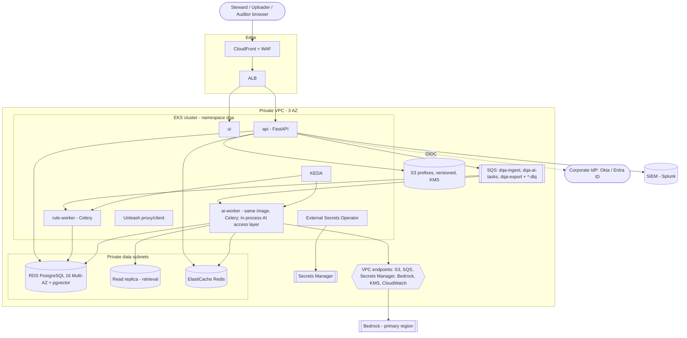

# Infrastructure Architecture — Data-Quality Assistant (DQA)

| | |
|---|---|
| Status | Draft for approval (documentation-first; nothing is provisioned) |
| Source | HLD PDF §2.3, §8.1–8.6, §8.10, §11.5; Markdown HLD in [../hld/HLD.md](../hld/HLD.md) |
| Owner | Platform / Engineering (TBD, see OQ-500) |

## 1. Purpose

Describe the target infrastructure that hosts DQA: networking, compute, data stores, queues, LLM connectivity, secrets, scalability and disaster recovery. This is the reference that Terraform and Helm will later implement. It deliberately contains **no** IaC; the files described here (Terraform modules, Helm charts, compose file) are created only after approval.

## 2. Scope

In scope: AWS runtime topology for dev/staging/prod, security boundaries, scaling model, DR. Out of scope: application logic ([../lld/LLD.md](../lld/LLD.md)), pipeline stages and environments ([ENVIRONMENTS_AND_DEPLOYMENT.md](ENVIRONMENTS_AND_DEPLOYMENT.md)), dashboards and alerts ([../operations/OBSERVABILITY_AND_OPERATIONS.md](../operations/OBSERVABILITY_AND_OPERATIONS.md)), Steward UI hosting details (UI has no LLD in this round; it is listed as a deployment because the HLD lists a `ui` deployment).

Cloud provider: **AWS**, taken from the HLD (§8). This is *proposed by the HLD and not yet confirmed by the business* (OQ-501). Decision record: ADR-008 (AWS EKS + Terraform), ADR-009 (PostgreSQL 16), ADR-005 (Celery + SQS), ADR-003 (pgvector).

## 3. Detailed explanation

### 3.1 Deployment diagram

Only `ai-worker` pods (via the in-process AI access layer) have egress to the single LLM endpoint. Workers and `api` have no route to the internet (see §3.7).

### 3.1b UI static hosting (PROVISIONAL, ADR-022)

The Steward UI is a static bundle. Provisional: S3 (private, KMS) behind CloudFront with the API same-origin under `/api`, so no CORS and a single CSP origin (A-800). Alternative: serve the bundle from the API container. Decision is OQ-808; CORS/CSP details OQ-813. The HLD's `ui` deployment is replaced by static hosting under this option.

### 3.2 Compute — EKS

| Deployment | Role | Scaling | Notes |
|---|---|---|---|
| `api` | FastAPI; batch/finding/decision/export endpoints; enqueues jobs | HPA on CPU/RPS (min 2 pods) | Stateless; JWT validated per request |
| `rule-worker` | Celery worker for `dqa-ingest` and `dqa-export` | KEDA on queue depth, 2–20 pods (ingest), 1–3 (export) per HLD §8.5 | Pure CPU-bound checks |
| `ai-worker` | Celery worker (same image as `rule-worker`) for `dqa-ai-tasks`; runs the plain-Python AI task pipeline and the in-process AI access layer | KEDA on queue depth, **capped by provider rate limits (tokens/min)** | Only workload with a route to the LLM endpoint; there is **no `ai-gateway` deployment** (ADR-017) |
| `ui` | Static React/TypeScript front end | HPA (min 2) or static origin behind CloudFront | UI design is outside this documentation round |

Node groups are managed. A separate node group for `ai-worker` is an option to isolate noisy neighbours; not decided (OQ-502). Pod security: non-root, read-only root filesystem, default-deny NetworkPolicy, mTLS inside the cluster where services call each other (HLD §5.1; with the gateway service gone there are fewer internal hops; mechanism OQ-503).

### 3.3 Database — RDS PostgreSQL 16 + pgvector

- Multi-AZ RDS PostgreSQL 16, pgvector extension, private subnets only, encrypted with KMS (AES-256).
- System of record for batch, record_snapshot, finding, decision, ai_task, audit_event, reference_data, item_embedding and chunk/task progress (no graph checkpointer, ADR-019; HLD §4.4). Schema and grants are specified in [../lld/modules/05-data-layer.md](../lld/modules/05-data-layer.md).
- Connection pooling (PgBouncer or RDS Proxy) is **required in practice** with KEDA-scaled workers; the HLD does not specify it (OQ-504).
- Read replica for retrieval and similarity search to avoid pgvector contention with OLTP (HLD §11.1 mitigation).
- Backups: automated backups + PITR 35 days; daily cross-region snapshot copy (HLD §8.10).
- Partitioning: `finding` partitioned by month when it approaches ~500M rows (HLD §11.5). Not at v1.
- Migrations: Alembic, forward-only, expand→migrate→contract (policy in [ENVIRONMENTS_AND_DEPLOYMENT.md](ENVIRONMENTS_AND_DEPLOYMENT.md)).

### 3.4 Vector database infrastructure

| Item | v1 position (HLD §8.4) |
|---|---|
| Store | pgvector inside the main RDS cluster |
| Index | HNSW (single index) |
| Dimension | 1024 (`item_embedding.vector(1024)`); single embedding model, so no cross-provider dimension conflict (OQ-21 resolved by ADR-017) |
| Source of truth | Source tables; vectors are rebuildable, so the vector store is never a source of truth |
| Re-index | Nightly and on reference-data change |
| Retrieval path | Read replica |

**Move-to-dedicated-store trigger** (HLD §8.4): either **> 10M vectors** or **p95 vector search latency > 100 ms**. Candidate targets named by the HLD: OpenSearch k-NN or Qdrant. Selection is deferred until a trigger fires (ADR-003 records the revisit conditions). Monitoring for both triggers is in the observability document.

### 3.5 Queues and cache

| Component | Prod | Local (dev) | Purpose |
|---|---|---|---|
| Broker | SQS standard queues `dqa-ingest`, `dqa-ai-tasks`, `dqa-export` | ElasticMQ (SQS-compatible) | Celery broker (ADR-005, user-directed local queue choice) |
| DLQ | `dqa-ingest-dlq`, `dqa-ai-tasks-dlq`, `dqa-export-dlq` | ElasticMQ DLQs | Non-retryable errors with reason code |
| Cache / rate limits | ElastiCache Redis | Redis container | Rate limiting, caching of `task_key` results (cache semantics specified in LLD 07), Unleash caching |

- Visibility timeout must exceed the maximum task time (HLD §8.5); message payloads carry `task_key`.
- Redrive policy / `maxReceiveCount` per queue: not specified in the HLD (OQ-505). SQS standard queues are at-least-once, which is why idempotency keys (HLD §4.7) are mandatory.
- Celery with SQS has known limitations around very long visibility timeouts and no result backend on SQS; results are written to Postgres, not to a Celery result backend (assumption A-500, to be validated in LLD 06).
- DLQ consumers: ops alert + replay tool (HLD §8.5). Replay tool design: OQ-506.

### 3.6 Object storage — S3

- Buckets for uploads and exports, versioning on, KMS (SSE-KMS), cross-region replication for DR (HLD §8.10).
- Access restricted by bucket policy and IAM roles (HLD §5.5).
- Export download via signed URL; expiry/format not specified (OQ-507, shared with the export LLD).
- Retention: raw files per retention policy "e.g. 2 years" (HLD §4.4) — value not final (OQ-508).

### 3.7 Network security

- Private VPC; EKS nodes, RDS, ElastiCache in private subnets; no public IPs on workloads.
- Ingress only via CloudFront + WAF + ALB (TLS 1.2+; WAF rate rules).
- VPC endpoints for Bedrock, S3, SQS, Secrets Manager (HLD §8.1); KMS and CloudWatch Logs endpoints are added here as a proposal (A-501).
- Egress: default-deny at security-group and NetworkPolicy level. Only `ai-worker` pods may reach the single LLM endpoint (Bedrock via the VPC endpoint, as proposed). The HLD's AWS-to-Azure private link is dropped with the Azure fallback (ADR-017); OQ-509 is therefore resolved.
- Outbound webhooks (ticketing: ServiceNow/Jira, HLD §2.7) and SIEM forwarding (Splunk) need explicit allow-listed egress paths that bypass the "no egress except the LLM endpoint" rule applied to the AI worker; the HLD says this restriction applies to the agent service principal, so the `api`/export path is a separate egress policy (A-502, OQ-510).
- mTLS between services; short-lived workload identity via IAM Roles for Service Accounts (no long-lived keys) (HLD §5.1).
- Security services: GuardDuty, Security Hub, least-privilege IAM (HLD §8.2).

### 3.8 LLM provider connectivity

- One provider: Claude via Amazon Bedrock in the primary region (proposed in HLD §8.2–8.3; ADR-001 updated by ADR-017). No second provider. Reached only through the in-process AI access layer (ADR-006, ADR-017).
- The access layer owns credential use, retries, PII masking, token budgets, response checks and logging; degradation is rule-only mode.
- Timeouts/retries for LLM calls (30 s, 2 retries, no second provider, exponential backoff + jitter 1s→8s) and embeddings (10 s, 3 retries) are specified in HLD §4.6 and implemented per LLD 07.
- Provider quotas (tokens/min, requests/min) bound `ai-worker` KEDA scaling; the actual quota values are unknown (OQ-511).
- Regional residency: HLD cites GDPR / India DPDP Act as examples; the actual regions are not chosen (OQ-512).

### 3.9 Secrets management

- AWS Secrets Manager + External Secrets Operator into Kubernetes (HLD §8.6).
- Automatic rotation: DB credentials every **30 days**, provider keys every **90 days**.
- No secrets in Git, images or logs; `gitleaks` in CI.
- IAM roles for service accounts where possible, so the number of stored secrets is minimal (Bedrock access via IAM role, not an API key).
- Bedrock access uses an IAM role, so there is no long-lived provider key; the Azure credential and its rotation (OQ-513) no longer exist (ADR-017).

### 3.10 Scalability

| Dimension | Mechanism | Limit / trigger |
|---|---|---|
| Ingest throughput | KEDA on `dqa-ingest` depth, 2–20 `rule-worker` pods | Postgres write throughput |
| AI throughput | KEDA on `dqa-ai-tasks`, capped by provider tokens/min | Provider rate limits; target ≥ 1k records/min with limits respected (HLD §7.8) |
| API | HPA | p95 findings API < 300 ms target (HLD §7.8) |
| Postgres | Multi-AZ, read replica, partition `finding` at ~500M rows | Single-region write ceiling (HLD §11.5) |
| Vector search | HNSW,; move out at >10M vectors or p95 > 100 ms | §3.4 |
| Review queue | UI pagination tuned for ~1M open findings (HLD §11.5) | cursor-based API |

#### Capacity estimates (all ASSUMPTIONS, not requirements)

Derived only from HLD assumptions: batches up to 100k records, typical 1k–20k; chunk size 50; rules < 30 s for 10k records; AI for 10k records < 15 min; AI used for < 30% of records (HLD §11.4 target).

| Quantity | Estimate | Basis |
|---|---|---|
| Chunks per 100k-record batch | 2,000 | 100,000 / 50 |
| AI tasks per 10k-record batch (upper) | ≤ 3,000 records × tasks/record | < 30% to AI; tasks per record 1–3 (A-503) |
| AI throughput required for 15 min per 10k | ≈ 3,000 records / 15 min ≈ 200 records/min | derived; far below the 1k/min stated target |
| Concurrent uploads (perf test) | 50 | HLD §7.8 |
| Total item volume, steady-state uploads/day | **unknown** | OQ-514 |

Sizing of RDS instance class, node counts and Redis size cannot be stated without volume and concurrency (OQ-514); initial sizing will be set from the performance test in a later phase.

### 3.11 Disaster recovery

| Item | Target / mechanism (HLD §8.10) |
|---|---|
| RPO | 15 minutes |
| RTO | 4 hours |
| Database | Multi-AZ failover; automated backups + PITR (35 days); daily cross-region snapshot copy |
| Object storage | Versioning + cross-region replication |
| Infrastructure | Reproducible from Terraform in the DR region |
| LLM outage | Both providers down → rule-only mode (degraded, not down) |
| Drills | Twice a year |

**Gap:** a PITR/daily-snapshot strategy alone does not meet RPO 15 min *cross-region* (daily snapshot copy ≈ 24 h RPO). Meeting a 15-minute RPO in a regional disaster requires cross-region read replica or equivalent continuous replication, which the HLD does not specify. Recorded as OQ-515. Single-region AZ failures are covered by Multi-AZ.

Restoration order in a DR event: network/VPC → secrets → RDS (restore/promote) → S3 (replicated) → queues (empty; in-flight messages are lost and re-driven from batch state) → workloads → smoke test ([ENVIRONMENTS_AND_DEPLOYMENT.md](ENVIRONMENTS_AND_DEPLOYMENT.md) §backup/restore). In-flight batches resume from `ai_task`/chunk progress rows if they are within the RPO; otherwise batches are re-run (findings idempotent by unique key).

### 3.12 Data retention (infrastructure-relevant)

| Data | Retention | Source |
|---|---|---|
| Audit events | 7 years | HLD §5.7 |
| Raw records / snapshots | e.g. 2 years (not final) | HLD §4.4 (OQ-508) |
| Chunk/task progress (`ai_task`, chunk status) | Until batch completes + 30 days | HLD §4.4 |
| Masked LLM prompt/response bodies | 30 days; sampled 10% prod, 100% staging | HLD §9.3 |
| Logs | 30 days hot, 1 year archive | HLD §9.1 |

## 4. Architecture decisions

| ADR | Decision | Relevance here |
|---|---|---|
| ADR-003 | pgvector in RDS for v1 | §3.4 |
| ADR-005 | Celery + SQS (prod), ElasticMQ (local), Redis for cache/rate limits | §3.5 |
| ADR-006 | Custom thin AI gateway, in-process (ADR-017) | §3.2, §3.8 |
| ADR-008 | AWS, EKS, Terraform, GitOps | whole document |
| ADR-009 | PostgreSQL 16 | §3.3 |
| ADR-001 | Claude via Bedrock, single provider (HLD proposal, unconfirmed; ADR-017) | §3.8 |

## 5. Dependencies

- [../hld/HLD.md](../hld/HLD.md) — system architecture.
- [../lld/modules/05-data-layer.md](../lld/modules/05-data-layer.md), [06-queue-and-workers.md](../lld/modules/06-queue-and-workers.md), [07-ai-gateway.md](../lld/modules/07-ai-gateway.md).
- [../security/SECURITY_AND_GOVERNANCE.md](../security/SECURITY_AND_GOVERNANCE.md) — IAM, encryption, access control.
- [ENVIRONMENTS_AND_DEPLOYMENT.md](ENVIRONMENTS_AND_DEPLOYMENT.md), [../operations/OBSERVABILITY_AND_OPERATIONS.md](../operations/OBSERVABILITY_AND_OPERATIONS.md).
- External: AWS account/organisation, Bedrock model access in the chosen region, corporate IdP, SIEM, ticketing system, LaunchDarkly/Unleash host (Unleash is self-hosted; hosting location OQ-516).

## 6. Risks and edge cases

| Risk | Impact | Mitigation |
|---|---|---|
| Postgres connection exhaustion from KEDA-scaled workers | Outage | Pooler (RDS Proxy/PgBouncer); cap max pods (OQ-504) |
| pgvector contention with OLTP | Latency | Read replica; trigger to move (§3.4) |
| SQS at-least-once / duplicate delivery | Double work/billing | `task_key` idempotency, `ON CONFLICT DO NOTHING` (HLD §4.7) |
| Visibility timeout shorter than task | Duplicate processing | Set timeout > max task time (HLD §8.5) |
| Provider quota exhaustion | AI backlog | KEDA cap, budgets in the access layer, rule-only degradation |
| Cross-region RPO gap (§3.11) | Data loss > 15 min in regional disaster | Resolve OQ-515 |
| Single provider dependency | AI unavailable during provider outage | Rule-only mode; adapter limits lock-in; OQ-509 resolved (no Azure link) |
| Cost of NAT / VPC endpoints / Multi-AZ | Budget | Cost review; not estimated (OQ-514) |
| KEDA scaling AI workers faster than provider limits | 429 storms | Provider concurrency caps (HLD §4.2) |
| Single-region deployment | Region outage | DR plan, RTO 4 h |

## 7. Related documents

[ENVIRONMENTS_AND_DEPLOYMENT.md](ENVIRONMENTS_AND_DEPLOYMENT.md) · [../operations/OBSERVABILITY_AND_OPERATIONS.md](../operations/OBSERVABILITY_AND_OPERATIONS.md) · [../security/SECURITY_AND_GOVERNANCE.md](../security/SECURITY_AND_GOVERNANCE.md) · [../project/ARCHITECTURE_DECISIONS.md](../project/ARCHITECTURE_DECISIONS.md) · [../project/OPEN_QUESTIONS.md](../project/OPEN_QUESTIONS.md) · [../project/RISKS_AND_DEPENDENCIES.md](../project/RISKS_AND_DEPENDENCIES.md)

## Appendix — Assumptions and open questions introduced here

| ID | Text |
|---|---|
| A-500 | Celery results are persisted in Postgres, not a Celery result backend on SQS |
| A-501 | KMS and CloudWatch Logs VPC endpoints are added beyond the four the HLD names |
| A-502 | `api`/export egress for ticket webhook and SIEM is governed separately from the AI worker "no egress except the LLM endpoint" rule |
| A-503 | 1–3 AI tasks per AI-routed record (category_check, normalise_description, duplicate_adjudication) |
| OQ-500 | Who owns platform/infra and the Terraform repository? |
| OQ-501 | Is AWS confirmed as the cloud, and which account/region layout? |
| OQ-502 | Dedicated node group for `ai-worker`? |
| OQ-503 | Mechanism for in-cluster mTLS (service mesh vs. app-level)? |
| OQ-504 | DB connection pooler (RDS Proxy vs PgBouncer) and max connections budget? |
| OQ-505 | SQS `maxReceiveCount`/redrive policy per queue? |
| OQ-506 | DLQ replay tool: scope, UI/CLI, authorisation? |
| OQ-507 | Signed-URL expiry and export file format? |
| OQ-508 | Final raw-record retention period (HLD says "e.g. 2 years")? |
| OQ-509 | **Resolved by ADR-017** — no Azure OpenAI link exists |
| OQ-510 | Allow-listed egress for ticketing webhooks and SIEM forwarding? |
| OQ-511 | Provider quota values (tokens/min, requests/min) per region? |
| OQ-512 | Chosen regions and data-residency constraints? |
| OQ-513 | **Resolved by ADR-017** — no Azure credential; Bedrock uses an IAM role |
| OQ-514 | Expected item volume and concurrency for sizing and cost? |
| OQ-515 | How is RPO 15 min met cross-region (daily snapshot copy alone is insufficient)? |
| OQ-516 | Where is Unleash hosted (in-cluster vs managed) and its HA requirements? |
