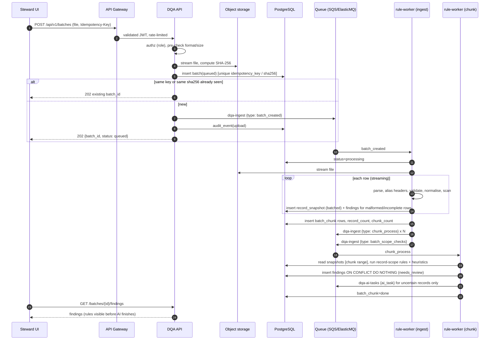

# Low-Level Design — Index, Conventions and Shared Models

**Status:** DRAFT for review. Documentation only; no code, migrations or manifests exist or are authorised.
**Source of truth:** the (corrected) [HLD](../hld/HLD.md), derived from `docs/HLD — Enterprise Item Data-Quality Assistant.pdf` ("HLD-PDF") and the brief sample in [`../testing/fixtures/`](../testing/fixtures/).
**Marking rules:** `PROVISIONAL` = my proposal where the HLD is silent, needing approval. `A-1xx` = assumption. `OQ-1xx` = open question (collected in [OPEN_QUESTIONS.md](../project/OPEN_QUESTIONS.md)). `ADR-0xx` = decision in [ARCHITECTURE_DECISIONS.md](../project/ARCHITECTURE_DECISIONS.md).

---

## 1. Purpose
Turn each HLD component into an implementation-ready specification that a developer can code without further interpretation: data shapes, step-by-step processing, API/queue contracts, failure behaviour, and tests to write first.

## 2. Scope
In scope: backend only. The Steward UI is a client of the API contract in [module 04](modules/04-api-service.md); it has no LLD.
Out of scope: application source code, migration scripts, infrastructure code (reference DDL in these documents is explanatory and is **not a migration**).

## 3. Detailed explanation

### 3.1 Module map

| # | Module | LLD | Owner of (HLD ref) |
|---|---|---|---|
| 01 | Ingestion & Validator | [01-ingestion-validator.md](modules/01-ingestion-validator.md) | FR-1; 2.2; 6.1.1–2; 6.3 |
| 02 | Rule Engine | [02-rule-engine.md](modules/02-rule-engine.md) | FR-2, FR-3, FR-4; 6.1.3 |
| 03 | Heuristic Engine | [03-heuristic-engine.md](modules/03-heuristic-engine.md) | FR-5, FR-6, FR-7; 6.1.4–5 |
| 04 | API Service | [04-api-service.md](modules/04-api-service.md) | 2.4; 6.4 |
| 05 | Data Layer | [05-data-layer.md](modules/05-data-layer.md) | 2.5; 6.5; 5.5; 5.7 |
| 06 | Queue & Workers | [06-queue-and-workers.md](modules/06-queue-and-workers.md) | 4.1–4.8; 8.5 |
| 07 | AI Access Layer (in-process) | [07-ai-gateway.md](modules/07-ai-gateway.md) | 8.3; 3.10; 5.4 |
| 08 | Agent Orchestrator | [08-agent-orchestrator.md](modules/08-agent-orchestrator.md) | 3.2–3.9 |
| 09 | AI Validation & Explanation | [09-ai-validation-and-explanation.md](modules/09-ai-validation-and-explanation.md) | 3.11; 6.1.6–8 |
| 10 | RAG & Reference Data | [10-rag-and-reference-data.md](modules/10-rag-and-reference-data.md) | 3.7; 6.6 |
| 11 | Review Workflow & Export | [11-review-workflow-and-export.md](modules/11-review-workflow-and-export.md) | FR-10, FR-11; 4.9–4.10 |
| 12 | Config, Flags & Prompts | [12-config-flags-and-prompts.md](modules/12-config-flags-and-prompts.md) | 6.2; 6.6; 6.7 |
| 13 | Steward UI | [13-steward-ui.md](modules/13-steward-ui.md) | 1.4 FR-9..FR-11; 4.9; 2.2 Steward UI (ADR-022) |

Modules 07–13 are written by other authors in later waves; this document only fixes the vocabulary they must share.

### 3.2 Python package layout (documentation of intent, not code)

```
dqa/
  ingest/        # module 01   parse, header aliases, row validation, snapshot writer
  normalize/     # module 01   is_blank, normalize_mpn, normalize_uom, token utils, suspicious-content scan
  checks/        # modules 02+03  registry + deterministic rules + heuristics (pure functions)
  validation/    # module 09   AI output validation pipeline
  api/           # module 04
  db/            # module 05   models, repositories, DB session helper
  workers/       # module 06   Celery app, tasks
  ai_access/     # module 07 (in-process library inside the worker image; no separate deployable)
  agents/        # module 08
```
The HLD coverage gate (85%) applies to `checks/`, `validation/`, `normalize/` (HLD-PDF 7.1).

### 3.3 Conventions

| Topic | Convention |
|---|---|
| Immutability | Records and findings are frozen Pydantic v2 models; functions return new objects. Input is never mutated (acceptance criterion: input byte-identical before/after). |
| Check signature | `check(records, ctx) -> list[Finding]`, pure: no I/O, no clock, no randomness. `created_at` is stamped at persistence. |
| Time | UTC, ISO-8601, `timestamptz` (A-103). |
| IDs | Prefixed ULIDs: `b_…` batch, `f_…` finding, `d_…` decision, `x_…` export, `t_…` ai_task row (A-101). HLD examples `b_42`, `f_8c1…` only show prefixes. |
| Severity | `low` \| `medium` \| `high` (A-106). |
| Confidence | number in [0,1], 3 decimals. Deterministic rules use a constant (see OQ-100); heuristics use the range in their LLD; AI uses calibrated score (module 09). |
| Errors | Taxonomy from HLD-PDF 9.6: `parse_error`, `provider_error`, `ai_invalid_output`, `policy_block`, `loop_guard_triggered`, `timeout`. Module-local codes (e.g. `too_many_rows`) are listed in the owning LLD and are **PROVISIONAL**. |
| API error body | PROVISIONAL: `{"error": {"code": "<snake_case>", "message": "<user-safe>", "details": {...}, "trace_id": "<id>"}}` — HLD defines none. |
| Logging | structlog JSON with `trace_id, batch_id, record_key, component, level` (HLD-PDF 9.1); no raw record text or PII. |
| Access control | Role + batch ownership checked in the API on every request; single entity, no tenant concept and no row-level security (ADR-016). |
| Idempotency | Upload: `Idempotency-Key` + SHA-256; findings: `dedupe_key` + `ON CONFLICT DO NOTHING`; AI tasks: `task_key`; decisions: one active per finding. |
| Wording | Forbidden in any output: "fixed", "corrected", "auto-approved" (NFR Safety). |

### 3.4 Canonical vocabulary (all documents must use these exact names)

**Input record** (from the brief sample; A-104): `item_id`, `item_description`, `manufacturer`, `manufacturer_part_number`, `category`, `unit_of_measure`, `source_system`. Alias accepted at input: `mfr_part_no → manufacturer_part_number` (HLD-PDF 6.8); full alias list is OQ-104.

**Keys:** `record_key` (unique within a batch, see §3.6), `task_key = hash(record_key, task, prompt_version, model_id)`, `dedupe_key` (OQ-109).

**Issue types:** `malformed_row`, `incomplete_row`, `missing_part_number`, `unsupported_uom`, `duplicate_item_id`, `weak_description`, `possible_duplicate`, `category_mismatch_candidate`, `conflicting_source_values`, `suspicious_content`. (FR-8 "normalised description suggestion" has no issue type in the HLD — OQ-122.)

**Finding source (PROVISIONAL, OQ-130):** `deterministic_rule` | `heuristic` | `ai_suggestion`.

**Finding states:** `needs_review`, `approved`, `rejected`, `investigating`, `in_change_file`, `closed`, `withdrawn`.
**Batch status:** `queued`, `processing`, `done`, `ai_partial`, `empty`, `failed`. **`ai_status`** (PROVISIONAL): `not_started`, `running`, `complete`, `partial`, `skipped`.

**Tables:** `batch`, `record_snapshot`, `finding`, `decision`, `ai_task`, `audit_event`, `reference_data`, `item_embedding` (HLD-PDF 6.5) plus provisional additions `batch_chunk`, `export` (OQ-126).

**Queues:** `dqa-ingest` (consumer `rule-worker`), `dqa-ai-tasks` (`ai-worker`), `dqa-export` (`rule-worker`), and `dqa-ingest-dlq`, `dqa-ai-tasks-dlq`, `dqa-export-dlq`.

**Flags:** `ai_layer_enabled`, `ai_task.<task>.enabled`, `prompt.<task>.canary_pct`, `bulk_approve_enabled` (single model per task via config; no primary/secondary route flag, ADR-017). AI tasks: `category_check`, `normalise_description`, `duplicate_adjudication`.

**Parameters (HLD-PDF 6.2):** `allowed_uom` (EA, PC, BOX, KG, M, L, SET, PR), `min_description_tokens`=3, `generic_terms` (bearing, valve, part, item, misc, spare), `dup_similarity_threshold`=0.88, `ai_uncertain_band`=0.75–0.88, `ai_min_confidence_display`=0.5, `chunk_size`=50, `ai_budget_per_batch_usd`=25, `four_eyes_threshold_items`=10.

### 3.5 Shared data models (logical; fields are normative, syntax is illustrative)

**Record** (frozen)

| Field | Type | Notes |
|---|---|---|
| `row_number` | int ≥1 | position in file (1-based, data rows) |
| `record_key` | str | §3.6 |
| `source_system`, `item_id` | str\|None | identity; either may be blank (→ `incomplete_row`) |
| `item_description`, `manufacturer`, `manufacturer_part_number`, `category`, `unit_of_measure` | str\|None | **raw** values as received (stringified; original JSON type kept in `raw`) |
| `raw` | dict | exact parsed input row; never modified |
| `norm` | `NormView` | `{description_tokens[], mpn_key, uom_key, manufacturer_key_raw, suspicious[]}` computed by `normalize/` |

**Finding** (frozen; HLD-PDF 6.4 object + FR-9)

| Field | Type | Notes |
|---|---|---|
| `finding_id` | str | `f_…`, assigned at persistence |
| `batch_id`, `record_key`, `item_id` | str | |
| `issue_type` | enum | §3.4 |
| `severity` | enum | policy table (OQ-106) |
| `confidence` | float | |
| `explanation` | str | template output (module 09), approved wording only |
| `evidence` | dict | raw field values/ids supporting the claim; **non-empty** |
| `suggested_action` | str | |
| `suggested_value` | dict\|None | e.g. `{"category":"Mechanical"}` |
| `source` | enum | §3.4 |
| `also_detected_by` | list[source] | PROVISIONAL: HLD 6.1.6 says "both sources listed" when rule and AI agree, but the finding object has a single `source` |
| `rule_id`, `rule_version` | str | semver, e.g. `category_mismatch` / `1.2.0` |
| `model_id`, `prompt_version` | str\|None | only for AI |
| `status` | enum | initial `needs_review` |
| `dedupe_key` | str | OQ-109 |
| `created_at` | datetime | |

**Example (rule finding for brief record 1001, as this LLD produces it):**
```json
{
  "finding_id": "f_01J9ZK3M8Q",
  "batch_id": "b_01J9ZK2A7T",
  "record_key": "ERP-A:1001",
  "item_id": "1001",
  "issue_type": "missing_part_number",
  "severity": "medium",
  "confidence": 1.0,
  "explanation": "Manufacturer 'SKF' is present but manufacturer part number is blank.",
  "evidence": {"manufacturer": "SKF", "manufacturer_part_number": ""},
  "suggested_action": "Request manufacturer part number from the source owner.",
  "suggested_value": null,
  "source": "deterministic_rule",
  "also_detected_by": [],
  "rule_id": "missing_part_number",
  "rule_version": "1.0.0",
  "model_id": null,
  "prompt_version": null,
  "status": "needs_review",
  "created_at": "2026-11-04T09:00:00Z"
}
```
`confidence` 1.0 follows the HLD; the brief expects 0.95 (OQ-100).

**Context (`ctx`, frozen):** `batch_id`, `params` (6.2 values), `reference` (`allowed_uom`, `uom_aliases`, `generic_terms`, `category_keywords`, `taxonomy`, `manufacturer_aliases`, `severity_policy`, each with its `version`).

### 3.6 `record_key` (PROVISIONAL, OQ-124)
`record_key = "{source_system}:{item_id}"` for the first occurrence in a batch. HLD-PDF says findings reference `(batch_id, record_key)` and also defines `duplicate_item_id` for the same `(source_system, item_id)` appearing twice, so the key would collide. Rule: later occurrences get `#2`, `#3`, … in row order. Rows with blank `source_system` or `item_id` get `row:{row_number}`. `record_snapshot` is unique on `(batch_id, row_number)` and on `(batch_id, record_key)`.

### 3.7 Sequence — upload to first findings



### 3.8 Sequence — decision to export

```mermaid
sequenceDiagram
  autonumber
  participant UI as Steward UI
  participant API as DQA API
  participant DB as PostgreSQL
  participant Q as Queue
  participant EW as rule-worker (export)
  participant S3 as Object storage
  participant TK as Ticketing (ServiceNow/Jira)

  UI->>API: POST /findings/{id}/decisions {action, reason_code, comment, edited_value}
  API->>API: authz: role may decide, finding exists
  API->>DB: BEGIN; lock finding row
  alt finding.status != needs_review
    API-->>UI: 409 (no-op if identical decision re-submitted)
  else approve and high impact (four-eyes)
    API->>DB: insert decision level 1; audit_event
    API-->>UI: 201 (awaits Data Owner level 2; state name = OQ-131)
  else approve | reject
    API->>DB: insert decision; finding.status=approved|rejected; audit_event (before/after, user, reason)
    API-->>UI: 201 {decision_id, finding_status}
  else investigate
    API->>DB: insert decision; finding.status=investigating; audit_event
    API->>TK: outbound webhook (ticket to source owner)
    API-->>UI: 201
  end
  API->>DB: COMMIT
  UI->>API: POST /batches/{id}/exports (Idempotency-Key)
  API->>DB: insert export(queued); audit_event
  API->>Q: dqa-export {export_requested}
  API-->>UI: 202 {export_id}
  Q->>EW: export_requested
  EW->>DB: select approved findings (satisfying four-eyes)
  EW->>S3: write change file
  EW->>DB: findings -> in_change_file; export=ready; audit_event
  UI->>API: GET export (signed URL; endpoint is OQ-132)
```

### 3.9 Requirement traceability (LLD level)

| Requirement | LLD module(s) |
|---|---|
| FR-1 ingest, never crash | 01, 04, 06 |
| FR-2 missing MPN | 02 |
| FR-3 unit of measure | 02 |
| FR-4 duplicate item_id | 02, 06 (batch-scope pass) |
| FR-5 weak description | 03 |
| FR-6 possible duplicate | 03, 08, 09 |
| FR-7 category mismatch | 03, 08, 09, 10 |
| FR-8 normalised description | 08, 09 (finding type OQ-122) |
| FR-9 finding fields | LLD §3.5, 05 (CHECK constraints), 09 |
| FR-10 decisions, audit | 04, 05, 11 |
| FR-11 export | 04, 06, 11 |
| NFR latency (10k < 30 s) | 01, 02, 03, 06 |
| NFR safety (zero writes to item data) | 05 (grants), 01 (immutability) |
| NFR auditability | 05 (hash chain) |

## 4. Architecture decisions
Referenced, defined in [ARCHITECTURE_DECISIONS.md](../project/ARCHITECTURE_DECISIONS.md): ADR-001 LLM provider, ADR-002 orchestration (LangGraph proposed in the HLD; superseded in part by ADR-019: plain Python pipeline), ADR-003 pgvector, ADR-004 FastAPI, ADR-005 Celery with SQS (prod), ElasticMQ (local) and Redis, ADR-006 custom thin AI gateway (in-process per ADR-017), ADR-007 Unleash, ADR-008 AWS EKS + Terraform, ADR-009 PostgreSQL 16, ADR-010 supervisor + specialists (pipeline + task handlers per ADR-019); simplified AI layer ADR-017 to ADR-021.

## 5. Dependencies
[HLD](../hld/HLD.md); [BRD](../business/BRD.md); [AI architecture](../ai/AI_ARCHITECTURE.md); [Security](../security/SECURITY_AND_GOVERNANCE.md); [Testing](../testing/TESTING_AND_EVALUATION.md).

## 6. Risks and edge cases
- Cross-module vocabulary drift: this file is the single place names are defined; any change needs an ADR.
- Questions that change several modules at once: OQ-100 (confidence), OQ-102 (similarity scorer), OQ-109 (dedupe_key), OQ-119 (batch-wide checks vs 50-record chunks), OQ-124 (record_key uniqueness), OQ-130 (source vocabulary).

## 7. Related documents
[Implementation plan](../project/IMPLEMENTATION_PLAN.md), [Task breakdown](../project/TASK_BREAKDOWN.md), [Open questions](../project/OPEN_QUESTIONS.md), [Risks](../project/RISKS_AND_DEPENDENCIES.md).

## Appendix — Open questions raised by this author (OQ-100 … OQ-132)
See each module's "Open questions" table; consolidated list is appended to [OPEN_QUESTIONS.md](../project/OPEN_QUESTIONS.md) by the review step.

## Appendix — Assumptions

| ID | Assumption |
|---|---|
| A-100 | Single-entity deployment: no `tenant_id` anywhere (ADR-016). |
| A-101 | Entity IDs are prefixed ULIDs. |
| A-102 | Python 3.12 + Pydantic v2 (HLD-PDF 2.3, proposed there; confirmation pending in ADR-004). |
| A-103 | All timestamps are UTC `timestamptz`. |
| A-104 | The record schema is exactly the seven brief fields; extra columns are retained in `raw` and ignored by checks. |
| A-105 | Blank markers `N/A` and `null` match case-insensitively after trimming. |
| A-106 | Severity enum is `low`/`medium`/`high`. |
