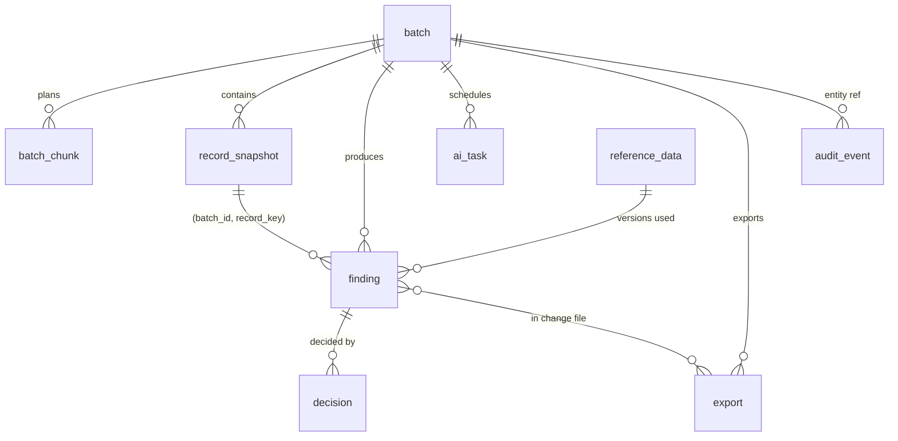

# LLD 05 — Data Layer (PostgreSQL 16 + pgvector)

**Status:** DRAFT. HLD refs: §2.5, §6.5, §5.5 (isolation), §5.7 (audit trail), §4.4 (state), §4.7 (idempotency), §6.8, §8.4, §11.5.
Shared models: [LLD.md](../LLD.md). **All DDL in this document is reference DDL, not a migration.** No migration scripts may be written until the design is approved.

## 1. Purpose
Define the system-of-record schema: tables, keys, constraints, indexes, roles/grants, the hash-chained audit log, and the data lifecycle.

## 2. Scope
In: relational schema, grants, audit chain, pgvector storage, retention/partitioning policy, migration policy. Out: ORM code, Alembic scripts, vector retrieval logic (module 10), backup infrastructure (infra docs).

## 3. Detailed explanation

### 3.1 Design principles
1. PostgreSQL is the single system of record (ADR-009); embeddings in the same cluster for v1 (ADR-003) and always rebuildable from source tables.
2. `record_snapshot` and `audit_event` are append-only; `decision` is append-only; `finding` is mutable only in `status`/`updated_at`.
3. Single entity (ADR-016): no `tenant_id` and no row-level security; access control is by database role and grants (§3.5, §3.6) plus role and batch-ownership checks in the API.
4. Idempotency is enforced by constraints, not by application checks.
5. Item data is never written back to source systems; the DQA DB role has no ability to modify snapshots (NFR "zero automatic writes to item data").

### 3.2 Entity relationships


### 3.3 Reference DDL (not a migration)

Types note: ids are text ULIDs with prefix (A-101). Enumerations are `CHECK` constraints (cheap to extend with expand/contract).

```sql
-- reference DDL, not a migration
CREATE TABLE batch (
  id              text PRIMARY KEY,                       -- 'b_' + ULID
  file_sha256     char(64) NOT NULL,
  idempotency_key text NOT NULL,
  s3_key          text NOT NULL,
  source_systems  text[] NOT NULL DEFAULT '{}',
  status          text NOT NULL CHECK (status IN ('queued','processing','done','ai_partial','empty','failed')),
  ai_status       text NOT NULL DEFAULT 'not_started'
                  CHECK (ai_status IN ('not_started','running','complete','partial','skipped')),
  record_count    integer CHECK (record_count >= 0),
  chunk_count     integer CHECK (chunk_count >= 0),
  error_code      text,                                   -- parse_error|timeout|too_many_rows|...
  error_detail    jsonb,
  reference_versions jsonb NOT NULL DEFAULT '{}',         -- {allowed_uom:3, taxonomy:7, ...}
  trace_id        text,
  created_by      text NOT NULL,
  created_at      timestamptz NOT NULL DEFAULT now(),
  updated_at      timestamptz NOT NULL DEFAULT now(),
  completed_at    timestamptz,
  UNIQUE (idempotency_key),
  UNIQUE (file_sha256)                         -- OQ-125: blocks explicit re-run of same file
);

CREATE TABLE batch_chunk (                                 -- PROVISIONAL addition (OQ-126)
  batch_id    text NOT NULL REFERENCES batch(id),
  chunk_no    integer NOT NULL CHECK (chunk_no >= 1),
  row_from    integer NOT NULL,
  row_to      integer NOT NULL CHECK (row_to >= row_from),
  status      text NOT NULL CHECK (status IN ('queued','running','done','failed')),
  attempts    smallint NOT NULL DEFAULT 0,
  lease_expires_at timestamptz,
  error_code  text,
  ai_tasks_enqueued integer NOT NULL DEFAULT 0,
  started_at timestamptz, finished_at timestamptz,
  PRIMARY KEY (batch_id, chunk_no)
);

CREATE TABLE record_snapshot (                              -- immutable
  batch_id    text NOT NULL REFERENCES batch(id),
  row_number  integer NOT NULL CHECK (row_number >= 1),
  record_key  text NOT NULL,                                -- LLD.md §3.6 (OQ-124)
  source_system text, item_id text,
  raw         jsonb NOT NULL,
  normalised  jsonb NOT NULL,                               -- {description_tokens, mpn_key, uom_key, suspicious[]}
  PRIMARY KEY (batch_id, row_number),
  UNIQUE (batch_id, record_key)
);

CREATE TABLE finding (
  id              text PRIMARY KEY,                         -- 'f_' + ULID
  batch_id        text NOT NULL,
  record_key      text NOT NULL,
  item_id         text,
  issue_type      text NOT NULL CHECK (issue_type IN (
                    'malformed_row','incomplete_row','missing_part_number','unsupported_uom',
                    'duplicate_item_id','weak_description','possible_duplicate',
                    'category_mismatch_candidate','conflicting_source_values','suspicious_content')),
  severity        text NOT NULL CHECK (severity IN ('low','medium','high')),
  severity_rank   smallint GENERATED ALWAYS AS (
                    CASE severity WHEN 'high' THEN 3 WHEN 'medium' THEN 2 ELSE 1 END) STORED,
  confidence      numeric(4,3) NOT NULL CHECK (confidence BETWEEN 0 AND 1),
  explanation     text NOT NULL CHECK (length(explanation) > 0),
  evidence        jsonb NOT NULL CHECK (evidence <> '{}'::jsonb),   -- FR-9
  suggested_action text NOT NULL,
  suggested_value jsonb,
  source          text NOT NULL CHECK (source IN ('deterministic_rule','heuristic','ai_suggestion')), -- OQ-130
  also_detected_by text[] NOT NULL DEFAULT '{}',
  rule_id         text NOT NULL,
  rule_version    text NOT NULL,
  model_id        text,
  prompt_version  text,
  status          text NOT NULL DEFAULT 'needs_review' CHECK (status IN (
                    'needs_review','approved','rejected','investigating','in_change_file','closed','withdrawn')),
  dedupe_key      char(64) NOT NULL UNIQUE,                 -- OQ-109
  created_at      timestamptz NOT NULL DEFAULT now(),
  updated_at      timestamptz NOT NULL DEFAULT now(),
  CHECK (source <> 'ai_suggestion' OR (model_id IS NOT NULL AND prompt_version IS NOT NULL)),
  FOREIGN KEY (batch_id, record_key) REFERENCES record_snapshot (batch_id, record_key)
);

CREATE TABLE decision (                                     -- append-only
  id           text PRIMARY KEY,                            -- 'd_' + ULID
  finding_id   text NOT NULL REFERENCES finding(id),
  decision_seq integer NOT NULL CHECK (decision_seq >= 1),  -- PROVISIONAL: supports investigate -> re-decide
  action       text NOT NULL CHECK (action IN ('approve','reject','investigate')),
  reason_code  text,                                        -- OQ-133
  comment      text,
  edited_value jsonb,
  decided_by   text NOT NULL,
  decided_at   timestamptz NOT NULL DEFAULT now(),
  approval_level smallint NOT NULL DEFAULT 1 CHECK (approval_level IN (1,2)),
  idempotency_key text,
  CHECK (action <> 'reject' OR reason_code IS NOT NULL),
  UNIQUE (finding_id, decision_seq, approval_level),
  UNIQUE (idempotency_key)
);

CREATE TABLE ai_task (
  id             text PRIMARY KEY,                          -- 't_' + ULID
  task_key       char(64) NOT NULL UNIQUE,                  -- hash(record_key, task, prompt_version, model_id)
  batch_id       text NOT NULL REFERENCES batch(id),
  record_key     text NOT NULL,
  counterpart_record_key text,                              -- duplicate_adjudication pairs (PROVISIONAL)
  task_type      text NOT NULL CHECK (task_type IN ('category_check','normalise_description','duplicate_adjudication')),
  model_id       text NOT NULL,
  prompt_version text NOT NULL,
  status         text NOT NULL CHECK (status IN ('queued','running','succeeded','dropped','failed','skipped')),
  attempts       smallint NOT NULL DEFAULT 0,
  tokens_in integer, tokens_out integer, cost_usd numeric(12,6), latency_ms integer,
  error_code     text,                                      -- ai_invalid_output|provider_error|policy_block|timeout|loop_guard_triggered
  result         jsonb,                                     -- validated, masked output; enables cached replay
  created_at timestamptz NOT NULL DEFAULT now(), updated_at timestamptz NOT NULL DEFAULT now()
);

CREATE TABLE audit_event (                                  -- append-only, hash-chained
  id         bigint GENERATED ALWAYS AS IDENTITY PRIMARY KEY,
  seq        bigint NOT NULL,                               -- sequence, gapless
  actor      text NOT NULL,                                 -- user id or service principal
  event_type text NOT NULL,                                 -- upload|finding_created|decision|export|config_change|prompt_change|...
  entity     text NOT NULL,                                 -- e.g. 'finding:f_01J9...'
  payload    jsonb NOT NULL,
  prev_hash  char(64) NOT NULL,                             -- '0'*64 for seq = 1
  hash       char(64) NOT NULL,
  created_at timestamptz NOT NULL DEFAULT now(),
  UNIQUE (seq)
);

CREATE TABLE reference_data (
  type           text NOT NULL,                             -- allowed_uom|uom_aliases|generic_terms|category_keywords|taxonomy|manufacturer_aliases|severity_policy|abbreviations|...
  version        integer NOT NULL CHECK (version >= 1),
  values         jsonb NOT NULL,
  effective_from timestamptz NOT NULL,
  created_by     text NOT NULL,
  PRIMARY KEY (type, version)                  
);

CREATE TABLE item_embedding (                               -- rebuildable; never a source of truth
  ref_id     text NOT NULL,                                 -- approved finding/record id or taxonomy node id (OQ-126)
  source     text NOT NULL CHECK (source IN ('approved','taxonomy')),
  model_id   text NOT NULL,
  embedding  vector(1024) NOT NULL,                         -- single embedding model (ADR-017); OQ-137 resolved
  created_at timestamptz NOT NULL DEFAULT now(),
  PRIMARY KEY (source, ref_id)
);

CREATE TABLE export (                                       -- PROVISIONAL addition (OQ-126)
  id          text PRIMARY KEY,                             -- 'x_' + ULID
  batch_id    text NOT NULL REFERENCES batch(id),
  status      text NOT NULL CHECK (status IN ('queued','running','ready','failed')),
  format      text,                                         -- OQ-134
  s3_key      text,
  finding_count integer,
  requested_by text NOT NULL,
  idempotency_key text NOT NULL,
  created_at timestamptz NOT NULL DEFAULT now(), completed_at timestamptz,
  UNIQUE (idempotency_key)
);
```

### 3.4 Indexes (reference)

| Index | Purpose |
|---|---|
| `finding (batch_id, status, severity_rank DESC, confidence DESC, id)` | review queue keyset pagination (API p95 < 300 ms) |
| `finding (batch_id, issue_type)` | `findings_by_type` counts, filters |
| `finding (batch_id, record_key)` | join back to snapshot; per-record view |
| `record_snapshot (batch_id, source_system, item_id)` | duplicate-id batch-scope pass |
| `record_snapshot (batch_id, ((normalised->>'mpn_key'))) WHERE normalised->>'mpn_key' <> ''` | exact-MPN blocking |
| `ai_task (batch_id, status)` | batch completion check, metrics |
| `batch_chunk (batch_id, status)` | completion/lease sweeper |
| `decision (finding_id)` | latest decision |
| `audit_event (created_at)`, `(entity)` | audit queries |
| `batch (created_at DESC)` | listings |
| `item_embedding` HNSW `(embedding vector_cosine_ops)` | retrieval (single HNSW index; no partitioning needed for one entity) |
| `reference_data (type, effective_from DESC)` | active-version lookup |
UNIQUE constraints above double as indexes (`dedupe_key`, `task_key`, idempotency keys).

### 3.5 Data access control
Single entity (ADR-016): there is no row-level security and no tenant column. Access is enforced by:
- **API layer**: role + batch ownership on every request (Uploader: own batches; Steward, Data Owner, Auditor: all batches).
- **Database roles and grants** (§3.6): the app role cannot UPDATE/DELETE append-only tables; the AI service principal is read-only on reference data and the batch snapshot and may write only `ai_task` and draft findings (HLD 5.2).
- **Platform Admin ("metadata only")**: no grants on content tables; sees a view `batch_metadata(id, status, record_count, created_at)` with aggregate counts only. **Auditor**: SELECT-only on `finding`, `decision`, `audit_event`.
- Grant tests per role and table are mandatory in CI (§3.12).

### 3.6 Roles and grants

| Role | Used by | Grants |
|---|---|---|
| `dqa_api` | API pods | SELECT/INSERT on `batch`, `finding` (UPDATE `status`,`updated_at` only), INSERT `decision`, `export`, `audit_event`; SELECT on rest; no DELETE anywhere |
| `dqa_worker` | rule/ai workers | INSERT/UPDATE on `batch`, `batch_chunk`; INSERT on `record_snapshot`, `finding`, `ai_task`(UPDATE), `audit_event`; SELECT on others; no UPDATE/DELETE on `record_snapshot` |
| `dqa_agent` | agent runtime (module 08) | SELECT on reference data and the *current batch snapshot*; INSERT/UPDATE on `ai_task`; INSERT on draft findings; **no network egress except the single LLM endpoint** (HLD 5.2; AI Access Layer runs in-process in the worker). Which table holds "draft findings" is unresolved (HLD-PDF 5.2 vs 2.6) → OQ-138 |
| `dqa_auditor` | audit API | SELECT-only on `finding`, `decision`, `audit_event` |
| `dqa_admin_migrator` | CI deploy job only | DDL; not available to running pods |
`REVOKE UPDATE, DELETE, TRUNCATE ON record_snapshot, decision, audit_event FROM PUBLIC/all app roles`, plus triggers that raise on UPDATE/DELETE as defence in depth.

### 3.7 Hash-chained audit log
**Goal:** tamper evidence (HLD 5.7). **Chain scope:** one global chain (single entity).
Append algorithm (one DB function `append_audit(actor, type, entity, payload)`; the only write path):
1. `pg_advisory_xact_lock(<audit-chain constant>)` — serialises appends.
2. `last := SELECT seq, hash FROM audit_event ORDER BY seq DESC LIMIT 1` (none ⇒ `seq=0, hash='0'*64`).
3. `seq := last.seq + 1`; `prev_hash := last.hash`; `created_at := clock_timestamp()` (set inside the function and part of the hash).
4. `canonical := canonical_json({seq, actor, event_type, entity, payload, created_at})` (sorted keys, no whitespace, UTC ISO-8601).
5. `hash := encode(sha256(convert_to(prev_hash || canonical, 'UTF8')), 'hex')`.
6. Insert. Runs in the caller's transaction, so an event commits atomically with the change it records.
**Verification:** scheduled job recomputes the chain (full nightly, incremental hourly); mismatch ⇒ SEV1-style alert (HLD 10.7 pattern). **Anchoring** the latest hash outside the DB (SIEM/S3 object lock) is recommended and is OQ-114.
Events recorded (HLD 5.7): upload, finding created (rule id/version or model+prompt version), decision (user, time, before/after, reason), exports, configuration and prompt changes. Also forwarded to the SIEM.
Contention note: the advisory lock serialises; high-volume `finding_created` events should be written as one summarised event per chunk (count + hash of finding ids) instead of one per finding — PROVISIONAL, because HLD says "every finding" is traceable (satisfied by the finding row itself) (OQ-114).

### 3.8 Data lifecycle and retention

| Data | Retention in HLD | Note |
|---|---|---|
| `record_snapshot` + S3 raw | "e.g. 2 years" (HLD 4.4) | not decided → OQ-115 |
| `finding`, `decision` | "Permanent" (4.4) | partition `finding` by month beyond ~500M rows (11.5) |
| `audit_event` | 7 years | immutable; erasure/retention vs immutability → OQ-115 |
| Chunk/task progress (`ai_task`, chunk status) | batch completion + 30 days | tables owned by modules 06/08 (no graph checkpointer, ADR-019) |
| Masked LLM bodies | 30 days, 10% sampled in prod | restricted store (observability doc) |
| `ai_task` | permanent (audit) | |

### 3.9 Migration policy (no scripts at this stage)
Alembic, forward-only, backward-compatible: **expand → migrate → contract**; no destructive change in the same release as the code change; previous app version must run against the new schema (HLD 6.5, 8.9). Enum changes via `CHECK` replacement in expand step. DDL runs only from the CI deploy role.

### 3.10 Transactions and consistency

| Operation | Boundary | Consistency |
|---|---|---|
| Upload | batch + audit + outbox in one tx | idempotent via unique keys |
| Snapshot insert | buffer of ≤1,000 rows per tx | PK makes re-run safe |
| Finding insert | per chunk tx, `ON CONFLICT (dedupe_key) DO NOTHING` | re-run safe |
| Decision | one tx: lock `finding`, insert `decision`, update status, `append_audit` | READ COMMITTED + row lock; unique `(finding_id, decision_seq, approval_level)` blocks races |
| Chunk done / batch completion | `UPDATE batch_chunk` then `SELECT count(*) … WHERE status<>'done'`; the worker that finds zero updates `batch` with a conditional `UPDATE … WHERE status='processing'` | exactly-once finalisation |
| Export | tx selects approved findings, marks `in_change_file` after S3 write succeeds | at-least-once file write, idempotent by `export.id` |

### 3.11 External dependencies
RDS PostgreSQL 16 Multi-AZ, pgvector, KMS (AES-256 at rest), PITR 35 days, cross-region snapshot copy (infra doc), read replica for retrieval (HLD 11.1).

### 3.12 Test requirements
Integration (Testcontainers): constraints (`evidence` non-empty, `source=ai_suggestion` ⇒ model/prompt present); role grants verified (least privilege, UPDATE/DELETE denied) for **every** table and role; append-only enforcement (UPDATE/DELETE on snapshot/decision/audit rejected); concurrent audit appends keep a gapless valid chain; chain-tamper test flips one payload byte ⇒ verifier fails; idempotent re-insert of findings; unique idempotency keys. Performance: findings keyset query on 5M rows p95 < 300 ms; migration expand/contract compatibility test (old app on new schema).

## 4. Architecture decisions
ADR-009 PostgreSQL 16; ADR-003 pgvector in v1. Local PROVISIONAL: D-05-1 audit chain with advisory lock; D-05-2 `batch_chunk` table; D-05-3 `CHECK` constraints as enums; D-05-4 `ai_task.result` stores validated masked output for replay.

## 5. Dependencies
Modules 01, 02, 04, 06, 08, 10, 11; [Security](../../security/SECURITY_AND_GOVERNANCE.md); [Infrastructure](../../infra/INFRASTRUCTURE.md).

## 6. Risks and edge cases
Advisory-lock contention on audit; `UNIQUE (file_sha256)` prevents deliberate re-runs (OQ-125); pgvector contention with OLTP; `finding` growth.

## 7. Related documents
[LLD.md](../LLD.md) · [04](04-api-service.md) · [06](06-queue-and-workers.md) · [10](10-rag-and-reference-data.md) · [Security](../../security/SECURITY_AND_GOVERNANCE.md) · [Infra](../../infra/INFRASTRUCTURE.md)

## Open questions (this module)

| ID | Question |
|---|---|
| OQ-114 | Audit chain scope (single global chain proposed), external anchoring, per-finding vs per-chunk events. |
| OQ-115 | Retention for snapshots/raw files; erasure vs immutability and the 7-year audit retention. |
| OQ-125 | Re-running the same file: `UNIQUE (file_sha256)` blocks it; the HLD mentions "explicit re-runs" (4.8) but has no endpoint. |
| OQ-126 | Approve schema additions to HLD 6.5: `batch_chunk`, `export`, `finding.also_detected_by`, `finding.severity_rank`, `decision.decision_seq`, `batch.error_*`, `batch.reference_versions`, `item_embedding.ref_id/model_id`, `ai_task.counterpart_record_key/result`. |
| OQ-136 | RESOLVED by ADR-016: reference data is global (single entity). Ownership of reference data remains OQ-135. |
| OQ-137 | **Resolved by ADR-017** — single embedding model, no fallback model dimension conflict; changing the model later needs a full re-embed. |
| OQ-138 | Which table holds AI "draft findings" given the agent role's restricted writes (HLD-PDF 5.2 vs 2.6). |
