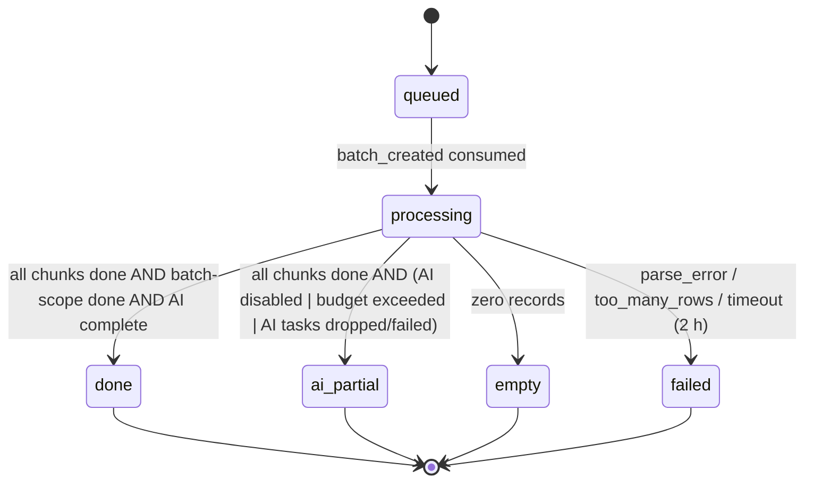
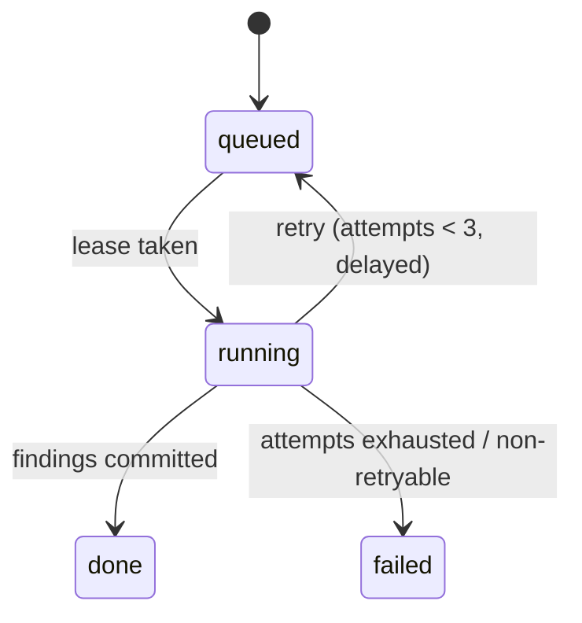

# LLD 06 — Queue & Workers

**Status:** DRAFT. HLD refs: §2.2 Queue, §2.6 steps 2–6, §4.1–4.8 (task decomposition, state, retries, idempotency, loop prevention), §8.5 (queues/scaling), §6.2 (`chunk_size`), §9.6 (error taxonomy).
Shared models: [LLD.md](../LLD.md).

## 1. Purpose
Specify how uploads become findings asynchronously: message types, queue topology, chunking, the batch state machine, retries/timeouts, dead-lettering, idempotency and scaling — including the batch-wide checks that do not fit 50-record chunks.

## 2. Scope
- In: Celery application design, queue/message contracts, consumers, chunk lifecycle, batch completion, retry/DLQ, local-vs-prod broker setup, KEDA scaling inputs.
- Out: what the rules/heuristics compute (02/03), the AI task pipeline (08), AI access layer (07).

## 3. Detailed explanation

### 3.1 Topology (ADR-005)

| Queue | Producer | Consumer (deployment) | Message types | Scaling (HLD 8.5) |
|---|---|---|---|---|
| `dqa-ingest` | API, rule-worker | `rule-worker` | `batch_created`, `chunk_process`, `batch_scope_checks` | KEDA on queue depth, 2–20 pods |
| `dqa-ai-tasks` | rule-worker | `ai-worker` | `ai_task` | KEDA, capped by provider rate limits (tokens/min) |
| `dqa-export` | API | `rule-worker` | `export_requested` | 1–3 pods |
| `*-dlq` (3) | broker redrive + worker | ops alert + replay tool | any | manual |

Broker: **prod = Amazon SQS** (standard queues) with redrive policy to the DLQ (`maxReceiveCount`); **local = ElasticMQ** (SQS-compatible, in docker-compose) so visibility timeouts and redrive behave the same as prod; Redis is used for rate limits/semaphores/cache only. This is a proposal in answer to "suggest local queues" and is recorded in ADR-005 (user may overturn; fallback Redis broker locally).
Celery notes that shape the design: no Celery result backend (`ignore_result`; state lives in Postgres); `acks_late=True`, `reject_on_worker_lost=True`, `prefetch_multiplier=1` (fair, long tasks); SQS visibility timeout **>** max task time (HLD 8.5); SQS max delay is 900 s, so "re-queue with delay" retries use ≤ 900 s delays; SQS gives at-least-once delivery ⇒ every task must be idempotent.

### 3.2 Message envelope (all types)
```json
{
  "type": "chunk_process",
  "message_id": "m_01J9ZK2B…",
  "batch_id": "b_01J9ZK2A7T",
  "trace_id": "7c1e…",
  "attempt": 1,
  "task_key": "…",
  "enqueued_at": "2026-11-04T09:00:01Z",
  "payload": {}
}
```
Rules: `trace_id` mandatory; payloads carry **ids, never record content or PII**; unknown fields ignored (forward compatible); `task_key` for AI tasks (HLD 8.5).

| Type | Payload | Consumer behaviour |
|---|---|---|
| `batch_created` | `{s3_key, file_sha256, filename}` | ingest (module 01) |
| `chunk_process` | `{chunk_no, row_from, row_to}` | record-scope rules + heuristics for the range |
| `batch_scope_checks` | `{}` | batch-scope rules/heuristics (see §3.4) |
| `ai_task` | `{task_type, record_key, counterpart_record_key?, prompt_version, model_id}` | module 08 |
| `export_requested` | `{export_id}` | module 11 |

DLQ record adds `{reason_code, error_taxonomy, last_error, failed_at, original_message}`.

### 3.3 Batch and chunk state machines


Rules:
- HLD 4.2: "A batch completes when all chunks report `done` or `ai_partial`". Interpretation (PROVISIONAL): chunks report `done` for the rule stage; AI progress is tracked on `batch.ai_status`; final batch status is `done` (AI complete or no AI needed) or `ai_partial` (AI skipped/dropped/budget). `ai_layer_enabled = false` ⇒ `ai_status=skipped` and batch `ai_partial` (HLD 3.10).
- A chunk with `failed` status makes the batch `failed`? HLD silent (OQ-139). PROVISIONAL: batch ends `failed` only if **all** chunks fail or ingest fails; otherwise findings from good chunks are delivered, batch `done`/`ai_partial` with `error_detail.failed_chunks=[…]` and an alert.
- Finalisation is exactly-once via conditional `UPDATE batch SET status=… WHERE id=… AND status='processing'` (module 05 §3.10).

### 3.4 Processing steps (worker side)

**`batch_created` (ingest, module 01)**: see module 01; ends by inserting `batch_chunk` rows and publishing `chunk_process` ×N and `batch_scope_checks` ×1.

**`chunk_process`** (idempotent):
1. Take lease: `UPDATE batch_chunk SET status='running', attempts=attempts+1, lease_expires_at=now()+interval '5 min', started_at=coalesce(started_at, now()) WHERE batch_id=$b AND chunk_no=$c AND (status='queued' OR (status='running' AND lease_expires_at < now()))`. 0 rows ⇒ another worker owns it or it is done ⇒ ack and exit.
2. Load `Record`s for `[row_from,row_to]` from `record_snapshot`; build `ctx` with the reference versions stored on `batch.reference_versions` (so a re-run uses the same rule inputs).
3. Run record-scope checks (modules 02/03) → findings + triage signals.
4. Tx: `INSERT finding … ON CONFLICT (dedupe_key) DO NOTHING`; create `ai_task` rows (`ON CONFLICT (task_key) DO NOTHING`) for signals if `ai_layer_enabled` and `ai_task.<task>.enabled`; set `batch_chunk.status='done'`, `ai_tasks_enqueued=n`; `append_audit` summary event.
5. After commit: publish `ai_task` messages for the new rows (a sweeper re-publishes `ai_task.status='queued'` rows older than 5 min — covers publish-after-commit gaps).
6. Check batch completion (§3.3).

**`batch_scope_checks`** (needs the *whole* batch; HLD chunking would break these, OQ-119):
1. Wait condition: runs after ingest has written all snapshots (message is sent only then), independent of chunk progress.
2. `duplicate_item_id` (module 02): indexed `GROUP BY (source_system,item_id) HAVING count>1`.
3. `possible_duplicate` + `conflicting_source_values` (module 03): exact-MPN blocks via the `mpn_key` index, similarity within manufacturer blocks, bounded by `max_block_size`.
4. Insert findings (same idempotent rule); create `duplicate_adjudication` `ai_task`s for the uncertain-band pairs; mark `batch.batch_scope_done=true` (PROVISIONAL column; add to OQ-126 list) so completion can be evaluated.
5. Time-box: part of the 5-min stage timeout; large blocks degrade as module 03 describes, never silently.

**`ai_task`** (module 08): consumed by `ai-worker`; per-provider concurrency caps via Redis semaphores; on completion updates `ai_task`, writes validated findings, and re-evaluates batch completion.

**`export_requested`** (module 11).

### 3.5 Retry, timeout, DLQ (HLD 4.6 verbatim values)

| Operation | Timeout | Retries | Backoff |
|---|---|---|---|
| LLM call | 30 s | 2 (no second provider) | exponential + jitter 1 s→8 s (module 07) |
| Embedding call | 10 s | 3 | exponential |
| Tool (DB lookup) | 2 s | 1 | fixed |
| Chunk stage | 5 min | 3 | re-queued with delay |
| Whole batch | 2 h | — | marked `ai_partial`, alert raised |

Mechanics: Celery `soft_time_limit=270 s`, `time_limit=300 s` for chunk tasks; retry via `self.retry(countdown=min(30·2^n, 900))` for retryable errors (S3/DB/timeout/provider 5xx/429); the 2-hour batch deadline is enforced by a periodic sweeper that finalises overdue batches as `ai_partial` (or `failed` if no chunk completed) and raises an alert. **Non-retryable** (schema violation after repair, policy block, 4xx) ⇒ straight to DLQ with reason (HLD 4.6). Crashed workers: SQS redelivers after visibility timeout; the chunk lease guard prevents double processing; redrive to DLQ after `maxReceiveCount` (value OQ-139).
DLQ handling: alert thresholds from HLD 10.6 (>10/h warn, >100/h critical); an ops **replay tool** re-publishes a DLQ message after the cause is fixed (tool design in operations doc).

### 3.6 Idempotency (HLD 4.7)
- Upload: `Idempotency-Key` + `file_sha256` (module 04).
- Snapshots: PK `(batch_id,row_number)`.
- Findings: `dedupe_key` UNIQUE + `ON CONFLICT DO NOTHING`.
- AI tasks: `task_key = hash(record_key, task, prompt_version, model_id)`; successful `result` is cached so replays/retries do not double-bill.
- Chunks: lease + status.
- Decisions: unique per finding/seq/level.
- Messages: duplicates are harmless because every handler is idempotent; no reliance on exactly-once delivery.

### 3.7 Loop prevention (HLD 4.8)
The pipeline is acyclic per chunk (single repair loop only). Records never re-enter AI triage because of an AI finding; only a new upload or explicit re-run (OQ-125) triggers analysis. Worker-level hard caps: max message `attempt`=3 for rule stages; AI caps (3 tool calls/step, 2 LLM calls/task (initial + one repair; ADR-018, OQ-20 resolved), token budget/batch, `loop_guard_triggered`) are module 08/07's.

### 3.8 Scaling and back-pressure
KEDA scales `rule-worker` on `dqa-ingest` depth (2–20 pods) and `ai-worker` on `dqa-ai-tasks` depth capped by provider tokens/min. Back-pressure: the API accepts uploads regardless (batch rows `queued`); if oldest-message age > 5 min warn / > 20 min critical (HLD 10.6). Concurrency: workers cap concurrent chunks globally (`max_concurrent_chunks`, parameter, OQ-139).

### 3.9 Database interactions
`batch`, `batch_chunk` (leases/status), `record_snapshot` (read), `finding` (insert), `ai_task` (insert/update), `audit_event` (append), `reference_data` (read). Every task opens its own transaction.

### 3.10 External dependencies
SQS/ElasticMQ, Redis (semaphores, rate limits), PostgreSQL, S3, Unleash (flags read at enqueue time; cached with TTL), OpenTelemetry (trace propagation through message `trace_id`).

### 3.11 Error handling
Error taxonomy codes recorded on `batch.error_code`, `batch_chunk.error_code`, `ai_task.error_code`, DLQ `reason_code`: `parse_error`, `provider_error`, `ai_invalid_output`, `policy_block`, `loop_guard_triggered`, `timeout`. A failure in the AI path must never block rule findings from being visible (availability NFR: AI layer degrades without blocking rule results).

### 3.12 Edge cases
Duplicate message delivery; worker killed mid-chunk (lease expiry → re-run); 100k-record batch (2,000 chunks) — enqueue in bulk batches of 10 (SQS limit); the last chunk smaller than `chunk_size`; flag toggled mid-batch (AI tasks already created finish; new ones skipped, batch `ai_partial`); AI disabled by flag; queue outage when enqueuing (outbox/sweeper); poison message (DLQ after `maxReceiveCount`); clock skew in lease (use DB time); batch `empty`.

### 3.13 Logging and metrics
Logs: `component=worker`, `task`, `batch_id`, `chunk_no`, `attempt`, `outcome`, `duration_ms`. Metrics: queue depth/age per queue, DLQ size, chunk duration histogram, findings/s, retries by error, batch time-to-first-finding and time-to-complete (HLD 9.8 dashboards).

### 3.14 Security
Messages hold ids only. Worker roles per module 05 (no UPDATE on snapshots). Queue access via IAM roles for service accounts (SQS VPC endpoint, HLD 8.1); in local, ElasticMQ is unauthenticated and bound to the compose network. Poison messages are not logged verbatim (may contain ids only; still treat as internal).

### 3.15 Performance
Targets: rules+heuristics 10k records < 30 s end-to-end (HLD 1.5): with `chunk_size=50` ⇒ 200 chunks fanned over ≥2 pods; chunk processing p95 target is derived in perf tests (not given by the HLD). Time-to-first-finding < 2 min on the golden two-record file (HLD 10.2 smoke). 100k-record batch and 50 concurrent uploads in load tests (HLD 7.8). Batch-scope pass must not exceed the stage timeout.

### 3.16 Test requirements
Unit: lease SQL logic (simulated concurrency), backoff calculation, state-machine transitions table-driven. Integration (Testcontainers Postgres + ElasticMQ): upload → chunks → findings; kill worker mid-chunk → resumed, no duplicates; duplicate message → no duplicate findings; poison message → DLQ with reason; AI disabled → batch `ai_partial` with all rule findings; chunk failure policy (OQ-139); 2-hour deadline sweeper (time injected); flag flip mid-batch. Load/soak: 100k records, 50 concurrent uploads, 8 h soak (queue back-pressure, memory).

## 4. Architecture decisions
ADR-005 Celery + SQS (prod) / ElasticMQ (local) / Redis (cache); ADR-009. Local PROVISIONAL: D-06-1 separate `batch_scope_checks` pass (OQ-119); D-06-2 DB-lease chunk ownership; D-06-3 sweepers (outbox, ai_task re-publish, 2 h deadline) instead of relying on the broker alone; D-06-4 no Celery results backend.

## 5. Dependencies
[01](01-ingestion-validator.md), [02](02-rule-engine.md), [03](03-heuristic-engine.md), [05](05-data-layer.md), [07](07-ai-gateway.md), [08](08-agent-orchestrator.md), [11](11-review-workflow-and-export.md), [Infra](../../infra/INFRASTRUCTURE.md).

## 6. Risks and edge cases
Celery's SQS transport limits (no result backend, delay ≤ 900 s, weaker monitoring) — ADR-005 must record the trade-off vs Arq/Redis Streams; at-least-once delivery requires every handler idempotent; chunk granularity vs batch-wide checks (OQ-119); sweeper correctness; ElasticMQ ≠ SQS in every detail (use LocalStack or staging smoke to cover differences).

## 7. Related documents
[LLD.md](../LLD.md) · [04](04-api-service.md) · [05](05-data-layer.md) · [08](08-agent-orchestrator.md) · [Infra](../../infra/ENVIRONMENTS_AND_DEPLOYMENT.md) · [Observability](../../operations/OBSERVABILITY_AND_OPERATIONS.md) · [Testing](../../testing/TESTING_AND_EVALUATION.md)

## Open questions (this module)

| ID | Question |
|---|---|
| OQ-119 | HLD processes 50-record chunks, but `duplicate_item_id`, exact-MPN blocking and similarity need the whole batch. Confirm the separate batch-scope pass (D-06-1) and its completion semantics. |
| OQ-139 | Batch outcome when some chunks fail; SQS `maxReceiveCount`; concurrency cap (`max_concurrent_chunks`). |
| OQ-127 | (shared with module 03/08) where triage runs: here (rule-worker emits `ai_task`, per HLD 2.6 step 4) vs inside the AI pipeline (HLD 3.9). Written here as PROVISIONAL: rule-worker. |
| OQ-125 | (see module 05) explicit re-run trigger/endpoint. |
