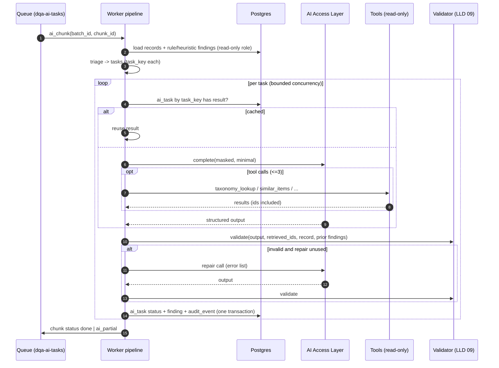

# LLD 08 — AI Task Pipeline (orchestrator)

> File name kept for link stability. Per ADR-019 the former LangGraph "agent orchestrator" is a **plain deterministic Python pipeline**: `triage → run task → validate → compose → persist`, with progress checkpointed in Postgres. There is no agent framework, no graph checkpointer and no LLM-chosen routing. The three "specialist agents" are three **AI task handlers** (prompt + schema + allowed tools).

## 1. Purpose

Runs the AI workflow for records that rules and heuristics could not settle. Code, not the model, decides what runs next; the LLM only fills typed answers (HLD §3.2, §3.9, §4; ADR-010 as updated by ADR-019).

## 2. Scope

In scope: chunk-level pipeline, triage, the three task handlers (Category, Normalisation, Duplicate), read-only tools, per-chunk/per-task progress records, replay, loop guards, the single repair attempt, hand-off to validation (LLD 09) and persistence of AI findings.

Out of scope: LLM transport, masking, budgets (LLD 07), validation, calibration, explanation (LLD 09), retrieval (LLD 10), queue mechanics (LLD 06), prompt/flag storage (LLD 12).

## 3. Detailed explanation

### 3.1 Responsibilities

1. Consume `ai_chunk` messages from `dqa-ai-tasks` (chunk size 50). The same worker image that runs rules consumes this queue; only the queue differs.
2. Triage, in code, which records need which AI task.
3. Run each task through the handler and the AI Access Layer (LLD 07).
4. Pass every output to the validator; allow **at most one repair** call.
5. Compose validated findings (LLD 09) and persist as `source = ai_suggestion` (provisional vocabulary), status `needs_review`.
6. Record progress (`ai_task.status`, chunk status) so a crashed worker resumes without repeating completed calls.
7. Enforce loop guards and report `done` / `ai_partial` to batch state.

### 3.2 Input and output

| Aspect | Definition |
|---|---|
| Input | `ai_chunk` message (`batch_id`, `chunk_id`, `record_keys[]`, `trace_id`) plus rule/heuristic findings and normalised records from Postgres (read-only) |
| Output | AI findings in `finding`, `ai_task` rows, chunk status event, drop/log events for invalid outputs |
| Never | Writes record data, calls the provider directly, sends messages, reaches the internet |

### 3.3 Pipeline

```mermaid
flowchart TD
    S([ai_chunk received]) --> L[load records + rule/heuristic findings]
    L --> T[triage (code)]
    T -->|no AI work| X([chunk done])
    T -->|task list| H[run task handler via AI Access Layer]
    H --> V[validator (code, LLD 09)]
    V -->|valid| C[explanation composer (template)]
    V -->|invalid, repair unused| R[one repair call with error list]
    R --> V
    V -->|invalid after repair| D[drop + log ai_invalid_output; rule findings kept]
    V -->|low confidence / unsure| I[keep as Investigate-only finding, human decides]
    C --> P[persist finding: needs_review]
    I --> P
    P --> Z([chunk done])
    D --> Z
```

The only loop is `V → R → V` (single repair). There is **no escalation to a larger model**; low confidence or `unsure` is presented to the steward as Investigate (ADR-018). A per-chunk step counter aborts with `loop_guard_triggered` if exceeded.

### 3.4 Progress and state (Postgres, no graph checkpointer)

```python
# in-memory per chunk run, typed (pseudocode; documentation, not implementation)
class ChunkRun(BaseModel):
    batch_id: str; chunk_id: str; trace_id: str
    records: dict[str, RecordView]
    prior_findings: dict[str, list[FindingRef]]
    tasks: dict[str, TaskState]          # keyed by task_key
    step_counter: int
    started_at: datetime

class TaskState(BaseModel):
    task_key: str
    task_type: Literal["category_check","normalise_description","duplicate_adjudication"]
    record_key: str | list[str]          # list for a duplicate pair
    attempts: int                        # logical LLM calls used, hard cap 2 (initial + 1 repair)
    repaired: bool
    result: CompleteResult | None
    validation: ValidationOutcome | None # accepted | downgraded | dropped(reason)
    finding_id: str | None
```

Durable progress lives in tables, not in a framework: `ai_task` (status per `task_key`, UNIQUE) and the chunk status on the batch/chunk record (LLD 05/06). After each task the handler commits `ai_task` status and, when valid, the finding plus `audit_event` in one transaction. A restarted worker re-reads `ai_task` by `task_key`, skips completed tasks and continues; completed AI calls are never repeated or re-billed. Chunk progress rows are kept until the batch completes + 30 days (HLD §4.4).

### 3.5 Triage rules (code, no LLM)

| Task | Condition | HLD source |
|---|---|---|
| `normalise_description` | record has `weak_description` finding | §6.1.4/5, §6.3 |
| `category_check` | keyword-ambiguous category or a `category_mismatch_candidate` needing semantic confirmation | §6.1.5, FR-7 |
| `duplicate_adjudication` | candidate pair with similarity in the uncertain band (default 0.75–0.88) | §6.1.5, `ai_uncertain_band` |

Triage excludes a record (rule-only) when: it carries `suspicious_content`; `ai_task.<task>.enabled` is off; the batch AI budget is exhausted; or it is already an AI-produced finding (records never re-enter AI triage because of an AI finding, HLD §4.8). Target: **< 30% of records reach AI** (HLD §11.4) — this is the main cost lever. Whether `category_check` also runs on unambiguous mismatches (so the brief's 1002 carries an AI source) is **OQ-209**.

Each task gets `task_key = hash(record_key, task, prompt_version, model_id)` (HLD §4.7). If `ai_task` already holds a result for that key the handler reuses it and makes no call.

### 3.6 Task handlers (summary; full cards in `docs/ai/AGENT_DESIGN.md`)

| Handler | Input (masked, minimal) | Output (schema) | Model tier | Tools allowed |
|---|---|---|---|---|
| Category | masked description, current category, top-k taxonomy nodes, similar approved items | `suggested_category`, `confidence`, `evidence_fields[]`, `retrieved_ids[]`, `rationale` ≤ 300 chars, or `unsure` | mid | `taxonomy_lookup`, `similar_items` |
| Normalisation | description, manufacturer, MPN | normalised description, extracted attributes, `evidence_fields[]` | small/fast | `abbreviation_dictionary` |
| Duplicate | candidate pair from blocking | `same_item` / `different` / `unsure`, `confidence`, differing attributes, `evidence_fields[]` | mid | `similar_items`, `manufacturer_alias` |

Common rules: record text is wrapped in `<record>…</record>` and is data, not instructions; output forced through structured mode; only free text is `rationale` ≤ 300 chars; `unsure` is always legal; reasoning is not exposed to users (HLD §3.5).

### 3.7 Tools

In-process, read-only, Pydantic-validated, time-boxed (2 s, 1 retry), logged with masked args (HLD §3.8, §5.6, §9.5).

| Tool | Signature | Backed by | Result limit |
|---|---|---|---|
| `taxonomy_lookup` | `(text) -> list[TaxonomyNode]` | taxonomy retrieval (LLD 10) | top-k 5 |
| `similar_items` | `(record_key, k) -> list[SimilarItem]` | approved-items retrieval | k ≤ 5 |
| `manufacturer_alias` | `(name) -> list[str]` | `reference_data` aliases | ≤ 20 |
| `abbreviation_dictionary` | `(token) -> str \| None` | exact lookup | 1 |

**Max 3 tool calls per handler step.** The registry is an allow-list per handler; an unexpected tool name or failed argument validation is logged as a **security event** and the step is dropped. The pipeline code executes the tool calls requested by the model within this bounded set; the model never picks handlers.

### 3.8 Error handling

| Step | Failure | Action |
|---|---|---|
| load | DB read timeout | chunk stage retry (3, re-queued with delay) |
| triage | invalid state | non-retryable → DLQ with reason; rule findings already persisted |
| call | `provider_error` / `timeout` | access layer already retried; task failed, record stays rule-only; repeated failures → batch `ai_partial` |
| call | `policy_block` (budget, disabled, PII) | task skipped, not retried |
| validator | schema/reference/grounding failure | one repair call, then drop |
| validator | `unsure` or low confidence | no extra call; Investigate-only finding |
| any | step counter exceeded | abort run `loop_guard_triggered`, alert, keep rule findings |

Non-retryable errors go straight to the DLQ with reason (HLD §4.6).

### 3.9 Loop prevention and hard caps

| Guard | Value | Source |
|---|---|---|
| Tool calls per handler step | 3 | HLD §3.8, §4.8 |
| LLM calls per task | **2** (1 initial + at most 1 repair) | HLD §4.8, ADR-018 |
| Repair attempts | 1 | HLD §3.10 |
| Escalations | **none** (removed) | ADR-018 |
| Budget per batch | `ai_budget_per_batch_usd` = 25 | HLD §6.2 (cost target mismatch: OQ-15) |
| Batch timeout | 2 h → `ai_partial` + alert | HLD §4.6 |
| Chunk stage timeout | 5 min, 3 retries | HLD §4.6 |

Provider retries of the same logical call do not count toward the cap. OQ-210 / OQ-20 are resolved by this decision (see OPEN_QUESTIONS).

### 3.10 Replay

Replay re-runs a chunk against a **different prompt version** for evaluation only (HLD §4.5). It writes to `ai_task` / evaluation tables with a `replay_id` included in the `task_key` hash input and **never touches live findings** (decision D-08-1; mechanism details OQ-211).

### 3.11 Sequence: one chunk



### 3.12 Database interactions

| Table | Access | Purpose |
|---|---|---|
| `record_snapshot` | read | normalised/raw records |
| `finding` | read (rule/heuristic) / insert (AI findings) | AI findings written by the worker service principal; physical table for drafts: OQ-212 |
| `ai_task` | upsert | status, attempts (also the progress ledger) |
| `audit_event` | insert | finding created with model id + prompt version (HLD §5.7) |

Persist writes finding + audit event in one transaction; `ON CONFLICT DO NOTHING` on the finding unique key (HLD §4.7).

### 3.13 External dependencies

AI Access Layer (LLD 07, in-process); Postgres; Celery with SQS (ElasticMQ locally) (LLD 06; ADR-005); retrieval (LLD 10); flags (LLD 12). No agent framework.

### 3.14 Logging and tracing

Per step an OpenTelemetry span (`triage`, `category_task`, `normalisation_task`, `duplicate_task`, `validator`, `composer`) with `task_key`, `attempt`, `outcome` (accepted / downgraded / dropped), `drop_reason` (HLD §9.2). LLM call metadata in `ai_task`; metrics in Prometheus. No raw record text/PII.

### 3.15 Security

- Worker principal read-only on record data; egress limited to the single LLM endpoint plus platform services (HLD §5.2).
- Injection defences: delimiters, input scanner → rule-only routing, read-only allow-listed tools, output validation (HLD §5.3).
- A prompt carries one record or one pair; few-shot examples only from approved steward decisions (HLD §5.5).

### 3.16 Performance

Chunk size 50; concurrency cap per worker pool; < 30% of records to AI; progress writes per task. Target ≥ 1k records/min AI (HLD §7.8); 10k-record AI pass < 15 min (HLD §1.5).

### 3.17 Testing

Unit: triage truth table (each condition, exclusion, budget), step-counter guard, tool argument validation, unexpected-tool security event, `task_key` stability. Pipeline with `StubSuggester`: valid; invalid → repair → valid; invalid → repair → drop; `unsure` → Investigate-only; provider failure → rule-only. Assert ≤ 1 repair, ≤ 3 tool calls, cap 2 LLM calls, loop guard. Resume: kill the worker after each task and verify no repeated provider calls. Replay: new prompt version writes nothing to live findings. Injection corpus: schema unchanged, no approvals. Trajectory metrics: steps and tool calls per task, repair rate, loop-guard triggers target 0 (HLD §7.6).

## 4. Architecture decisions

| ID | Decision | Rationale |
|---|---|---|
| ADR-002 | LangGraph — **superseded in part by ADR-019** | Plain Python pipeline; same determinism, one less dependency |
| ADR-010 | Supervisor + specialists, supervisor is code — updated by ADR-019 | Handlers instead of agents |
| ADR-018 | 2 LLM calls per task, no escalation tier | Cost and simplicity |
| D-08-1 | Replay isolation via `replay_id` | Prevents live finding mutation |

## 5. Dependencies

LLD 06 (queues, chunking), 07 (access layer), 09 (validation, composer), 10 (retrieval), 12 (prompts, flags), 05 (schema); docs `docs/ai/AGENT_DESIGN.md`, `AGENT_WORKFLOW.md`, `AI_GUARDRAILS.md`.

## 6. Risks and edge cases

| # | Case | Handling |
|---|---|---|
| E1 | Worker crash mid-chunk | Resume from `ai_task` progress; idempotent `task_key` |
| E2 | Duplicate-pair explosion | Blocking caps, uncertain-band pairs only (LLD 03); cap value OQ-213 |
| E4 | Prompt version changes mid-batch | `prompt_version` pinned at chunk start; canary applies per task |
| E5 | Rule and AI disagree | Merge rules in LLD 09 |
| E6 | AI finding on a record already decided | Stored only if the same `dedupe_key` is absent; decided findings never reopened (A-206) |
| E7 | Many identical records overspend budget | Budget guard and cache by `task_key` |
| E8 | Injection text in description | Triage excludes `suspicious_content`; access layer rescans |
| E9 | Flag flipped off mid-run | Remaining tasks skipped, batch `ai_partial`, validated results kept |
| E10 | Non-English / abbreviation-heavy | Abbreviation dictionary + multilingual model; low confidence → Investigate |

## 7. Related documents

`docs/hld/HLD.md`; `docs/ai/AI_ARCHITECTURE.md`; `docs/ai/AGENT_DESIGN.md`; `docs/ai/AGENT_WORKFLOW.md`; `docs/ai/AI_GUARDRAILS.md`; LLD 03, 06, 07, 09, 10, 12; `docs/testing/TESTING_AND_EVALUATION.md`.

### Assumptions and open questions

| ID | Text |
|---|---|
| A-204 | (Withdrawn: single-entity deployment, ADR-016) |
| A-205 | Progress is written per task (and chunk status per chunk), not per record |
| A-206 | AI findings never reopen or alter findings already decided by a steward |
| OQ-209 | Does `category_check` run only on ambiguous keyword cases, or also confirm every heuristic `category_mismatch_candidate`? |
| OQ-210 | **Resolved by ADR-018** — cap is 2 LLM calls per task (1 initial + ≤ 1 repair), no escalation |
| OQ-211 | Replay mechanism and where replay results are stored/compared |
| OQ-212 | Which table holds draft AI findings and which DB role writes final findings |
| OQ-213 | Cap on candidate pairs per blocking group and per chunk |
