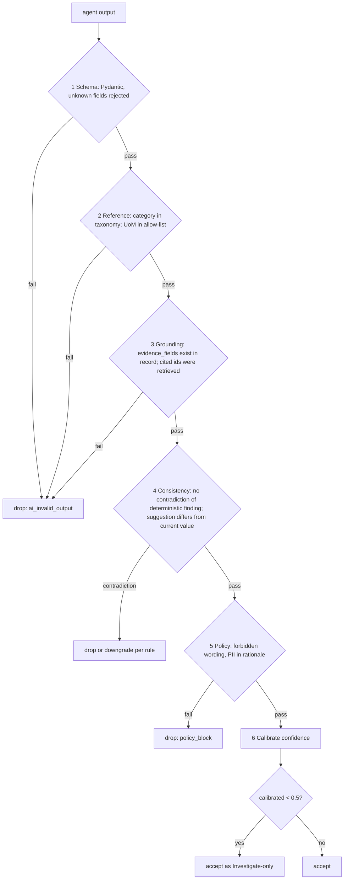
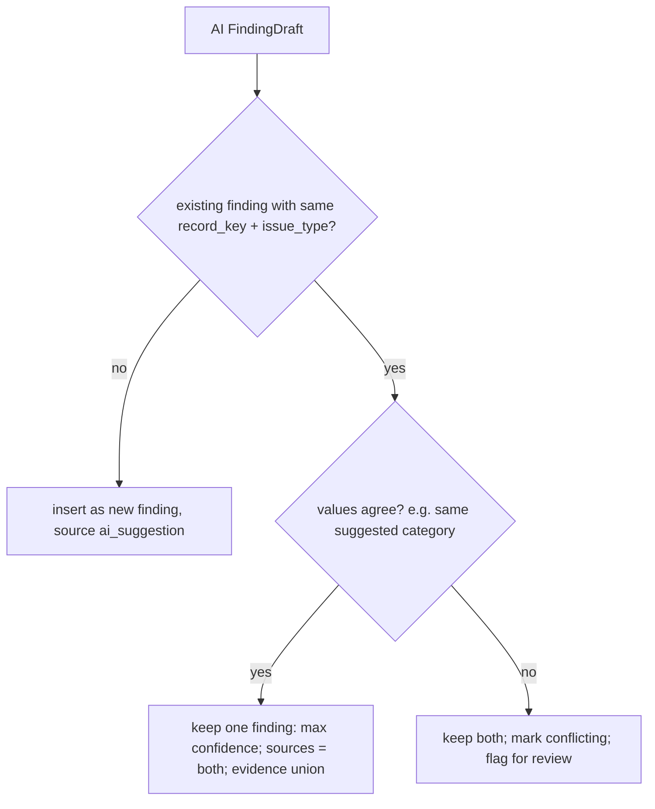

# LLD 09 — AI Output Validation, Confidence Calibration, Merge and Explanation

## 1. Purpose

Nothing an LLM returns becomes a finding until code has validated it. This module is the **validator**, **confidence calibrator**, **rule/AI merger** and **explanation composer** (HLD §3.11, §6.1 steps 6–8, §3.2). It exists so that the model "only ever fills a typed answer" and "can never choose its own next step" (HLD §3.2).

## 2. Scope

In scope: the six-step validation pipeline; accept/downgrade/drop decisions; confidence calibration; merging rule/heuristic and AI findings; severity assignment; the explanation composer; the forbidden-wording policy filter.

Out of scope: calling the LLM and provider-level checks (LLD 07), pipeline control flow (LLD 08), retrieval (LLD 10), review states and decisions (LLD 11). Rule/heuristic finding production is LLD 02/03.

## 3. Detailed explanation

### 3.1 Responsibilities

1. Validate any agent output through six ordered checks; emit `accepted`, `downgraded` (confidence reduced) or `dropped(reason)`.
2. Map model confidence to calibrated confidence from steward outcomes.
3. Merge an AI result with an existing rule/heuristic finding for the same record and issue.
4. Assign severity from the policy table and confidence from rule constant or calibrated AI score.
5. Compose the steward-facing explanation from approved templates, populated with evidence.
6. Guarantee no forbidden wording and no PII reaches output.

### 3.2 Input and output

| Aspect | Definition |
|---|---|
| Input | `AgentOutput` (typed), the `RecordView`, `retrieved_ids` actually returned by tools for this task, existing rule/heuristic findings for the record, reference data (taxonomy, allowed UoM) at the version used, policy tables |
| Output | `ValidationOutcome` (`accepted` / `downgraded` / `dropped` + `reason`), final `FindingDraft` (issue_type, severity, calibrated confidence, explanation, evidence, suggested_action, suggested_value, source, model/prompt/rule versions, status `needs_review`) |
| Failure | Drop with reason; rule findings are never removed because AI failed validation |

### 3.3 Interface contract (internal Python API, no HTTP)

```python
def validate(output: AgentOutput, ctx: ValidationContext) -> ValidationOutcome: ...
def calibrate(task_type: str, model_id: str, raw_confidence: float) -> float: ...
def merge(existing: list[Finding], ai: FindingDraft) -> MergeResult: ...
def compose_explanation(draft: FindingDraft) -> str: ...
```

`ValidationOutcome` example:

```json
{
  "task_key": "7f3c…",
  "decision": "downgraded",
  "reasons": ["consistency.same_as_current_value"],
  "confidence_raw": 0.82,
  "confidence_calibrated": 0.61,
  "checks": { "schema": "pass", "reference": "pass", "grounding": "pass", "consistency": "fail", "policy": "pass", "calibration": "applied" }
}
```

### 3.4 Six-step validation pipeline (HLD §3.11)



Step details:

| # | Check | Pass rule | On failure |
|---|---|---|---|
| 1 | Schema | Parses to the task's Pydantic model; **no unknown fields**; `rationale` ≤ 300 chars | `ai_invalid_output`; eligible for the single repair (LLD 08) |
| 2 | Reference | `suggested_category` ∈ taxonomy (current `reference_data` version); any `uom` ∈ allowed list. Categories outside the taxonomy count as hallucination (target 0, HLD §7.5) | drop (repair allowed once) |
| 3 | Grounding | every `evidence_fields[i]` is a key present in the record; every cited retrieved id ∈ the ids returned by tools in this task | drop (repair allowed once) |
| 4 | Consistency | does not contradict a deterministic finding (e.g. cannot claim "MPN present" where `missing_part_number` fired); `suggested_value` ≠ current value | contradiction with a deterministic finding → **drop the AI result, keep rule finding**; same-as-current → drop |
| 5 | Policy | no forbidden wording (§3.8); no PII (re-scan with the masking detectors) in `rationale`/explanation text | `policy_block`; not repaired automatically (non-retryable, HLD §4.6) |
| 6 | Calibrate | map to calibrated confidence (§3.5); below `ai_min_confidence_display` (default 0.5) → "Investigate" only | accepted but labelled Investigate |

Repair semantics: only failures of steps 1–3 are repairable, with a single re-ask containing the machine-readable error list (HLD §3.10). Failure after the repair is dropped and logged `ai_invalid_output`; rule findings stay.

Boundary at 0.5: HLD §3.11 says findings **below** 0.5 are shown only as Investigate while §6.2 names the parameter `ai_min_confidence_display = 0.5`. This LLD treats `< 0.5` as Investigate-only and `≥ 0.5` as displayable, pending **OQ-214**.

### 3.5 Confidence calibration

- Raw model confidence is **not** shown to stewards. It is mapped through a calibration table built from steward outcomes (HLD §3.11 step 6).
- Table keyed by `(task_type, model_id, prompt_version family)` with confidence bins (e.g. deciles) → observed steward approval rate.
- Rebuilt on a schedule from `decision` outcomes; version stored in `reference_data` (type `calibration`), referenced in every finding (HLD §6.6: "every finding stores the versions used").
- **Cold start problem**: before any steward outcomes exist (shadow mode starts with zero labelled data, HLD §10), no table can be built. HLD is silent on the initial mapping. Options (none chosen here): identity mapping capped (e.g. min(raw, X)); a fixed conservative constant; seed from the 300–500-record golden set (HLD §7.3). Until decided, the module applies a **provisional conservative cap** (A-207) and logs `calibration=cold_start`. Logged as **OQ-215**.
- Rule and heuristic confidences are **constants** (rule 1.0, heuristic 0.6–0.9 by rule) not passed through calibration (HLD §6.1.7). The brief's sample shows 0.95 for `missing_part_number`; this conflicts with "rule = 1.0" (**OQ-216**).

### 3.6 Severity and confidence assignment

Severity comes from a **policy table** by issue type and business impact (HLD §6.1 step 7). Known values from the HLD and the brief:

| Issue type | Severity (HLD) | Brief sample |
|---|---|---|
| `missing_part_number` | medium | medium |
| `unsupported_uom` | high | — |
| `duplicate_item_id` | high | — |
| `weak_description` | low/medium | — |
| `possible_duplicate` | not stated | — |
| `category_mismatch_candidate` | not stated | low |
| `conflicting_source_values`, `suspicious_content`, `malformed_row`, `incomplete_row` | not stated | — |

The full table is **OQ-217** (it is also required by LLD 02/03). The queue is sorted by severity then confidence (HLD §6.1.7).

### 3.7 Merge of rule/heuristic and AI findings (HLD §6.1 step 6)

Rule: "if a rule and AI agree, keep **one** finding with the higher confidence and both sources listed; if they disagree, keep **both** and flag for review."



Details left for decision: how "agree" is defined per issue type (category: equal; duplicate: same pair & verdict; normalisation: n/a since no rule counterpart) — recorded as A-208; how a **multi-source** finding is represented given a single `source` column and a single `dedupe_key` (HLD §6.5 vs §4.7) — **OQ-218**. If multi-source is needed, a `sources[]` array field is the proposed additive change (HLD §6.8 allows additive finding schema).

### 3.8 Forbidden wording and policy filter

HLD fixes the intent ("fixed", "corrected", "auto-approved" must be blocked, §1.5) but not the complete list. **Proposed list** (provisional, a configuration entry in `reference_data` type `forbidden_terms`, owned by the AI governance owner): `fixed`, `corrected`, `auto-approved`, `improved`, `resolved automatically`, `auto-merged`, `applied`, `updated in ERP`. Matching: case-insensitive, whole-word + stem variants, applied to explanation, rationale, suggested_action and any steward-visible string. Whether the list is closed and how "fixed" is handled inside quoted evidence (e.g. a description containing "fixed") is **OQ-219**. Evidence values (raw record text) are shown in the `evidence` object, not in prose; the invariant test scans **generated** text only (A-209).

### 3.9 Explanation composer (template, no LLM)

- One approved template per issue type; slots filled from evidence; "approved wording only" (HLD §6.1.8).
- The brief supplies two expected strings; they become the reference templates:

| issue_type | Template (from brief; `{}` slots proposed) | suggested_action (brief) |
|---|---|---|
| `missing_part_number` | "Manufacturer is present but manufacturer part number is missing." (HLD example adds the value: "Manufacturer 'SKF' is present but manufacturer part number is blank.", the two differ, **OQ-220**) | "Request manufacturer part number from the source owner." |
| `category_mismatch_candidate` | "Description suggests a mechanical bearing, but category is Electrical." | "Review category assignment before approval." |

- Templates for the remaining issue types (`unsupported_uom`, `duplicate_item_id`, `weak_description`, `possible_duplicate`, `conflicting_source_values`, `suspicious_content`, `malformed_row`, `incomplete_row`, normalisation suggestion): **wording not given in HLD or brief**, tracked as **OQ-221** (needs steward/product sign-off, HLD §3.5 "reviewed wording only").
- AI rationale is shown only as a bounded field, never as prose replacing the template; no PII, no chain-of-thought.
- Output always carries `source`, `status = needs_review`, `explanation`, `evidence`, `suggested_action` (FR-9, NFR "Explainability: 100%").

### 3.10 Database interactions

| Table | Access |
|---|---|
| `reference_data` | read taxonomy, allowed_uom, forbidden_terms, calibration table, policy (severity) table, pinned by version |
| `finding` | read existing findings for merge; insert/update (single finding when merged) with `ON CONFLICT DO NOTHING` on dedupe key |
| `audit_event` | insert "finding created" with `model_id`, `prompt_version`, validator decision; dropped outputs are logged (not stored as findings) |
| `ai_task` | update status `validated` / `dropped` and `drop_reason` |

The merge + insert + audit write run in **one transaction**; a crash between validation and persist resumes from `ai_task` progress (LLD 08) and is idempotent through the dedupe key.

### 3.11 External dependencies

None at runtime beyond Postgres and the in-process masking detectors (reused from LLD 07 library) for the PII re-scan. Pydantic v2.

### 3.12 Error handling

| Condition | Result |
|---|---|
| Reference data version missing | `policy_block`-class internal error; task dropped, alert (A-210) |
| Calibration table missing | cold-start path (A-207) |
| Forbidden term in template output (code defect) | fail the invariant test in CI; at runtime raise and drop (never emit) |
| Unknown issue type | drop + alert (config drift) |

No retries inside this module (pure functions); retry is orchestrator-level.

### 3.13 Logging

Per decision: `task_key`, `decision`, `reasons[]`, `drop_reason`, raw and calibrated confidence, versions (rule/prompt/model/reference/calibration). No raw record text; masked/hashed identifiers (HLD §9.1). Dropped outputs counted per reason for the "AI quality" dashboard (drop rate by reason).

### 3.14 Security

Forbidden-wording and PII filters are defence in depth against prompt injection that tries to produce approvals or exfiltration strings (HLD §5.3). The module has no network access and no write path other than the finding persist. A request to alter severity/status from model output is ignored: the model never sets `status`, `severity` or `source`.

### 3.15 Performance

Pure CPU, O(1) per output; calibration lookup cached in memory by table version; PII re-scan on short text only (≤ 300 chars rationale + explanation). Target negligible versus LLM latency.

### 3.16 Testing requirements

Unit: each of the six checks (pass/fail per case); unknown-field rejection; category outside taxonomy; evidence field absent in record; cited id not retrieved; contradiction with deterministic finding; confidence boundary values 0.49/0.50; forbidden-word matrix incl. casing/stems; PII in rationale. Property tests: composer never emits a forbidden term for any issue type/evidence combination (Hypothesis). Merge: agree/disagree/no-existing for each issue type. Golden: brief records produce the two expected findings' fields (issue_type, severity, suggested_action, explanation text) — acceptance rule on extras/exact match is **OQ-222**. Calibration: monotonic mapping, cold-start path. Invariants (HLD §7.1): every finding has explanation + evidence + source; no mutation of inputs.

## 4. Architecture decisions

| ID | Decision | Rationale |
|---|---|---|
| ADR-010 (related) | Validation and composition in code, not LLM | Predictability, auditability |
| D-09-1 | Dedicated validator separate from the AI access layer | The access layer cannot know taxonomy/ruleset; keeps provider code generic |
| D-09-2 | Templates (no LLM) for explanations | HLD §6.1.8; enables forbidden-wording guarantees |
| D-09-3 | Provisional `<0.5` ⇒ Investigate | HLD ambiguous (OQ-214) |

## 5. Dependencies

LLD 02/03 (finding producers and severity table), LLD 05 (schema), LLD 07 (masker), LLD 08 (caller), LLD 10 (reference data), LLD 11 (statuses), LLD 12 (versions/params). Docs: `docs/ai/AI_GUARDRAILS.md`, `docs/testing/TESTING_AND_EVALUATION.md`.

## 6. Risks and edge cases

| # | Case | Handling |
|---|---|---|
| E1 | Taxonomy updated between retrieval and validation | Validate against the version recorded at task start; finding stores the version |
| E2 | Model cites a retrieved id that exists but is not relevant | Grounding only proves existence; relevance covered by faithfulness evals (HLD §7.4) |
| E3 | Confidence miscalibration after provider model drift | Monthly golden-set re-run; approval-rate alerts (HLD §10.4) |
| E4 | Rule and AI "agree" but both wrong | Four-eyes and sampled QA (HLD §11.2) |
| E5 | Forbidden word legitimately present in evidence text | Evidence excluded from the prose filter; OQ-219 |
| E6 | Merged finding conflicts with unique key semantics | OQ-218 |
| E7 | Cold-start overconfidence | Provisional cap; shadow mode hides AI findings (HLD §10) |
| E8 | Brief sample says 1001 confidence 0.95 vs rule constant 1.0 | OQ-216; test fixture follows the brief unless corrected |

## 7. Related documents

`docs/hld/HLD.md`; `docs/ai/AI_GUARDRAILS.md`; `docs/ai/AGENT_WORKFLOW.md`; LLD 02, 03, 07, 08, 10, 11, 12; `docs/testing/fixtures/brief-expected-output.json`; `docs/project/OPEN_QUESTIONS.md`.

### Assumptions and open questions introduced here

| ID | Text |
|---|---|
| A-207 | Until a calibration table exists, AI confidence is capped conservatively and logged `calibration=cold_start` |
| A-208 | "Agree" means equal suggested value for category, same pair+verdict for duplicates |
| A-209 | The forbidden-wording invariant applies to generated text, not to raw evidence values |
| A-210 | Missing reference-data version is an alertable internal error, not a silent default |
| OQ-214 | Boundary of the Investigate-only rule (`<0.5` vs `≤0.5`) |
| OQ-215 | Calibration cold-start strategy and who owns the initial table |
| OQ-216 | Confidence for deterministic findings: 1.0 (HLD) vs 0.95 (brief sample) |
| OQ-217 | Complete severity policy table for all issue types |
| OQ-218 | Representation of multi-source merged findings given single `source` and `dedupe_key` |
| OQ-219 | Final forbidden-term list and handling of those terms inside quoted evidence |
| OQ-220 | Canonical `missing_part_number` explanation wording (brief vs HLD example) |
| OQ-221 | Approved explanation/suggested-action wording for all remaining issue types |
| OQ-222 | Does acceptance require exactly the two brief findings, or tolerate additional findings (e.g. `weak_description` on "bearing")? |
