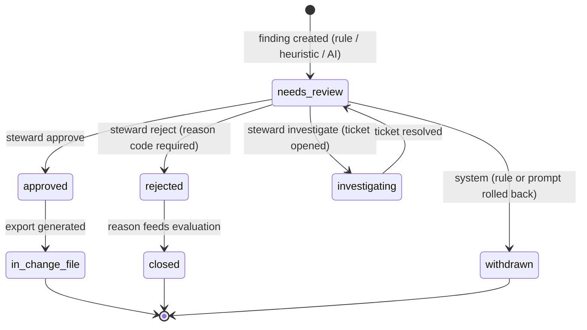

# LLD 11 — Review Workflow, Decisions and Export

> **ADR-023 note (2026-11-04):** no sign-in. Every request is the `anonymous` principal with all roles except Platform Admin; role/ownership checks, four-eyes and OIDC described below are **not enforced** until a new ADR reintroduces authentication through the `Authenticator` slot. Network controls are the only access control.

## 1. Purpose

Humans are the only actors who change a finding's outcome (HLD §4.9). This module implements the **finding state machine**, steward **decisions** (approve / reject / investigate / edit-and-approve, single and bulk), the **four-eyes** rule, the **change-file export** and the **ticket webhook**. DQA never writes to ERPs or item data (FR-11; HLD §1.3).

## 2. Scope

In scope: decision endpoints, state transitions, four-eyes, bulk decisions (207), edit-and-approve, investigate/ticket flow, system withdrawal, export job and signed URL, audit events and decision-derived outputs.

Out of scope: finding creation (LLD 02/03/08/09), authentication/RBAC primitives (Security doc), UI (excluded by the user), reference-data governance (LLD 10), queue mechanics (LLD 06).

## 3. Detailed explanation

### 3.1 Responsibilities

1. Enforce the state machine; the system can only **create** or **withdraw** findings; every other transition is a steward or Data Owner action.
2. Record each decision append-only with user, time, reason code, comment, before/after value, approval level.
3. Enforce one active decision per finding; re-submitting the same decision is a no-op.
4. Apply four-eyes for high-impact actions.
5. Provide bulk decisions (max 500) with per-item results.
6. Produce the change file for approved findings; never write to source data.
7. Open a ticket to the source owner on Investigate and re-queue on ticket resolution.

### 3.2 State machine (HLD §4.10)



"Approved: four-eyes if high impact" (HLD diagram) means the approval is not final until the second approver acts; how that sub-state is represented (a distinct status such as `pending_second_approval`, or `approved` with `approval_level`) is **not in the HLD** — the decision table has an `approval_level` column. This LLD models it as **approval_level on the decision row** and a computed "awaiting second approval" view, pending **OQ-233**.

Allowed transitions (all others → `409 invalid_transition`):

| From | To | Actor | Conditions |
|---|---|---|---|
| (none) | `needs_review` | system | on finding insert |
| `needs_review` | `approved` | Data Steward, Data Owner | RBAC + batch ownership; if high impact needs second approval |
| `needs_review` | `rejected` | Steward, Owner | `reason_code` required |
| `needs_review` | `investigating` | Steward, Owner | ticket created or queued |
| `needs_review` | `withdrawn` | **system only** | bulk retract by `prompt_version`/`rule_version` (HLD §8.9) |
| `investigating` | `needs_review` | system (ticket resolved) or Steward | webhook/manual |
| `approved` | `in_change_file` | system (export job) | included in a change file |
| `rejected` | `closed` | system | after reason logged |
| `approved`/`in_change_file`/`closed` | `withdrawn` | not allowed (A-216) | decided findings are not silently withdrawn; withdrawal of already-approved findings is **OQ-234** |

### 3.3 API contracts (HLD §6.4)

#### `POST /api/v1/findings/{id}/decisions`

Headers: `Authorization: Bearer <JWT>`, `Idempotency-Key: <uuid>` (all writes, HLD §2.4).

Request (HLD §6.4):

```json
{
  "action": "approve",
  "reason_code": "wrong_suggestion",
  "comment": "Confirmed bearing belongs under Mechanical",
  "edited_value": { "category": "Mechanical" }
}
```

`action ∈ approve | reject | investigate`; `edited_value` only with `approve` (edit-and-approve). `reason_code` is required for `reject` (HLD §4.9). The permitted reason codes are not listed in the HLD beyond the example `wrong_suggestion` (and `wrong_category` in §10.4): **OQ-235**.

Response `201`:

```json
{ "decision_id": "d_91", "finding_status": "approved", "approval_level": 1, "requires_second_approval": true }
```

Errors: `401`, `403` (role/batch ownership), `404`, `409` (invalid transition; another active decision exists), `422` (missing reason code, invalid `edited_value`), `429`.

#### `POST /api/v1/findings/decisions:bulk` (max 500)

```json
{
  "action": "approve",
  "finding_ids": ["f_1", "f_2", "f_3"],
  "reason_code": null,
  "comment": "Batch review"
}
```

Response `207`:

```json
{
  "results": [
    { "finding_id": "f_1", "status": 201, "decision_id": "d_1", "finding_status": "approved" },
    { "finding_id": "f_2", "status": 409, "error": "invalid_transition" },
    { "finding_id": "f_3", "status": 403, "error": "second_approval_required_role" }
  ]
}
```

Rules: gated by flag `bulk_approve_enabled` (HLD §6.7); no default "approve all" for AI findings (HLD §11.2, automation-bias mitigation); each item is authorised and processed independently; the request is idempotent as a whole through `Idempotency-Key` and per item through the one-active-decision rule. Whether bulk selection of high-impact items is permitted at all, and whether `edited_value` is allowed in bulk: **OQ-236**.

#### `POST /api/v1/batches/{id}/exports`

```json
{ "format": "csv", "scope": "approved", "include_statuses": ["approved"] }
```

Response `202`: `{ "export_id": "e_7", "status": "queued" }`; polled via an export status resource (path not in HLD, **OQ-237**) which returns a **signed URL** to the S3 change file when complete (HLD §6.4). Idempotent by `Idempotency-Key` + deterministic export content hash (A-217).

### 3.4 Four-eyes rule (HLD §4.10, §6.2)

- High-impact = duplicate merges, and category changes affecting more than **N** items; default `four_eyes_threshold_items = 10`, owner Data Owner (HLD §6.2).
- Second approver must be a **Data Owner** (RBAC "Second approval: Yes" only for Data Owner) and must be a **different user** from the first approver (A-218; HLD does not state "different user" explicitly, but four-eyes implies it).
- Open points: how "affecting more than N items" is computed (count of findings in one decision? records affected by a category change across the data set?) — **OQ-238**; behaviour when the first approver is itself a Data Owner (must a second Data Owner approve?) — **OQ-239**; what happens if the second approver rejects — assumed to return the finding to `needs_review` with both decisions audited (A-219).
- Duplicate merges are never auto-applied (out of scope v1): an approved `possible_duplicate` produces a **change-file line** requesting a merge by the MDM team, not a merge.

### 3.5 Processing logic

**Single decision**

1. Authenticate JWT; authorise against **role + batch ownership** (HLD §5.1).
2. Validate payload (Pydantic): action, reason code (if reject), `edited_value` shape (must validate against the same schema/taxonomy/UoM allow-list as a suggested value).
3. `BEGIN`; `SELECT … FROM finding WHERE id = :id FOR UPDATE`.
4. Check current status allows the transition; find active decision: same action and same payload ⇒ return existing result (no-op, `200/201` same body); different ⇒ `409`.
5. Evaluate high-impact; set `approval_level` (1 or 2); if second approval required, finding status remains `needs_review`-equivalent until completed (OQ-233).
6. Insert `decision` row; update `finding.status`; insert hash-chained `audit_event` (actor, time, before/after value, reason) — **same transaction**.
7. If `investigate`: enqueue ticket job (outbox row in same transaction, A-220) → `dqa-export`-class queue.
8. `COMMIT`; return result. Emit metrics/spans.

**Bulk**: loop over items, each in its own transaction (partial success allowed; 207); cap 500; items sorted for deterministic locking order to avoid deadlocks; stop early on an authorisation failure (security event).

**Edit-and-approve**: `edited_value` is stored in `decision.edited_value` and takes precedence over `finding.suggested_value` in the export; the audit event stores before/after (HLD §5.7).

### 3.6 Export flow

```mermaid
sequenceDiagram
    autonumber
    participant S as Steward (via API client)
    participant A as DQA API
    participant DB as Postgres
    participant Q as Queue (dqa-export)
    participant W as rule-worker (export)
    participant S3 as S3 (KMS)
    participant M as MDM team

    S->>A: POST /batches/{id}/exports (Idempotency-Key)
    A->>DB: authorise (role export); create export row; audit
    A->>Q: export job {export_id, batch_id}
    A-->>S: 202 {export_id}
    W->>Q: consume
    W->>DB: select approved findings (completed approvals only), decisions, edited_value
    W->>W: build change file (CSV/JSON), deterministic ordering, checksum
    W->>S3: put object (versioned)
    W->>DB: findings -> in_change_file; audit "export"; export status ready
    S->>A: GET export status
    A-->>S: signed URL (time-limited)
    S-->>M: hand over change file (applied by normal MDM change process)
```

The change file is a **request for change**, not an applied change: "DQA itself has no write access to ERPs" (HLD §4.10).

**Change file format** is not specified in the HLD (only "CSV/JSON", "lines", "approved findings"). Required columns, one line per finding or per record, how merges and category changes are expressed, handling of `edited_value`, source system and `item_id` addressing, checksum and signing: **OQ-240**. The signed-URL mechanism (S3 presigned vs API-signed token) and expiry: **OQ-241**. Until decided, the LLD fixes only the invariants: includes `finding_id`, `batch_id`, `source_system`, `item_id`, `issue_type`, `approved_value`, `decided_by`, `decided_at`, `approval_level`, `model_id/prompt_version/rule_version` (A-221, drawn from the audit requirements in HLD §5.7, not from a format spec).

### 3.7 Ticket webhook (Investigate)

- On `investigate`: outbound webhook creates a ServiceNow or Jira ticket for the source owner with the finding evidence (HLD §2.7, §10.8). Retry per outbound policy; failures go to a DLQ and the finding stays `investigating` with `ticket_status=failed` (A-222).
- Which ticketing system, payload mapping, authentication, and how "ticket resolved" returns to DQA (inbound webhook, polling, or manual steward action): **OQ-242**. HLD diagram shows `investigating → needs_review` on "ticket resolved".
- Outbound webhook must not leak PII or pricing; payload built from the allow-listed evidence fields only (A-223).

### 3.8 System withdrawal

Bulk retract by `prompt_version` / `rule_version` (HLD §8.9): sets status `withdrawn` for `needs_review` findings only, audited, minutes-scale, can be triggered only by a Platform Admin/ops flow (A-224). Findings already decided are not auto-withdrawn (OQ-234).

### 3.9 Database interactions

| Table | Operations | Constraints |
|---|---|---|
| `finding` | `SELECT … FOR UPDATE`, status update | status enum, `dedupe_key` UNIQUE |
| `decision` | insert (append-only) | one active decision per finding: partial unique index on `(finding_id) WHERE active` |
| `audit_event` | insert, hash chain (`prev_hash`, `hash`) | append-only, no UPDATE/DELETE privilege |
| `batch` | read (ownership) | |
| export table | not in HLD §6.5 | **OQ-243**: add an `export` table (id, batch_id, status, checksum, s3_key, created_by) as an additive schema change |


### 3.10 External dependencies

S3 (exports, KMS), Queue, ServiceNow/Jira (webhook), SIEM (audit streaming), Unleash (`bulk_approve_enabled`), IdP-issued JWT claims for role.

### 3.11 Error handling and retry

| Operation | Timeout/Retry | Failure outcome |
|---|---|---|
| Decision write | DB tx; client retries safe via Idempotency-Key | 409/422 deterministic, no partial state |
| Export job | chunk-stage style: 5 min, 3 retries re-queued (A-225) | DLQ with reason; export status `failed`; findings remain `approved` |
| Ticket webhook | retry with backoff (values: **OQ-244**) | DLQ + visible `ticket_status` |
| SIEM stream | async, at-least-once | does not block decisions |

### 3.12 Logging and audit

Every decision, export and ticket action creates an `audit_event` (actor, event type, entity, payload with before/after, hash chain) streamed to SIEM; retained 7 years (HLD §5.7). App logs carry `trace_id, batch_id, finding_id`; no raw record text. Audit failure aborts the decision (the transaction includes the audit insert).

### 3.13 Security requirements

RBAC matrix (HLD §5.2): Uploader cannot decide; Steward and Owner decide and export; **only Owner** gives second approval; Auditor read-only; Platform Admin metadata only. Authorization on every request against role + batch ownership; unauthorised access attempts are security events. Signed URLs are short-lived,. CSRF protection and rate limiting on submission endpoints per the project web security rules; honeypots not applicable (API client).

### 3.14 Performance considerations

Bulk 500 items per request with per-item transactions: target p95 per item inside the findings API p95 < 300 ms is for reads (HLD §7.8); bulk latency target not given — **OQ-245**. Locking order and short transactions avoid contention. Export generation streams from DB cursor to S3 (no full in-memory build) for large batches (up to 100k records).

### 3.15 Testing requirements

Unit: transition matrix (all allowed/forbidden); reason-code requirement; idempotent re-submit; four-eyes (different user, Owner role, threshold edge N, N+1); edit-and-approve validation; export determinism. Integration (Testcontainers): concurrency — two stewards deciding the same finding; bulk with mixed outcomes yields 207; audit chain integrity (tamper detection); export → S3 stub → status; webhook failure → DLQ. E2E (HLD §7.2): approve, reject with reason, investigate → export → audit log shows all events. RBAC matrix test per endpoint (HLD §7.7). Invariant: no code path writes to record/source tables.

## 4. Architecture decisions

| ID | Decision | Rationale |
|---|---|---|
| D-11-1 | Decisions append-only; one active decision per finding | Auditability (HLD §4.7) |
| D-11-2 | Approval level recorded on decision row (provisional) | HLD schema has `approval_level`, no extra status (OQ-233) |
| D-11-3 | Transactional outbox for ticket jobs | Avoids lost tickets on crash (A-220) |
| D-11-4 | Per-item transactions in bulk (207) | Partial success semantics required by HLD 207 |
| ADR-009 | Postgres 16 as system of record | Row locks, partial unique indexes |
| ADR-005 | Queue for exports/tickets | Same broker mechanics as workers |

## 5. Dependencies

LLD 04 (API framework, idempotency), 05 (schema, audit chain, grants), 06 (queue/workers), 09 (finding drafts), 10 (reference values for validation of `edited_value`), 12 (flags). Docs: `docs/security/SECURITY_AND_GOVERNANCE.md`, `docs/operations/OBSERVABILITY_AND_OPERATIONS.md`.

## 6. Risks and edge cases

| # | Case | Handling |
|---|---|---|
| E1 | Two stewards act at once | `FOR UPDATE` + one-active-decision unique index; second gets 409 |
| E2 | Automation bias / rubber-stamping | Source badges, no default approve-all for AI, sampled QA, four-eyes (HLD §11.2) |
| E3 | Approve on a finding later withdrawn by rollback | Withdraw only `needs_review`; OQ-234 for approved ones |
| E4 | Edited value violates taxonomy/UoM | 422; same validators as AI output |
| E5 | Export includes findings approved after export start | Snapshot by `decided_at ≤ export_started_at`, deterministic selection (A-217) |
| E6 | Ticket system outage | DLQ, visible state, manual retry |
| E7 | Bulk containing findings the caller may not decide | Per-item 403; security event |
| E8 | High-impact threshold computed inconsistently | OQ-238 |
| E9 | Rejecting a finding the AI later recreates on re-run | Dedupe key + no reopening of decided findings (A-206 in LLD 08) |
| E10 | Reviewer decides on stale reference data | Finding stores reference versions; shown in evidence |

## 7. Related documents

`docs/hld/HLD.md` (§4.9–4.10, §6.4); `docs/lld/modules/04-api-service.md`; `05-data-layer.md`; `06-queue-and-workers.md`; `09-ai-validation-and-explanation.md`; `10-rag-and-reference-data.md`; `12-config-flags-and-prompts.md`; `docs/security/SECURITY_AND_GOVERNANCE.md`; `docs/project/OPEN_QUESTIONS.md`.

### Assumptions and open questions introduced here

| ID | Text |
|---|---|
| A-216 | Decided findings (approved/in_change_file/closed) are not silently withdrawn by the system |
| A-217 | Export content is deterministic (ordering, snapshot time) and idempotent per request |
| A-218 | Second approver must be a different user from the first |
| A-219 | A second-approver rejection returns the finding to `needs_review` with both decisions audited |
| A-220 | Ticket and export jobs are enqueued through a transactional outbox |
| A-221 | Change-file invariants listed in §3.6 until the format is decided |
| A-222 | Failed ticket creation leaves the finding `investigating` with `ticket_status=failed` |
| A-223 | Webhook payloads use allow-listed evidence fields only |
| A-224 | Bulk retraction is an admin/ops-only operation |
| A-225 | Export jobs follow chunk-stage timeout/retry values |
| OQ-233 | Representation of "awaiting second approval" (new status vs `approval_level`) |
| OQ-234 | Handling of withdrawal when a finding is already approved or exported |
| OQ-235 | Authoritative reject reason-code list |
| OQ-236 | Bulk: allowed for high-impact? allowed with `edited_value`? |
| OQ-237 | Export status resource path and fields |
| OQ-238 | Definition of "affecting more than N items" |
| OQ-239 | Second-approval rule when the first approver is a Data Owner |
| OQ-240 | Change-file format and columns (one line per finding vs per record; merges; edits) |
| OQ-241 | Signed-URL mechanism and expiry |
| OQ-242 | Ticketing system, payload, auth and the "ticket resolved" return path |
| OQ-243 | Add an `export` table (additive schema) |
| OQ-244 | Webhook retry/backoff values |
| OQ-245 | Latency target for bulk decisions |
