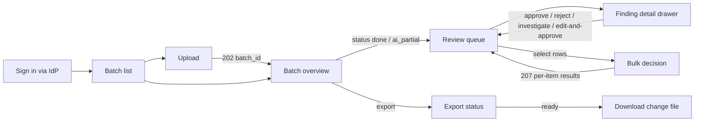

# LLD 13 — Steward UI (React + TypeScript)

> **ADR-023 note (2026-11-04):** no sign-in. Every request is the `anonymous` principal with all roles except Platform Admin; role/ownership checks, four-eyes and OIDC described below are **not enforced** until a new ADR reintroduces authentication through the `Authenticator` slot. Network controls are the only access control.

**Status:** DRAFT. **Code paused:** no UI code is written until the backend API for P2/P3 exists (user decision, 2026-11-04). The UI is designed here against the contracts in [module 04](04-api-service.md) and [module 11](11-review-workflow-and-export.md). Design direction is **PROVISIONAL** pending the owner's taste (OQ-807).
HLD refs: §1.4 FR-9, FR-10, FR-11; §2.2 (Steward UI); §4.9 (human-in-the-loop); §4.10 (approval workflow); §5.2 (RBAC); §6.4 (API contracts); §7.2 (E2E). Decision: [ADR-022](../../project/ARCHITECTURE_DECISIONS.md).

## 1. Purpose
Give data stewards one place to upload item batches, watch processing, review ranked and explained findings, decide on them (approve, reject, investigate, edit-and-approve, in bulk) and export the approved changes as a change file. The UI never changes item data; every outcome is a human decision sent to the API (HLD §1, §4.9).

## 2. Scope
- **In (first version, "Steward core"):** sign-in, upload, batch list/status, findings review queue with filters, finding detail, single and bulk decisions, export.
- **Later (only if the API provides the endpoint):** Auditor read-only audit-log view (OQ-400); separate "Needs investigation" tab for low-confidence AI findings (HLD §4.9; API already has the `tab` filter, boundary OQ-214); reference-data editing (OQ-135); admin config.
- **Out:** mobile app, offline mode, ERP write-back, the backend (modules 01-12), identity provider.
- **Paused:** all implementation until P3 exit; only this design, the ADR and the task list exist now.

## 3. Detailed explanation

### 3.1 Responsibilities (module template items 1-3: purpose, responsibilities, input/output)
1. Authenticate the user through the corporate IdP (OIDC) and hold the access token in memory only.
2. Call the API at `/api/v1` with a typed client; validate every response shape at the boundary.
3. Present findings with source badge, severity, confidence, explanation, highlighted evidence and the suggested action/value.
4. Send decisions with an `Idempotency-Key`; show per-item results for bulk (207).
5. Keep shareable state (filters, sort, page cursor, selected finding, tab) in the URL.
6. Never show actions the user's role cannot perform (convenience only; the API enforces authorisation).

| | Inputs | Outputs |
|---|---|---|
| UI | user actions; JWT claims (`user_id`, `roles`); API JSON | HTTP requests per section 3.5; rendered state; downloaded change file via signed URL |

### 3.2 Screens and routes

| Route | Screen | Roles | Purpose |
|---|---|---|---|
| `/` | redirect | all | to `/batches` |
| `/batches` | Batch list | Uploader (own), Steward, Data Owner, Auditor (all) | Find a batch, see status and counts (needs a list endpoint, OQ-810) |
| `/batches/new` | Upload | Uploader, Steward, Data Owner | Select file, upload with idempotency key |
| `/batches/:batchId` | Batch overview | same as list | Status, `findings_by_type`, `ai_status`, export action |
| `/batches/:batchId/findings` | Review queue | Steward, Data Owner (decide); Auditor (read-only) | Table, filters, bulk bar, detail drawer (`?finding=f_…`) |
| `/batches/:batchId/exports/:exportId` | Export status | Steward, Data Owner | Poll until `ready`, then download |
| `/forbidden`, `/signin/callback` | system | all | 403 view, OIDC redirect handler |

Uploader sees no review queue for batches it does not own (the API returns `404`, shown as "not found"). The Needs-investigation tab and Auditor audit view are **not routes in v1**.



### 3.3 Component tree (feature folders, per the web coding-style rules)

```
src/
  app/            App.tsx, routes.tsx, providers.tsx (QueryClient, auth), error-boundary
  features/
    auth/         AuthProvider, useSession, RequireRole, oidc.ts (code + PKCE)
    batches/      BatchList, BatchOverview, UploadForm, useBatch (poll), batches.css
    findings/     FindingsTable, FilterBar, SourceBadge, ConfidenceMeter, SeverityTag,
                  FindingDrawer, EvidenceView, findings.css
    decisions/    DecisionPanel, RejectDialog, EditValueForm, BulkBar, BulkResultDialog,
                  useDecision (optimistic + rollback), useBulkDecision
    exports/      ExportButton, ExportStatus, useExport
  components/ui/  Button, Dialog, Toast, Tag, EmptyState, ErrorState, Skeleton, VisuallyHidden
  hooks/          useUrlState, useReducedMotion, useIdempotencyKey, useDebouncedValue
  lib/            api/ (client.ts, schemas.ts, errors.ts), format.ts, roles.ts
  styles/         tokens.css, typography.css, global.css
```
Rules: PascalCase components, `use` hooks, kebab-case CSS classes; one feature owns its CSS; no file over 400 lines. Semantic HTML first (`<header>`, `<nav aria-label>`, `<main>`, `<table>` for the queue, `<dialog>` or an accessible dialog for modals).

### 3.4 State model

| Kind | Tool | Examples | Rule |
|---|---|---|---|
| Server state | TanStack Query | batch, findings pages, exports, reference data | Never copied into a client store; keys include filter object; stale-while-revalidate; `findings` uses infinite/cursor query |
| URL state | `useUrlState` over `URLSearchParams` | `issue_type`, `severity`, `source`, `status`, `tab`, `limit`, `cursor` history, `finding` (open drawer), sort | Shareable; back/forward work |
| Local UI state | React state | row selection (ids), dialog open, form drafts | Selection resets when filters change; selection holds ids only |
| Session | AuthProvider (memory) | access token, roles, user id | Token never in `localStorage`/`sessionStorage` (OQ-800) |
| Per-viewer convenience | `localStorage` (try/catch) | column visibility, density | UI works with it empty or blocked |

Derived values are computed, not stored (for example "awaiting second approval" from `requires_second_approval`, OQ-233).

### 3.5 API mapping (template items 4-5: API contracts, request/response schemas)
Base path `/api/v1`; `Authorization: Bearer <JWT>`; every POST also sends `Idempotency-Key` (a UUID generated when the form opens and reused on retry of the same intent) and `traceparent`.

| Screen / action | Endpoint | Notes |
|---|---|---|
| Upload | `POST /batches` (multipart `file`) | `202 {"batch_id","status":"queued"}`; existing batch returned for same key/SHA |
| Batch list | **not in LLD 04** (OQ-810) | needed: `GET /batches?limit&cursor` |
| Batch overview/poll | `GET /batches/{id}` | poll while `status ∈ queued, processing` or `ai_status = running`; SSE later (OQ-801) |
| Review queue | `GET /batches/{id}/findings?issue_type&severity&source&status&tab&limit&cursor` | `{"items":[Finding],"next_cursor"}`; default order severity desc, confidence desc |
| Finding detail | from the list item (all FR-9 fields present); history **not available** (OQ-811) | |
| Decide | `POST /findings/{id}/decisions` | body below |
| Bulk | `POST /findings/decisions:bulk` | max 500; flag `bulk_approve_enabled` |
| Export | `POST /batches/{id}/exports`, then `GET /exports/{export_id}` (provisional, OQ-132) | download from `signed_url` |
| Reference lists (UoM, taxonomy) | `GET /reference-data/{type}` | for edit-and-approve selects; ETag cached |

Decision request/response (module 11):
```json
// POST /api/v1/findings/f_01J9ZK3P4R/decisions
{"action":"approve","comment":"Confirmed bearing belongs under Mechanical","edited_value":{"category":"Mechanical"}}
// 201
{"decision_id":"d_91","finding_status":"approved","approval_level":1,"requires_second_approval":true}
```
```json
// reject
{"action":"reject","reason_code":"wrong_suggestion","comment":"…"}
```
Bulk response (207):
```json
{"results":[{"finding_id":"f_1","status":201,"decision_id":"d_1","finding_status":"approved"},
            {"finding_id":"f_2","status":409,"error":{"code":"state_conflict"}}]}
```
Finding fields used by the UI are exactly the object in [LLD.md section 3.5](../LLD.md); unknown fields are ignored (HLD 6.8). Responses are parsed with runtime schemas; a failed parse shows the generic error state and logs a UI error with `trace_id`.

### 3.6 Finding presentation (source badge, confidence, evidence)
- **Source badge:** `deterministic_rule` → "Rule", `heuristic` → "Heuristic", `ai_suggestion` → "AI" (labels provisional with the enum, OQ-18/OQ-130). `also_detected_by` shown as secondary badges. Badge is text plus shape, never colour alone.
- **Confidence:** numeric (two decimals) plus a thin meter; deterministic rule values show "certain" wording only if the owner confirms (OQ-19).
- **Severity:** `high | medium | low` tag with icon and text; default sort puts severity first.
- **Evidence:** a definition list of `evidence` key/values in monospace; the fields named in `evidence` are highlighted in a record preview; raw values are shown exactly as received (blank shown as an explicit "(blank)" marker).
- **Explanation and suggested action:** server-provided text rendered as plain text (never HTML). Wording is not altered by the UI; forbidden words are the backend's concern (NFR Safety).
- **Suggested value:** shown as before → after; "Edit value" opens a form limited to the issue type's editable fields (OQ-803).
- **Automation-bias controls (HLD 11.2):** no "approve all" default; bulk approve requires an explicit selection and a confirmation step; AI findings never pre-selected.
- **Four-eyes:** after a decision whose response has `requires_second_approval: true`, the row shows "Awaiting second approval" until the API reports otherwise (representation OQ-233).

### 3.7 Role-based visibility (convenience; API is the control)

| Capability | Uploader | Data Steward | Data Owner | Auditor | Platform Admin |
|---|---|---|---|---|---|
| Upload | yes | yes | yes | no | no |
| See batches | own | all | all | all | metadata only (no findings; UI shows nothing in v1) |
| Open review queue | own batch | yes | yes | read-only | no |
| Decide / bulk | no | yes | yes (+ second approval) | no | no |
| Export | no | yes | yes | no | no |

Roles come from JWT claims; mapping from IdP groups is OQ-401. The UI hides, never trusts: a `403` or `404` from the API always wins.

### 3.8 UI states (template: error handling)

| View | Loading | Empty | Error | Partial |
|---|---|---|---|---|
| Batch list | skeleton rows | "No batches yet" + upload button | retry banner with `trace_id` | none |
| Batch overview | skeleton + status chip | batch `empty`: "File contained no records" | `failed`: show `error_code` (for example `too_many_rows` with split guidance) | `ai_partial`: banner "AI suggestions incomplete; rule findings are complete" |
| Review queue | skeleton table | "No findings match these filters" + clear-filters; or "No findings" | inline error row + retry; stale data kept visible | AI still running: banner, queue refreshes |
| Decision | button spinner, row optimistic | n/a | rollback + toast with reason; `409` refreshes the row | n/a |
| Bulk | progress state | n/a | request-level error toast | `207`: dialog lists failed items with codes; successful items updated |
| Export | queued/running status | `finding_count: 0` explained | `failed` with retry | n/a |

### 3.9 Decision sequence

```mermaid
sequenceDiagram
  autonumber
  actor S as Steward
  participant UI as Review queue
  participant Q as TanStack Query cache
  participant API as DQA API
  S->>UI: click Approve (with optional edit)
  UI->>UI: validate (reason_code for reject; edited_value shape)
  UI->>Q: snapshot row, mark pending (optimistic)
  UI->>API: POST /findings/{id}/decisions (Idempotency-Key)
  alt 201
    API-->>UI: decision_id, finding_status, requires_second_approval
    UI->>Q: set row status; invalidate batch counts
  else 409 state_conflict
    API-->>UI: error
    UI->>Q: rollback, refetch row
    UI-->>S: toast "Already decided by someone else"
  else 403/404/5xx or network
    API-->>UI: error
    UI->>Q: rollback to snapshot
    UI-->>S: visible error with trace_id (retry reuses same key)
  end
```

### 3.10 Design direction (PROVISIONAL, OQ-807)
Avoids the default admin-template look (uniform cards, grey-on-white, one accent). Direction: **"Ledger": a dense, editorial data workbench in the Swiss tradition**, built for people who read hundreds of rows a day.
- **Composition:** a wide, ruled table is the hero; hairline rules and strong typographic hierarchy instead of boxed cards. A persistent left rail holds filters as typographic facets with live counts. The detail drawer overlaps the table edge on a raised surface (depth through layering, not shadows everywhere). Spacing is deliberately uneven: tight inside rows, generous between regions.
- **Typography (two loaded families, `font-display: swap`, subset):** *Newsreader* (editorial serif) for page titles, batch names and large numerals; *IBM Plex Sans* for UI and table text; the system monospace stack for ids, evidence and record keys (no third download). Scale by `clamp()` tokens; numerals in tables use `font-variant-numeric: tabular-nums`.
- **Palette (oklch tokens, light theme first; dark theme provided only if the owner wants it):** warm paper surface, near-black ink, one deep "ink-blue" action colour, and **semantic** severity hues: high = vermilion, medium = ochre, low = slate-teal. Source badges use shape + label (rule = square, heuristic = diamond, AI = circle). Contrast is checked per token pair (target 4.5:1 text, 3:1 UI).
- **States:** hover = row tint plus a 2 px left rule; focus-visible = 2 px offset ring in the action colour (never removed); active = 1 px press translate; selected rows = ink-blue left bar plus tint; disabled = reduced contrast plus `aria-disabled` and a reason tooltip.
- **Motion:** only `transform`/`opacity`/`clip-path`, 150-300 ms with `--ease-out-expo`; drawer slides, rows fade on update; **all** motion removed under `prefers-reduced-motion`.
- **Tokens** live in `styles/tokens.css` as CSS custom properties (colour, type scale, spacing, durations, radii, elevation); no hard-coded palette in feature CSS. Radius and shadow vary by role (table 0, drawer 2 px, dialogs 4 px) instead of one uniform value.

Example token set (documentation of intent, final values to be fixed in U-02):
```css
:root {
  --color-surface: oklch(97.5% 0.008 85);   --color-ink: oklch(20% 0.02 260);
  --color-action:  oklch(42% 0.14 262);     --color-rule: oklch(86% 0.01 85);
  --color-sev-high: oklch(55% 0.19 32);     --color-sev-med: oklch(68% 0.13 80);
  --color-sev-low:  oklch(52% 0.07 200);
  --text-base: clamp(0.9rem, 0.86rem + 0.2vw, 1rem);
  --text-title: clamp(1.6rem, 1.1rem + 2vw, 2.75rem);
  --duration-fast: 150ms; --duration-normal: 300ms; --ease-out-expo: cubic-bezier(0.16, 1, 0.3, 1);
}
```

### 3.11 Accessibility
Target WCAG 2.2 AA (A-801, OQ-815). Full keyboard path: filters, table (roving tabindex; `j/k` or arrows to move, `Enter` to open, `a`/`r`/`i` shortcuts proposed but off by default), drawer (focus trapped, `Esc` closes, focus returns to the row), dialogs. Table is a real `<table>` with `scope`, sortable headers as buttons with `aria-sort`; virtualised rows keep `aria-rowcount`/`aria-rowindex`. Status changes announced via a polite live region (decision results, bulk outcome, batch status). Colour never the only signal. Reduced-motion honoured. Axe automated checks in CI plus a manual screen-reader pass before pilot.

### 3.12 Performance (template item 14)
- **Budgets:** app page JS < 300 kB gzipped, CSS < 50 kB gzipped (web performance rules); LCP < 2.5 s, INP < 200 ms, CLS < 0.1, FCP < 1.5 s, TBT < 200 ms on the review queue with 200 rows.
- **Scale:** the queue targets up to ~1M open findings per batch scope (HLD 11.5): cursor pagination (limit 50-200, no offset), TanStack Table with row virtualisation, filters sent to the server (no client-side filtering of the full set), memoised row components, selection by id set.
- **Loading:** route-level code splitting; Playwright/axe dev tools not in the bundle; images explicit `width`/`height`; fonts preloaded only for the two critical weights.
- **Network:** query de-duplication, stale-while-revalidate, prefetch next cursor page when the last 20 rows are visible, polling with exponential backoff (2 s to 15 s) and pause when the tab is hidden.

### 3.13 Security (template item 13)
- **Auth:** OIDC Authorization Code + PKCE against the corporate IdP; access token in memory; refresh by silent renew (flow and cookie-vs-bearer decision: OQ-800 / OQ-408 / OQ-401); logout clears memory and calls the IdP end-session endpoint.
- **XSS:** no `innerHTML`/`dangerouslySetInnerHTML`; all server text (explanations, descriptions, evidence) rendered as text nodes; link targets never built from record data.
- **CSP (production, nonce-based):** `default-src 'self'; script-src 'self' 'nonce-…'; style-src 'self'; img-src 'self' data:; font-src 'self'; connect-src 'self' <API origin>; frame-src 'none'; object-src 'none'; base-uri 'self'`. Fonts self-hosted (so no Google Fonts origin). Origins to be finalised per hosting (OQ-808, OQ-813).
- **Headers:** HSTS, `X-Content-Type-Options: nosniff`, `X-Frame-Options: DENY`, `Referrer-Policy: strict-origin-when-cross-origin`, `Permissions-Policy` camera/mic/geolocation off.
- **Secrets:** none in the bundle; configuration (API base path, IdP authority, client id) is public by nature and loaded at runtime.
- **CSRF:** only relevant if cookie auth is chosen (OQ-800); bearer tokens assumed.
- **Uploads:** client-side checks (type, size limit from `max_upload_mb` once defined, OQ-118) are convenience; the server validates.
- **Downloads:** change file fetched from the signed URL returned by the API; the UI never constructs storage URLs; URL expiry handled by requesting a fresh export status.
- **PII:** no record text in telemetry or error reports; only ids, `trace_id`, codes.

### 3.14 Error taxonomy mapping

| API error (`error.code` / status) | UI behaviour |
|---|---|
| `401 unauthenticated` | silent renew once, else redirect to sign-in preserving the return URL |
| `403 forbidden` | `/forbidden` view or inline "not allowed"; if `bulk_approve_enabled` off: hide bulk bar |
| `404 not_found` | "Not found" (also shown for batches the user may not see) |
| `409 state_conflict` | refetch the row, toast "already decided or no longer open" |
| `422 validation_error` | show `details` (line/position for uploads) next to the form |
| `422 idempotency_conflict` | developer-class error: show generic failure + `trace_id` (should not occur) |
| `413 payload_too_large` | show limit and split guidance |
| `429 rate_limited` | respect `Retry-After`, disable the action, countdown |
| `5xx` / network | retry with backoff for GETs; for POSTs offer "Retry" reusing the same key |
| Batch `error_code` (`too_many_rows`, `parse_error`, `timeout`) | batch overview failed state with plain-language message and next step |

### 3.15 Telemetry and logging (template item 12)
Browser error reporting with release tag (tool OQ-814) and Core Web Vitals reporting; every API error logs `trace_id`, route, status code, not payloads. User ids are hashed; no record text. W3C `traceparent` is sent so a UI action can be followed to its audit event.

### 3.16 Data stores (template item 7)
The UI has **no database**. Browser storage holds only per-viewer conveniences (column visibility, density) in `localStorage`, always wrapped in try/catch with a working default. The session token is memory-only.

### 3.17 External dependencies (template item 8)
DQA API; corporate IdP (OIDC); S3 signed URL (change-file download); fonts self-hosted; optional browser error-reporting service. No third-party scripts at runtime.

### 3.18 Retry strategy and timeouts (template item 10)
GETs: 3 retries, exponential backoff with jitter (1 s, 2 s, 4 s), cancelled on navigation. POSTs: no automatic retry except on network loss before a response, using the same `Idempotency-Key`; user-initiated retry reuses the key for the same intent and creates a new key for a changed request. Request timeout 30 s (uploads: progress-based, no hard cap beyond the gateway limit, OQ-118). Poll loops stop after the terminal state and show last-updated time.

### 3.19 Edge cases (template item 11)
- Open filter returns zero items while `next_cursor` exists: keep loading until items or end.
- Another steward decides a row currently open: `409` on submit; row refreshed.
- Token expires mid-bulk: bulk request is atomic per item on the server; UI shows partial results after re-auth and never re-sends successful items (ids tracked).
- Finding list shifts while paging (new findings arriving during AI): cursor is keyset, so no duplicates; a banner offers refresh.
- Very long descriptions/evidence: truncated with an expandable region; full value in drawer, never layout-breaking at 320 px.
- Duplicate upload (same file): API returns the existing batch; UI says so instead of "created".
- Browser back after a decision: URL state restores filters; data refetched.
- `withdrawn` findings (system rolled back a rule/prompt): shown read-only with a "withdrawn" tag if the filter includes them.
- Unknown enum values from a newer API: shown as raw text, no crash (additive evolution, HLD 6.8).

### 3.20 Testing (template item 15; detail in [Testing](../../testing/TESTING_AND_EVALUATION.md) section on UI)

| Type | Tool | Metric / threshold |
|---|---|---|
| Unit (hooks, formatters, url-state, role guard) | Vitest | 80%+ coverage on `lib/`, `hooks/`, `features/*/use*` |
| Component | Vitest + Testing Library | every state in section 3.8 has a test |
| Accessibility | axe via Playwright | 0 serious/critical violations on every route and state; keyboard-only run of the golden journey passes |
| Visual regression | Playwright screenshots at 320, 768, 1024, 1440 | review queue, drawer, bulk dialog, empty/error states; no unreviewed diff |
| E2E | Playwright against staging | upload, review, approve, reject with reason, investigate, edit-and-approve, bulk 207, export, audit visible; 100% pass |
| Cross-browser | Chromium, Firefox, WebKit | golden journey passes on all three |
| Responsive | 320, 375, 768, 1024, 1440, 1920 | no horizontal overflow, touch targets >= 44 px |
| Performance | Lighthouse CI | budgets in section 3.12 |
| Security | CSP check, dependency audit, no `innerHTML` lint rule | zero high findings |
Mocks: MSW seeded with the brief sample for component tests; the E2E suite runs against real staging, not mocks.

### 3.21 Acceptance criteria
1. A steward can upload `brief-sample-input.json` and see the batch reach `done`.
2. The review queue shows the provisional brief findings (1001 `missing_part_number`, 1002 `category_mismatch_candidate`) with explanation, evidence, source badge and confidence.
3. Approve, reject (with reason code), investigate and edit-and-approve each send the documented request and update the row; a `409` is shown, not swallowed.
4. Bulk of 3 items with one conflict shows a `207` result dialog listing the failure.
5. Export produces a ready change file and download works; a batch with zero approved findings is explained.
6. Filters, sort, tab and open finding are restored from a pasted URL.
7. Keyboard-only completion of criteria 1-5; axe 0 serious/critical.
8. No overflow at 320 px; budgets in 3.12 met on the queue.
9. Roles: Uploader cannot reach another user's batch; Auditor sees no decision controls.
10. Reload mid-decision never double-applies (idempotency verified in E2E).

## 4. Architecture decisions
[ADR-022](../../project/ARCHITECTURE_DECISIONS.md) (scope in, Vite + React + TypeScript + TanStack Query/Table, plain CSS tokens). Local decisions: **D-13-1** server state via TanStack Query only, URL as state for list parameters; **D-13-2** token in memory (provisional, OQ-800); **D-13-3** keyset-cursor virtualised table instead of client-side data; **D-13-4** design direction "Ledger" (PROVISIONAL, OQ-807); **D-13-5** UI hosted as static assets behind the HLD edge (CloudFront + WAF) with `/api` on the same origin (provisional, OQ-808).

## 5. Dependencies
[04 API](04-api-service.md), [11 workflow](11-review-workflow-and-export.md), [12 config/flags](12-config-flags-and-prompts.md) (`bulk_approve_enabled`), [Security](../../security/SECURITY_AND_GOVERNANCE.md) (RBAC, OIDC), [Infrastructure](../../infra/INFRASTRUCTURE.md) (edge hosting), [Testing](../../testing/TESTING_AND_EVALUATION.md). Build/run needs: P3 API on staging, IdP client registration, API origin and CORS or same-origin routing.

## 6. Risks and edge cases
- **API gaps block screens:** no batch list endpoint (OQ-810), no finding detail/history endpoint (OQ-811), no "current user" endpoint (OQ-812), reject reason codes undefined (OQ-802), export read endpoint provisional (OQ-132), reference-data write path missing.
- **Large result sets:** wrong pagination approach would freeze the browser at ~1M findings; mitigated by keyset cursors and virtualisation (tested with a seeded staging batch).
- **Automation bias:** easy bulk approval of AI findings; mitigated by source badges, no default select-all, confirmation, bulk flag.
- **Token handling in a SPA:** XSS would expose an in-memory token; mitigated by CSP and no HTML injection; a cookie-based alternative has CSRF trade-offs (OQ-800).
- **Design taste unconfirmed:** a distinctive direction may not match the organisation's brand (OQ-807).
- **UI paused:** if API contracts shift in P2/P3, this LLD needs a revision before U-tasks start.

## 7. Related documents
[LLD.md](../LLD.md) · [04](04-api-service.md) · [11](11-review-workflow-and-export.md) · [12](12-config-flags-and-prompts.md) · [Security](../../security/SECURITY_AND_GOVERNANCE.md) · [Testing](../../testing/TESTING_AND_EVALUATION.md) · [Infrastructure](../../infra/INFRASTRUCTURE.md) · [Environments](../../infra/ENVIRONMENTS_AND_DEPLOYMENT.md) · [ADRs](../../project/ARCHITECTURE_DECISIONS.md) · [Tasks](../../project/TASK_BREAKDOWN.md) · [Open questions](../../project/OPEN_QUESTIONS.md)

## Open questions (this module)

| ID | Question |
|---|---|
| OQ-800 | Authentication in the SPA: OIDC code + PKCE with in-memory token vs cookie session (extends OQ-408, OQ-401); silent-renew mechanism and refresh rotation. |
| OQ-801 | Batch progress: polling only (baseline) or SSE `GET /batches/{id}/events` (extends OQ-8, OQ-117). |
| OQ-802 | Authoritative reject reason-code list and how the UI obtains it (static enum vs reference data) (extends OQ-6, OQ-133, OQ-235). |
| OQ-803 | Which fields are editable in edit-and-approve per issue type (category from taxonomy, unit_of_measure from allowed list, free text?) and validation rules. |
| OQ-804 | "Select all matching filter" in bulk: the API only takes explicit ids (max 500); is a server-side filter bulk wanted? UI limit for selection and confirmation wording. |
| OQ-805 | Language and locale: English only (A-803)? date/number formats; i18n readiness. |
| OQ-806 | Browser support matrix beyond Chrome/Firefox/Safari latest-2; minimum viewport. |
| OQ-807 | Design direction and tokens: owner of the visual language, existing corporate brand or design system, who reviews the "Ledger" direction. |
| OQ-808 | UI hosting: static assets on S3 + CloudFront with `/api` same-origin (provisional), or served by the API container. |
| OQ-809 | When to build the Auditor audit-log view and the Needs-investigation tab (needs an audit-read endpoint, OQ-400, and the confidence boundary, OQ-214). |
| OQ-810 | Missing `GET /batches` list endpoint (filter by creator for Uploader, status, date; cursor pagination). |
| OQ-811 | Missing `GET /findings/{id}` and decision-history endpoint (for the drawer history and deep links). |
| OQ-812 | Missing current-user/roles endpoint, or roles read from JWT claims only. |
| OQ-813 | Same-origin routing vs CORS allow-list for the UI origin; exact CSP `connect-src`. |
| OQ-814 | Browser error reporting and web-vitals collection tool (no extra service by default). |
| OQ-815 | Accessibility target level (WCAG 2.2 AA assumed) and who performs the manual assistive-technology review. |
| OQ-816 | Keyboard shortcut set for review (proposed `j/k`, `a`, `r`, `i`) and whether it ships enabled. |

**Assumptions:** A-800 UI is a single-page app served as static assets (provisional, OQ-808). A-801 accessibility target WCAG 2.2 AA. A-802 evergreen browsers (Chromium, Firefox, WebKit latest two). A-803 English only. A-804 desktop-first steward back office, but usable at 320 px without horizontal overflow (web rules).
