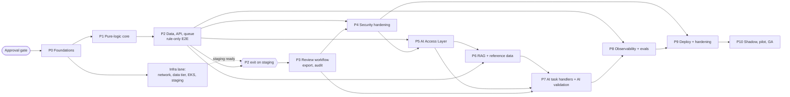

# Implementation Plan

> **ADR-023 note (2026-11-04):** no sign-in. Every request is the `anonymous` principal with all roles except Platform Admin; role/ownership checks, four-eyes and OIDC described below are **not enforced** until a new ADR reintroduces authentication through the `Authenticator` slot. Network controls are the only access control.

**Status:** DRAFT for review. Documentation only. **No implementation may start until the approval gate in section 3.1 is passed.**

## Purpose
Define the order, gates and parallelism for building the Data-Quality Assistant (DQA) once the architecture is approved. It turns the corrected [HLD](../hld/HLD.md), the [LLD modules](../lld/LLD.md), the [AI architecture](../ai/AI_ARCHITECTURE.md), [security](../security/SECURITY_AND_GOVERNANCE.md), [testing](../testing/TESTING_AND_EVALUATION.md), [infrastructure](../infra/INFRASTRUCTURE.md) and [operations](../operations/OBSERVABILITY_AND_OPERATIONS.md) documents into phases (P0..P10) with measurable entry and exit gates. The per-task detail is in [TASK_BREAKDOWN.md](TASK_BREAKDOWN.md).

## Scope
In scope: backend, workers, AI access layer, AI task handlers, data layer, security, observability, deployment and production validation. Steward UI is in scope since ADR-022 (phase P3b, [module 13](../lld/modules/13-steward-ui.md)). Out of scope: write-back to ERPs, streaming ingestion, global entity resolution (HLD 1.3, 11.6).
No calendar dates are given. Sizing is relative (S/M/L/XL, see TASK_BREAKDOWN) because team size and capacity are unknown (OQ-500, OQ-514).

## Detailed explanation

### 3.1 Approval gate (mandatory)
1. **No application code, migrations, dependency manifests, infrastructure code or agent implementations are created** until the owner explicitly approves: the HLD, the LLD, the AI architecture, and this roadmap.
2. Implementation then proceeds **module by module**, each against its LLD acceptance criteria.
3. **Any architectural change during implementation requires an ADR first**, recorded in [ARCHITECTURE_DECISIONS.md](ARCHITECTURE_DECISIONS.md) and approved before code changes.
4. Provisional choices marked `PROVISIONAL` in the documents, and tasks marked **BLOCKED-BY OQ-xx**, need the owner's answer before the affected task starts (see [OPEN_QUESTIONS.md](OPEN_QUESTIONS.md)).

### 3.2 Guiding principles for ordering
- **Rule-only product first.** Deterministic rules and heuristics (confidence from constants, no LLM) are delivered end to end (upload to decision to export) before any AI work. This also satisfies the requirement that the system works with the LLM disabled (HLD 1.6; NFR-2; BR-12).
- **Pure logic before I/O.** `normalize/`, `checks/` are pure functions and are built and tested first (HLD 6.1; LLD 3.2).
- **Safety and security gate AI.** Role and batch-ownership access control, audit and the AI access layer's masking exist before any AI task handler can call an LLM.
- **Tests first (TDD).** Each phase lists the entry tests that are written RED before implementation (section 3.5).
- **Infrastructure lane runs in parallel** from P2 so staging is ready when P2 exits; production is built in P9.

### 3.3 Phase overview

| Phase | Name | Workstreams (see TASK_BREAKDOWN) | Primary LLD modules | FR / NFR covered |
|---|---|---|---|---|
| P0 | Foundations | WS1 | [LLD 3.2-3.3](../lld/LLD.md) | NFR-8 |
| P1 | Pure-logic core (no I/O) | WS2, WS7 | 01, 02, 03 | FR-1..FR-7, FR-9, NFR-3, NFR-4, NFR-8 |
| P2 | Data layer, API and queue (rule-only, end to end) | WS2, WS5, WS8 (basic), WS1 (infra lane) | 04, 05, 06 | FR-1, FR-9, NFR-1, NFR-2, NFR-9 |
| P3 | Review workflow, export and audit | WS5, WS6 (audit) | 11, 05 | FR-10, FR-11, NFR-3, NFR-6 |
| P3b | Steward UI (UI code paused until the P2/P3 API exists; ADR-022) | WS11 | 13 | FR-9, FR-10, FR-11, NFR-3 |
| P4 | Security hardening | WS6 | 04, 05, security doc | NFR-5, NFR-6 |
| P5 | AI Access Layer (in-process) | WS3 | 07 | NFR-5, NFR-7 |
| P6 | RAG and reference data | WS3 | 10, 12 | FR-6, FR-7, FR-8 |
| P7 | AI task handlers and AI validation | WS4 | 08, 09 | FR-6, FR-7, FR-8, NFR-3, NFR-4, NFR-7 |
| P8 | Observability and evaluation | WS8, WS7 | all | NFR-1, NFR-6, NFR-7 |
| P9 | Infrastructure, deployment and hardening | WS1, WS9 | [infra docs](../infra/INFRASTRUCTURE.md) | NFR-2, NFR-1, DR targets |
| P10 | Production validation and go-live | WS10 | all | all success metrics (HLD 1.6) |

### 3.4 Dependency graph (phases)

**Critical path:** approval gate, P0, P1, P2, P3 (rule-only product usable by stewards), then P4, P5, P6, P7, P8, P9, P10. P3 is the first *releasable* product (rule-only, behind the AI kill-switch off). Everything AI-related (P5-P7) sits after P4 because the HLD requires masking, RBAC and batch-ownership access control and audit before any LLM call (HLD 5, NFR-5).

### 3.5 Parallel lanes

| Lane | Can run in parallel with | Notes |
|---|---|---|
| L1 Core logic (WS2 pure modules) | Local env, CI (WS1), test harness | Checks are independent pure functions: each rule/heuristic is a separate task |
| L2 Infra (Terraform, EKS, Helm) | P1, P2 application work | Blocked by OQ-500, OQ-501, OQ-512; no app code dependency until staging deploy |
| L3 Security (OIDC, RBAC, DB grants) | P3 workflow work after P2 schema exists | Grants need schema (P2) |
| L4 AI Access Layer (WS3) | P3, P4 after P2 | In-process module with its own interface contract (module 07); no separate deployable (ADR-017) |
| L5 Evaluation datasets (T-05) | Everything | Labelling needs stewards; can start immediately (OQ-435) |
| L7 Steward UI (WS11) | P4..P8 after the P3 API gate | Built against LLD 04/11 contract; no backend dependency beyond P2/P3 endpoints; blocked by OQ-800, OQ-807, OQ-810..812 |
| L6 Observability (WS8) | Application work | Instrument as modules land; dashboards at P8 |

Not parallelisable: P1 before P2 (shared models); P5 before P7; P6 before P7 (agents depend on retrieval and tools); P9 production build after P4 and P8.

### 3.6 Entry/exit gates and TDD entry tests per phase

| Phase | Entry gate | Entry tests written first (RED) | Exit gate (measurable) |
|---|---|---|---|
| P0 | Approval gate passed | Smoke test that CI runs lint, types and an empty pytest session; fixture loader reads the two brief files | CI green on a trivial change; local env starts all services; shared models validate the brief sample |
| P1 | P0 exit | Property tests for `normalize_mpn`, `is_blank`; positive/negative/edge tests per check; no-mutation test; golden fixture test (assertion mode per OQ-12/OQ-432) | Brief sample produces `missing_part_number` for 1001 and `category_mismatch_candidate` for 1002; input byte-identical before/after; 85 % coverage on `checks/`, `validation/`, `normalize/` (coverage basis OQ-418, OQ-523); no forbidden wording in output |
| P2 | P1 exit | Testcontainers integration: upload to findings; idempotent re-upload returns same `batch_id`; empty/malformed file never 500; chunk retry does not duplicate findings | 10 k records rules+heuristics < 30 s; findings API p95 < 300 ms (HLD 7.8); 100 k batch completes; empty/malformed/null-heavy files give findings or empty list |
| P3 | P2 exit | State-machine transition tests; decision idempotency; four-eyes enforcement; export contains only approved findings; audit events for each decision | Every decision in audit log with user, time, reason; approved finding appears in change file; nothing written to records |
| P4 | P2 exit (schema), P3 for audit | RBAC matrix per endpoint (all roles x all endpoints); Uploader reads of another user's batch return 404; JWT expiry/refresh tests | RBAC matrix 100 % pass; zero access-control test failures; no critical/high SAST/dependency findings |
| P5 | P4 exit | Masking tests with seeded emails/phones/pricing; budget-exceeded returns policy block; retry then `provider_error` on 5xx/429/timeouts using fakes | PII never in access-layer request logs; degradation to rule-only and kill-switch verified with recorded responses; token budget enforced |
| P6 | P5 exit | Retrieval recall@5 tests on small labelled set; index isolation test; re-index idempotency | recall@5 >= 0.9 on the labelled set (HLD 7.4); retrieval reads only approved indexes |
| P7 | P5, P6, P3 exit | Pipeline tests with StubSuggester; validator tests for each of the 6 checks; loop-guard tests (cap 2 calls); resume-from-`ai_task` test | Schema-valid >= 99 %, hallucinated evidence < 1 %, injection corpus never changes schema or produces approvals, loop_guard_triggered = 0 on replayed batches, results in HLD 1.6 / 7.5 / 7.6 |
| P8 | P2 exit (basic), P7 exit | Dashboard and alert definitions reviewed against HLD 10.6; prompt regression gate fails on a seeded regression | Prompt regression gate (F1 drop <= 1 point per class) active in CI; dashboards for service health, pipeline, AI quality, AI cost, steward workflow; alert thresholds per HLD 10.6 |
| P9 | P4, P8 exit | Terraform plan review checks; deploy to staging via GitOps; rollback and kill-switch drills | Staging E2E + smoke pass; performance targets met at 2x expected peak (expected peak per OQ-430); rollback and AI kill-switch rehearsed; DR drill completed |
| P10 | P9 exit | Smoke suite in production with synthetic test data set | Two weeks shadow with AI findings hidden; golden-set precision rules >= 85 %, AI >= 70 %; pilot group; GA sign-off by on-call engineer and product owner (OQ-423) |

### 3.7 Environments
Dev (docker-compose, local), staging (production-shaped, StubSuggester plus real providers for smoke), production. Parity table and environment rules are in [ENVIRONMENTS_AND_DEPLOYMENT.md](../infra/ENVIRONMENTS_AND_DEPLOYMENT.md). Staging topology (separate cluster vs shared namespace) is OQ-520.

### 3.8 Go-live staging
1. **Shadow mode (two weeks):** AI findings are produced but hidden; compared with steward decisions (flag `ai_layer_enabled` plus a hidden-findings flag, OQ-28, OQ-249).
2. **Pilot group:** a limited set of users or source systems, AI canary percentages per flag `prompt.<task>.canary_pct`; heightened watch for 72 hours after each release (HLD 10.3).
3. **General availability:** each gate requires the quality and cost targets in HLD 1.6 and 10; prompt/model changes follow offline eval, shadow, canary 10 %, full rollout (HLD 10.9).

### 3.9 Workstream-to-phase view
WS1 Foundation and infrastructure: P0, P2 (infra lane), P9. WS2 Core application: P1, P2. WS3 AI/LLM integration: P5, P6. WS4 Agent development: P7. WS5 Workflow orchestration: P2, P3. WS6 Security: P3 (audit), P4. WS7 Testing and evaluation: P1 onwards, mainly P8. WS8 Observability: P2 (basic), P8. WS9 Deployment: P9. WS10 Production validation: P10.

### 3.10 Traceability: requirement to phase

| Requirement | Phase(s) | Tasks (examples) |
|---|---|---|
| FR-1 ingest, never crash | P1, P2 | CA-02, CA-03, CA-04, CA-18, T-04 |
| FR-2 missing MPN | P1 | CA-06 |
| FR-3 unsupported UoM | P1 | CA-07 |
| FR-4 duplicate item_id | P1 | CA-08 |
| FR-5 weak description | P1 | CA-09 |
| FR-6 possible duplicate | P1, P7 | CA-10, G-05 |
| FR-7 category mismatch | P1, P7 | CA-11, G-03 |
| FR-8 normalised description | P7 | G-04 |
| FR-9 finding fields | P1, P2 | CA-14, CA-19 |
| FR-10 decisions | P3, P3b | W-04, W-05, W-06, U-09 |
| FR-11 export | P3, P3b | W-07, U-10 |
| NFR-1 latency | P2, P8, P9 | W-02, T-10 |
| NFR-2 availability, AI degrades | P2, P5, P9 | W-03, AI-04, D-04 |
| NFR-3 safety / forbidden wording | P1, P3, P7 | T-02, G-06, W-07 |
| NFR-5 security | P4, P5 | S-01..S-05, AI-02 |
| NFR-6 auditability | P3, P4 | S-04, W-04 |
| NFR-7 cost | P5, P7, P8 | AI-04, O-05 |
| NFR-8 maintainability, coverage | P0, P1 | F-01, CA-05, T-01 |
| NFR-9 data volume | P2 | CA-02, W-02, T-10 |

## Architecture decisions
This plan relies on ADR-001..ADR-021 in [ARCHITECTURE_DECISIONS.md](ARCHITECTURE_DECISIONS.md): LLM provider, one provider and two tiers (001, 017, 018), orchestration as a plain Python pipeline (002 superseded in part, 019), pgvector with simplified retrieval (003, 020), FastAPI (004), Celery with SQS / ElasticMQ / Redis (005), custom thin AI gateway realised in-process (006, 017), Unleash (007), AWS EKS with Terraform (008), PostgreSQL 16 (009), supervisor plus task handlers as a deterministic pipeline (010, 019), cost controls and simplified observability (021). Technologies proposed by the HLD but not confirmed by the owner (OQ-16, OQ-549) are re-confirmable at the approval gate; changing one after approval needs a new ADR.

## Dependencies
- Owner approval of the HLD, LLD, AI architecture and this roadmap.
- Answers to blocking open questions per task (listed in TASK_BREAKDOWN).
- External: corporate IdP (OIDC/SAML), AWS accounts and regions (OQ-501, OQ-512), Bedrock access (single provider) with zero-retention terms (OQ-207, OQ-411), ticketing system (OQ-242), SIEM, steward time for labelling (OQ-435).
- Platform and infra ownership (OQ-500).

## Risks and edge cases
Full register in [RISKS_AND_DEPENDENCIES.md](RISKS_AND_DEPENDENCIES.md). Plan-specific:
- **Unanswered open questions on the critical path** (OQ-02 tenancy, OQ-03 input schema, OQ-12 acceptance semantics, OQ-17 empty file contract, OQ-119 chunk-scope vs batch-scope checks) block P1/P2 tasks; resolve at the approval gate.
- **Chunking vs batch-scope checks:** 50-record chunks cannot run `duplicate_item_id`, exact-MPN or similarity checks (OQ-119). A batch-scope pass is proposed and must be approved before W-02.
- **Brief vs HLD mismatch** (confidence 0.95 vs 1.0, extra `weak_description` on 1001, `possible_duplicate` between 1001 and 1002) can fail the golden acceptance test (OQ-12, OQ-100, OQ-101, OQ-102, OQ-432, OQ-434). Resolve before T-04.
- **AI work depends on an uncertain cost and quality profile**; shadow mode is the control. If AI precision < 70 %, the AI tasks are re-tuned or switched off (HLD 10.9) and the product still ships rule-only.
- **Infrastructure lead time** (accounts, VPC endpoints; the Azure private link is gone, OQ-509 resolved) can delay P9; start the infra lane at P2.
- **Retention vs erasure** (OQ-26, OQ-402) is a legal question; it blocks S-08 only.

## Related documents
[TASK_BREAKDOWN.md](TASK_BREAKDOWN.md) · [OPEN_QUESTIONS.md](OPEN_QUESTIONS.md) · [RISKS_AND_DEPENDENCIES.md](RISKS_AND_DEPENDENCIES.md) · [ARCHITECTURE_DECISIONS.md](ARCHITECTURE_DECISIONS.md) · [HLD](../hld/HLD.md) · [LLD](../lld/LLD.md) · [TESTING_AND_EVALUATION.md](../testing/TESTING_AND_EVALUATION.md) · [ENVIRONMENTS_AND_DEPLOYMENT.md](../infra/ENVIRONMENTS_AND_DEPLOYMENT.md)
